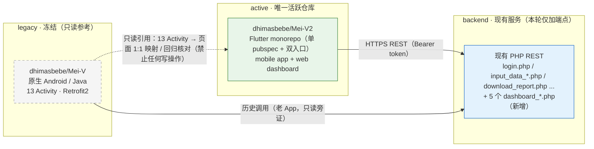
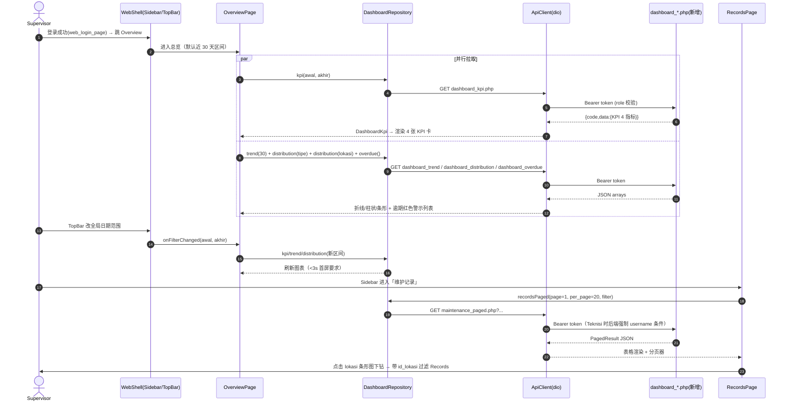
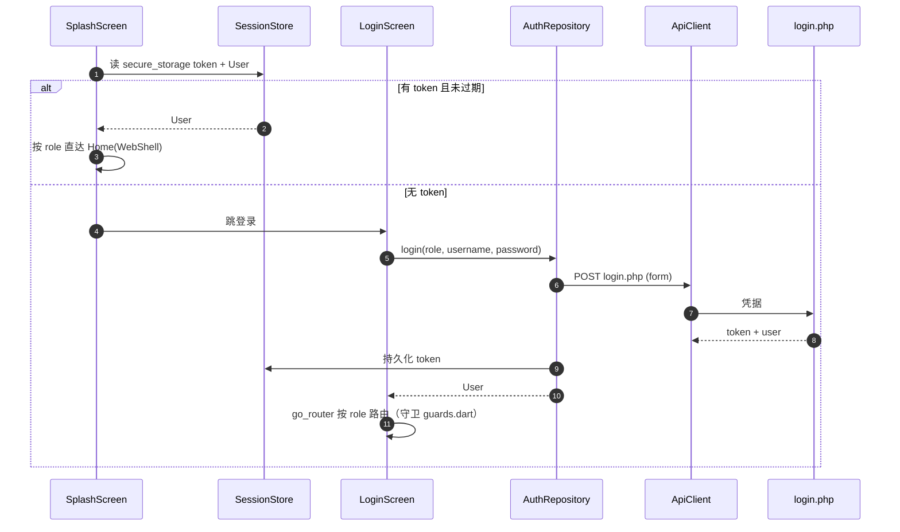
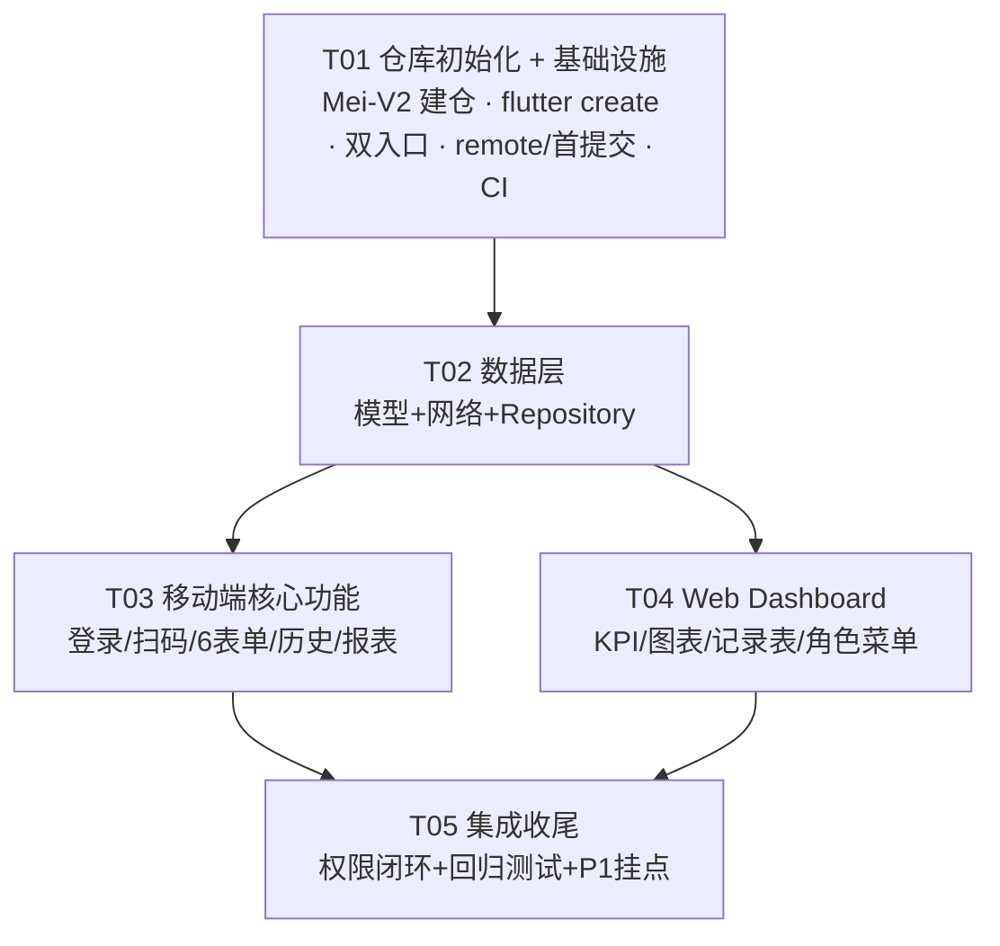

# ARCHITECTURE — Mei-V2：Flutter 重构 + Web 监控 Dashboard

> **实现现状（2026-10-14 更新）**：本文件是规划稿，实际落地以 `STATUS.md` 为准。
> 差异：后端实际用 **Laravel 13.36 + Sanctum 4.3.3**（非 Laravel 11）；API 前缀
> `/api/v1`，**15 个端点**；已验证 **19 测试 / 173 断言**、**80 项模型契约检查**、
> 两个入口点编译通过。运行 `scripts/verify-all.ps1` 可复现。

> 版本：v1.1（新增 §0 仓库拓扑、§9 后端选型；§2/§5 落点统一到 `Mei-V2`）｜ 作者：高见远（Gao，架构师）｜ 状态：待评审
>
> **v1.2 增量（2026-10-14，基于老项目《Buku Tugas Akhir》全文分析）**：
> 1. 后端前提变化——老后端域名 `meivtelpro.my.id` 已 NXDOMAIN、托管不可达 ⇒ **P0 直接新建 Laravel 11 + Sanctum**（见 `BACKEND-RECOMMENDATION.md` §4.4）。
> 2. 数据库结构已**实证**（Buku TA Tabel 3.13–3.20 + PHP 代码）⇒ 以 **`docs/db/schema-v2.sql`** 为准（7 表 + 2 视图），本文件 §3 的接口契约与 §2 的目录树以该结构为基准阅读。
> 3. 老系统表单是**按 kategori/spesifikasi 动态生成**的（非 6 套硬编码）⇒ 保留"配置化表单"决策，数据源改为 `kategori` + `spesifikasi`。
> 4. UI/UX、用例流程、时序图、ERD、测试基线（SUS 85.5%）⇒ 见 **`docs/LEGACY-ANALYSIS.md`**；落地任务分解 ⇒ 见 **`docs/PLAN-FLUTTER-LARAVEL.md`**。
> 输入：`docs/PRD.md`（许清楚）｜ 参考源项目（**只读**）：https://github.com/dhimasbebe/Mei-V ｜ **活跃仓库**：https://github.com/dhimasbebe/Mei-V2
> 本阶段**仅规划**，不含实现代码。

---

## 0. 仓库拓扑（Repo Topology）

> v1.1 新增。**唯一活跃前端仓库 = `Mei-V2`**；老仓库 `Mei-V` **冻结只读**；后端 PHP 本轮只增量新增聚合端点。



| 仓库 | 角色 | 本轮是否改动 | 说明 |
|---|---|:-:|---|
| `dhimasbebe/Mei-V` | 老原生 Android（Java） | **零写入（冻结）** | 仅作 13 个 Activity → Flutter 页面的 1:1 功能对照与回归核对清单的**只读**来源。**不**建分支、**不**提 PR、**不** push、**不** rename、**不** archive、**不** fork 后回写（详见 §7-11）。 |
| `dhimasbebe/Mei-V2` | **Flutter monorepo（唯一活跃）** | ✅ 全部新代码落此 | 单 pubspec + 双入口：`lib/main.dart`（mobile）/ `lib/main_web.dart`（web），共享 `core/data/domain/shared`；`docs/`（PRD、ARCHITECTURE、图）一并入库。 |
| backend（现有 PHP） | 现有 REST 服务 | 仅**新增 5 个聚合端点** | P0-12 复用老端点；新增 `dashboard_kpi/trend/distribution`、`maintenance_paged`、`dashboard_overdue`（契约见 §3.3，方案见 §9 与 `docs/BACKEND-RECOMMENDATION.md`）。 |

**边界规则（硬约束）**：
1. 任何 `git` 写操作**只允许**发生在 `Mei-V2`；对 `Mei-V` 的访问限于 GitHub 网页/API **读**（`git clone` 只读副本亦可，但不得回写）。
2. `Mei-V2` 为**单仓单 pubspec + 双入口**，不引入 melos、不拆 packages（理由见 §1.1）。
3. 老 Android 13 Activity → Flutter 页面 **1:1 映射表**随 `docs/` 入库，作为回归基线（映射清单见 §5 T05 产出）。

---

## 1. 实现方案 + 技术选型

### 1.1 仓库与工程形态

**结论：在全新仓库 `dhimasbebe/Mei-V2` 内采用「单仓单 pubspec + 多入口（Single App, Multi-Entry）」，不引入 melos、不拆 packages。**

> 落点仓库 = `Mei-V2`（新建空仓，见 §0）；老仓库 `Mei-V` 冻结只读，不做原地改造。

| 方案 | 结论 | 理由（1 句） |
|---|:-:|---|
| melos monorepo 多包 | ❌ | 仅 2 个目标端、团队小，melos 的 bootstrap/version 管理开销大于收益。 |
| packages 拆分（domain/data 独立 package） | ❌ | 单 pubspec 下用 `lib/domain`、`lib/data` 目录已能强制分层，拆包徒增 build_runner 与依赖解析成本。 |
| **单 app 多入口** | ✅ | `lib/main.dart`（mobile）与 `lib/main_web.dart`（web）共享同一套 `core/data/domain`，一条命令即可起 Dashboard，一套依赖一次升级。 |

- **UI 层不共享**：`lib/mobile/**` 与 `lib/web/**` 各自独立页面，仅共享 `lib/shared/**`（主题 token、通用控件、6 类表单 schema）。理由：移动端底部 Tab 与 Web Sidebar 是完全不同的布局范式，强行 responsive 复用会产生大量 `kIsWeb` 分支。
- **窄屏适配**：移动端内部用 `LayoutBuilder` 断点适配平板；Web Dashboard 侧栏 < 960px 时折叠为图标栏。断点逻辑自研（不引第三方 responsive 包）。
- 仓库名 `Mei-V2`；pubspec `name: mei_v_flutter`（PRD 代号，可改）；GitHub remote 指向 `https://github.com/dhimasbebe/Mei-V2.git`。

### 1.2 技术选型总表

| 领域 | 选型 | 版本约束 | 理由（1 句） |
|---|---|---|---|
| 状态管理 | flutter_riverpod | `^2.5.1` | 编译期安全、无 BuildContext 依赖、repository 天然注入，适合 mobile/web 双端共享 Notifier。 |
| 路由 | go_router | `^14.2.0` | 官方推荐、declarative 路由表 + `redirect` 钩子可直接实现角色守卫与 web URL 同步。 |
| 网络层 | dio（**不用 retrofit**） | `^5.4.0` | 老 PHP 端点返回格式不规则（纯数组/字符串混杂），retrofit 强注解收益低；dio 拦截器 + 手写 DataSource 更可控。 |
| JSON 序列化 | json_annotation + json_serializable + build_runner | `^4.9.0` / `^6.8.0` / `^2.4.0` | 6 类表单模型字段多，手写 fromJson 易错；生成代码保证 1:1 字段映射。 |
| 本地存储 | flutter_secure_storage（token）+ shared_preferences（轻配置）+ hive（P1 离线草稿） | `^9.2.0` / `^2.2.0` / `^2.2.0` | token 不落明文满足 PRD 安全项；hive 三端通用（含 Web）适合草稿队列。 |
| 扫码 | mobile_scanner | `^5.2.0` | 持续维护、Android/iOS 双端支持 QR+多格式条码；Web 端按 PRD 不扫码，仅手动输入。 |
| 图表 | fl_chart | `^0.68.0` | 一套 API 覆盖折线/柱状/饼/横向条形，Flutter Web 渲染一致，无 canvas 二进制依赖。 |
| 报表导出 | dio 浏览器下载（P0 复用 `download_report.php`）+ pdf + printing + csv | `^5.11.0` / `^5.13.0` / `^6.0.0` | P0 只透传老端点文件流；P1 用 pdf/printing 生成图表化报表、csv 供 Records 表格导出。 |
| i18n | flutter_localizations + intl（ARB + gen-l10n） | sdk / `^0.19.0` | P0 先建 l10n 骨架、默认单语，P2 切换 id/zH/en 只改 ARB 不动代码。 |
| 离线检测（P1） | connectivity_plus | `^6.0.0` | 检测联网自动触发草稿补传。 |
| 测试 | flutter_test + mocktail + integration_test | sdk / `^0.6.0` / sdk | repository 层 mocktail 单测；核心链路（登录→扫码→提交）integration_test 回归。 |

### 1.3 后端决策（关联 PRD Q1/Q2/Q3）

**结论：P0 复用现有 PHP 端点，同时新增一组 `dashboard_*.php` 聚合端点；不做后端重写。**

API 层新旧兼容策略（三层结构）：

1. **ApiClient（dio 单例）**：统一 base url（`--dart-define=API_BASE_URL=...` 注入）、超时、`Authorization` 拦截器。
2. **DataSource 按端点族分组**：
   - `LegacyAuthApi` / `LegacyAlatApi` / `LegacyMaintenanceApi` / `LegacyReportApi` —— 封装老端点（form POST 与 GET+query 两种风格，各自声明 `ResponseType`）。
   - `DashboardApi` —— 只调新端点，统一按 `{code, data, message}` envelope 解析。
3. **LegacyResponseAdapter**：老端点返回不规则（无 envelope），适配层把字符串/裸数组包装成内部 `Result<T>`，Repository 消费统一接口；后续后端若重构，只改 DataSource 不动上层。

新端点契约见 §3.3；后端由谁实现待确认（PRD Q2）。**后端选型论证与分阶段迁移见 §9 与 `docs/BACKEND-RECOMMENDATION.md`。**

### 1.4 认证与角色权限

| 项 | 方案 |
|---|---|
| 登录 | 复用 `login.php`（form POST：role + username + password）；预期返回 token（若老端仅返回用户 JSON，则用返回的 session 标识，**待确认**，见 §8）。 |
| token 存储 | flutter_secure_storage（内存缓存 + 安全落盘），退出登录即清；密码不明文落盘（PRD 安全项）。 |
| 拦截器 | dio `AuthInterceptor`：自动附加 `Authorization: Bearer <token>`；401 时清会话并跳登录。 |
| 前端路由守卫 | go_router `redirect`：未登录→login；Teknisi 访问 web 管理页→403 页；角色菜单按 `Role` 枚举过滤（PRD：Teknisi 仅 Records 自己的数据 / Supervisor 全量 / Admin +用户管理）。 |
| 后端二次校验 | **硬性要求**：所有新增 `dashboard_*.php` 必须校验 token 与 role（Supervisor/Admin 才可访问 KPI/图表；Teknisi 只能查自己记录）；前端隐藏菜单不构成权限（PRD §7）。 |

### 1.5 监控语义配色（重要约定）

本系统为设备维护监控语义，**不采用 A 股"红涨绿跌"惯例**，统一采用：

- **红 = 异常 / 逾期 / 不合格**（如电压三相不平衡、APAR tekanan 不达标、overdue 列表）
- **绿 = 正常 / 达标 / 按期完成**（完成率条形图达标段、状态徽章）
- 黄 = 关注（接近阈值）；灰 = 无数据。全端（mobile + web）一致，集中在 `core/theme/app_colors.dart`。

---

## 2. 目录 / 文件列表

> 仓库根 = `Mei-V2`（唯一活跃仓库）。`lib/**` 为手写代码；`android/`、`ios/`、`build/`、`.dart_tool/` 由 `flutter create` / 构建生成，**不入库**（见 `.gitignore`）。

```
Mei-V2/                                   # ← 全新仓库，remote: dhimasbebe/Mei-V2.git
├── pubspec.yaml                          # 依赖声明（分组见 §6）
├── analysis_options.yaml                 # lint 规则（flutter_lints + 自定义）
├── l10n.yaml                             # gen-l10n 配置（P2 多语言骨架，ARB 目录 lib/l10n/）
├── .gitignore                            # 忽略 build/ .dart_tool/ *.g.dart(可选) .env 等
├── README.md                             # 项目说明 + 双入口运行命令 + legacy 映射表索引
├── web/
│   └── index.html                        # Flutter Web 入口页（title/ favicon 配置）
├── .github/
│   └── workflows/
│       ├── analyze_test.yml              # flutter analyze + flutter test（PR / push 触发）
│       └── build_web.yml                 # flutter build web（dashboard 产物，可选）
├── docs/                                 # ── 文档随仓库入库 ──
│   ├── PRD.md                            # 需求（许清楚）
│   ├── ARCHITECTURE.md                   # 本文件
│   ├── BACKEND-RECOMMENDATION.md         # 后端选型建议（§9 详版）
│   ├── class-diagram.mermaid             # 类图
│   ├── sequence-diagram.mermaid          # 时序图
│   └── legacy-activity-mapping.md        # 老 13 Activity → Flutter 页面 1:1 映射 + 回归核对表
├── lib/
│   ├── main.dart                         # 【入口1】移动端 App 启动（初始化 DI、会话恢复、 runApp）
│   ├── main_web.dart                     # 【入口2】Web Dashboard 启动（注入 web 配置）
│   ├── app.dart                          # 根组件：按入口参数挂 MobileApp / WebApp（各自 MaterialApp.router）
│   │
│   ├── core/                             # ── 跨端基础设施，禁止 import mobile/web ──
│   │   ├── config/app_config.dart        # API_BASE_URL/超时/默认分页 20 条，--dart-define 注入
│   │   ├── network/api_client.dart       # Dio 单例 + 日志拦截器 + 全局错误映射
│   │   ├── network/auth_interceptor.dart # token 附加、401 清会话跳登录
│   │   ├── network/api_envelope.dart     # 新端点 {code,data,message} 解析
│   │   ├── network/legacy_adapter.dart   # 老 PHP 返回 → 内部 Result<T> 适配
│   │   ├── errors/app_exception.dart     # 统一错误：network/timeout/auth/api/validation/offline
│   │   ├── storage/session_store.dart    # token + 当前用户（flutter_secure_storage）
│   │   ├── storage/prefs_store.dart      # 主题/语言等轻配置（shared_preferences）
│   │   ├── storage/draft_store.dart      # P1 离线草稿队列（hive）
│   │   ├── router/app_router.dart        # go_router 路由表（mobile/web 两组 route）
│   │   ├── router/guards.dart            # requireLogin / requireRole 守卫
│   │   ├── theme/app_colors.dart         # 监控语义色（红=异常/绿=正常，见 §1.5）
│   │   ├── theme/app_theme.dart          # 主题、字阶、输入框/表格样式
│   │   └── utils/datetime_utils.dart     # ISO8601 解析 + WIB(+07:00) 格式化
│   │
│   ├── domain/                           # ── 纯 Dart 实体 + 仓库接口，零 Flutter 依赖 ──
│   │   ├── enums/role.dart               # Role: teknisi/supervisor/admin（取值待确认 Q5）
│   │   ├── enums/equipment_type.dart     # 6 类设备：ac/petir/panel/apar/alarm/hydrant
│   │   ├── models/user.dart              # User(username, role, ...)
│   │   ├── models/alat.dart              # Alat(barcode, nama, tipe, id_lokasi)
│   │   ├── models/lokasi.dart            # Lokasi(id_lokasi, nama_lokasi)
│   │   ├── models/maintenance_record.dart# MaintenanceRecord 基类：6 表单公共字段
│   │   ├── models/forms/ac_maintenance.dart              # suhu_ac/tekanan_ac/ampere_ac/kondisi_ac
│   │   ├── models/forms/petir_maintenance.dart           # kondisi_baut/grounding_test
│   │   ├── models/forms/panel_maintenance.dart           # voltage_rs/rt/st, ampere_rs/rt/st, kondisi_baut
│   │   ├── models/forms/apar_maintenance.dart            # tekanan/selang/nossel
│   │   ├── models/forms/alarm_maintenance.dart           # smoke_test/heat_test/cek_batre
│   │   ├── models/forms/hydrant_maintenance.dart         # tekanan/fungsi
│   │   ├── models/dashboard/kpi.dart                     # DashboardKpi（4 张 KPI 卡数据）
│   │   ├── models/dashboard/trend_point.dart             # TrendPoint(tanggal, jumlah)
│   │   ├── models/dashboard/distribution_item.dart       # DistributionItem(label, value, rate?)
│   │   ├── models/dashboard/overdue_item.dart            # OverdueItem(barcode, hari_lewat, ...)
│   │   ├── models/dashboard/paged_result.dart            # PagedResult<T>(items, page, total)
│   │   └── repositories/                  # 接口（实现放 data/）
│   │       ├── auth_repository.dart      # login/logout/register/updatePassword/profile
│   │       ├── alat_repository.dart      # 扫码反查/详情/列表/lokasi 列表
│   │       ├── maintenance_repository.dart# 提交 6 类表单 + 历史查询
│   │       ├── report_repository.dart    # 日期区间报表下载（P1 PDF/CSV）
│   │       └── dashboard_repository.dart # KPI/趋势/分布/分页记录/逾期（P1 异常）
│   │
│   ├── data/                             # ── Repository 实现 + 远端/本地数据源 ──
│   │   ├── datasources/auth_api.dart             # login.php/formregistrasi.php/updatepassword.php
│   │   ├── datasources/alat_api.dart             # cari_id_alat/detail_alat/get_lokasi + 设备列表
│   │   ├── datasources/maintenance_api.dart      # input_data_{6类}.php + history_maintenance.php
│   │   ├── datasources/report_api.dart           # download_report.php（流式下载）
│   │   ├── datasources/dashboard_api.dart        # 新 dashboard_*.php 端点族
│   │   ├── repositories/*_impl.dart              # 5 个 Repository 实现（对应 domain 接口）
│   │   └── mappers/record_mapper.dart            # 端点 JSON → 6 类实体的分发（按 tipe 字段）
│   │
│   ├── shared/                           # ── mobile/web 共享的展示资产 ──
│   │   ├── form_schema/form_schema.dart          # 6 类表单字段配置（label/键盘/必填/校验/单位）
│   │   ├── widgets/app_button.dart / app_text_field.dart / confirm_dialog.dart
│   │   ├── widgets/status_badge.dart             # 正常/异常徽章（红绿语义）
│   │   └── widgets/empty_state.dart / loading_view.dart / error_view.dart
│   │
│   ├── mobile/                           # ── 移动端 UI（入口1 使用）──
│   │   ├── app/mobile_app.dart                  # Mobile MaterialApp.router + 主题
│   │   ├── features/splash/splash_screen.dart   # 启动页 + 会话恢复
│   │   ├── features/auth/login_screen.dart      # role 下拉 + username + password（form POST）
│   │   ├── features/auth/registrasi_screen.dart
│   │   ├── features/auth/edit_pass_screen.dart
│   │   ├── features/home/home_screen.dart       # 底部 4 Tab 容器
│   │   ├── features/home/beranda_tab.dart       # 扫码 FAB + 快捷维护 + 最近记录
│   │   ├── features/home/daftar_alat_tab.dart   # 设备列表 + lokasi 筛选
│   │   ├── features/home/history_tab.dart       # 维护历史（barcode 搜索）
│   │   ├── features/home/profil_tab.dart        # 资料/改密/登出
│   │   ├── features/scan/capture_screen.dart    # 相机扫码 + 手动输入兜底
│   │   ├── features/alat/detail_alat_screen.dart# 设备信息卡 + 「Mulai Maintenance」
│   │   ├── features/maintenance/maintenance_form_screen.dart # 配置化单页滚动表单（6 类复用）
│   │   ├── features/maintenance/maintenance_controller.dart  # 表单校验/提交/草稿(P1)
│   │   ├── features/history/history_detail_sheet.dart
│   │   └── features/report/download_report_screen.dart       # periode awal/akhir + 下载
│   │
│   └── web/                              # ── Dashboard UI（入口2 使用）──
│       ├── app/web_app.dart                     # Web MaterialApp.router
│       ├── app/web_shell.dart                   # Sidebar(7 菜单) + TopBar(全局日期筛选/头像/登出)
│       ├── app/sidebar_nav.dart                 # 角色过滤菜单（Teknisi 仅 Records）
│       ├── features/auth/web_login_page.dart
│       ├── features/overview/overview_page.dart # KPI 卡行 + 3 图表 + 逾期警示列表
│       ├── features/overview/kpi_card.dart
│       ├── features/overview/charts/line_trend_chart.dart     # 近 30 天趋势折线
│       ├── features/overview/charts/type_bar_chart.dart       # 设备类型分布柱状
│       ├── features/overview/charts/lokasi_bar_chart.dart     # lokasi 完成率横向条形（低=红）
│       ├── features/overview/overdue_list.dart
│       ├── features/analytics/analytics_page.dart # P1：热力/异常排行（P0 仅趋势复用图）
│       ├── features/records/records_page.dart     # 明细表：筛选 + 分页 + CSV 导出
│       ├── features/records/records_filter_bar.dart
│       ├── features/alat/web_alat_page.dart       # 设备管理（下钻详情）
│       ├── features/lokasi/web_lokasi_page.dart
│       ├── features/reports/report_page.dart      # 日期区间 + 图表预览 + 导出（P1 PDF）
│       └── features/users/users_page.dart         # Admin：注册/重置密码/用户列表
│
└── test/
    ├── domain/models_test.dart            # 序列化/校验单测
    ├── data/repositories_test.dart        # mocktail 打桩 dio
    └── shared/form_schema_test.dart       # 6 类表单配置完整性
```

> 合计约 75 个源文件（全部落在 `Mei-V2`）；6 类表单**共用** `maintenance_form_screen.dart` + schema 配置，不做 6 套硬编码 UI（PRD §7 可维护性）。`docs/` 随仓库入库，作为评审与回归基线。

## 3. 数据结构与接口

### 3.1 类图（classDiagram）

```mermaid
classDiagram
    class User {
        +String username
        +Role role
        +String? token
        +String? id_lokasi
        +fromJson(json) User
        +toJson() Map
    }

    class Role {
        <<enum>>
        teknisi
        supervisor
        admin
    }

    class Alat {
        +String barcode
        +String nama
        +String tipe
        +String id_lokasi
        +fromJson(json) Alat
    }

    class Lokasi {
        +String id_lokasi
        +String nama_lokasi
        +fromJson(json) Lokasi
    }

    class MaintenanceRecord {
        <<abstract>>
        +String waktu_maintenance
        +String barcode
        +String username
        +String id_lokasi
        +String catatan
        +EquipmentType tipe
        +params() Map~String,dynamic~
    }

    class AcMaintenance {
        +num suhu_ac
        +num tekanan_ac
        +num ampere_ac
        +String kondisi_ac
    }

    class PetirMaintenance {
        +String kondisi_baut
        +num grounding_test
    }

    class PanelMaintenance {
        +num voltage_rs
        +num voltage_rt
        +num voltage_st
        +num ampere_rs
        +num ampere_rt
        +num ampere_st
        +String kondisi_baut
    }

    class ArMaintenance {
        +num tekanan
        +String selang
        +String nossel
    }

    class AlarmMaintenance {
        +bool smoke_test
        +bool heat_test
        +bool cek_batre
    }

    class HydrantMaintenance {
        +num tekanan
        +String fungsi
    }

    class DashboardKpi {
        +int total_maintenance
        +num completion_rate
        +int total_alat
        +int overdue_count
        +num? delta_prev_period
        +fromJson(json) DashboardKpi
    }

    class TrendPoint {
        +String tanggal
        +int jumlah
    }

    class DistributionItem {
        +String label
        +int value
        +num? completion_rate
    }

    class OverdueItem {
        +String barcode
        +String nama
        +String tipe
        +String nama_lokasi
        +int hari_lewat
        +String? maintenance_terakhir
    }

    class PagedResult~T~ {
        +List~T~ items
        +int page
        +int per_page
        +int total
    }

    class AuthRepository {
        <<interface>>
        +login(role, username, password) Future~User~
        +register(...) Future~void~
        +updatePassword(...) Future~void~
        +logout() Future~void~
    }

    class AlatRepository {
        <<interface>>
        +findByBarcode(barcode) Future~Alat~
        +getDetail(nama) Future~Alat~
        +listAlat(query, id_lokasi) Future~List~Alat~~
        +listLokasi() Future~List~Lokasi~~
    }

    class MaintenanceRepository {
        <<interface>>
        +submit(MaintenanceRecord) Future~void~
        +historyByBarcode(barcode) Future~List~MaintenanceRecord~~
    }

    class DashboardRepository {
        <<interface>>
        +kpi(awal, akhir) Future~DashboardKpi~
        +trend(hari) Future~List~TrendPoint~~
        +distribution(dimensi) Future~List~DistributionItem~~
        +recordsPaged(filter) Future~PagedResult~MaintenanceRecord~~
        +overdue() Future~List~OverdueItem~~
    }

    class ReportRepository {
        <<interface>>
        +downloadReport(awal, akhir) Future~Uint8List~
    }

    MaintenanceRecord <|-- AcMaintenance
    MaintenanceRecord <|-- PetirMaintenance
    MaintenanceRecord <|-- PanelMaintenance
    MaintenanceRecord <|-- ArMaintenance
    MaintenanceRecord <|-- AlarmMaintenance
    MaintenanceRecord <|-- HydrantMaintenance
    User "1" --> "1" Role : role
    Alat "1" --> "1" Lokasi : id_lokasi
    MaintenanceRecord --> Alat : barcode
    MaintenanceRecord --> User : username
    DashboardKpi "1" o-- "*" TrendPoint : 近30天
    DashboardKpi "1" o-- "*" DistributionItem : 类型/lokasi
    DashboardKpi "1" o-- "*" OverdueItem : 逾期清单
    AuthRepository <|.. data 层实现
    AlatRepository <|.. data 层实现
    MaintenanceRepository <|.. data 层实现
    DashboardRepository <|.. data 层实现
    ReportRepository <|.. data 层实现
```



> 注：`ArMaintenance` = APAR 灭火器记录（Dart 类名避免缩写全大写冲突）；6 类实体 JSON 字段名与老端点**逐字段一致**（`suhu_ac` 等，不翻译）。

### 3.2 REST 接口契约 —— 复用的现有 PHP 端点（P0 原样兼容）

| Method | Path / 端点 | 参数 | 说明 |
|---|---|---|---|
| POST | `login.php` | role, username, password（form） | 登录，返回用户/会话（格式待确认，见 Q1/Q5） |
| POST | `formregistrasi.php` | 注册字段 | 注册（自助或 Admin 建号，见 Q5） |
| GET | `updatepassword.php` | username, password 新值 | 改密 |
| GET | `cari_id_alat.php` | `?barcode=` | 扫码反查设备（扫码与手动输入同端点） |
| GET | `detail_alat.php` | `?nama=` | 设备详情 |
| GET | `get_lokasi.php` | — | 位置列表 |
| GET | `history_maintenance.php` | `?barcode=` | 历史记录，倒序 |
| POST | `input_data_ac.php` | suhu_ac, tekanan_ac, ampere_ac, kondisi_ac + 公共字段 | 提交 AC 表单 |
| POST | `input_data_petir.php` | kondisi_baut, grounding_test + 公共字段 | 提交避雷针表单 |
| POST | `input_data_panel.php` | voltage_rs/rt/st, ampere_rs/rt/st, kondisi_baut + 公共字段 | 提交配电柜表单 |
| POST | `input_data_apar.php` | tekanan, selang, nossel + 公共字段 | 提交灭火器表单 |
| POST | `input_data_alarm.php` | smoke_test, heat_test, cek_batre + 公共字段 | 提交报警器表单 |
| POST | `input_data_hydrant.php` | tekanan, fungsi + 公共字段 | 提交消防栓表单 |
| GET | `download_report.php` | `?periodeawal=&periodeakhir=` | 文件流下载报表 |
| GET | `get_alat.php`（列表，若缺则补） | `?q=&id_lokasi=` | 设备列表（PRD #10；老端点若无列表接口需新增，见 §8） |

公共字段：`waktu_maintenance, barcode, username, id_lokasi, catatan`（6 表单一致）。

### 3.3 REST 接口契约 —— **需后端新增**的端点（P0 核心，统一 `{code, data, message}`，必须校验 token + role）

**① Dashboard KPI 聚合**（P0-08）

```
GET /dashboard_kpi.php?periodeawal=2025-01-01&periodeakhir=2025-01-31
Header: Authorization: Bearer <token>   （role: supervisor/admin）
```

```json
{
  "code": 0,
  "message": "ok",
  "data": {
    "total_maintenance": 128,
    "completion_rate": 0.86,
    "total_alat": 150,
    "overdue_count": 7,
    "delta_prev_period": 0.12
  }
}
```

**② 趋势折线**（P0-09）

```
GET /dashboard_trend.php?hari=30
```

```json
{ "code": 0, "message": "ok", "data": [ { "tanggal": "2025-01-05", "jumlah": 4 } ] }
```

**③ 类型/lokasi 分布与完成率**（P0-09）

```
GET /dashboard_distribution.php?dimensi=tipe|lokasi&periodeawal=&periodeakhir=
```

```json
{ "code": 0, "message": "ok",
  "data": [ { "label": "AC", "value": 40, "completion_rate": 0.9 } ] }
```

**④ 分页 + 筛选记录查询**（P0-10；替代 download_report 的 JSON 场景）

```
GET /maintenance_paged.php?page=1&per_page=20&tanggal_mulai=&tanggal_akhir=
    &tipe=ac|petir|panel|apar|alarm|hydrant&id_lokasi=&q=&status=normal|anomaly
    （Teknisi 仅返回本人记录，由后端按 token 强制加 username 条件）
```

```json
{ "code": 0, "message": "ok",
  "data": { "page": 1, "per_page": 20, "total": 137,
    "items": [ { "waktu_maintenance": "2025-01-10T09:30:00+07:00",
                 "barcode": "ALAT-001", "nama": "AC Lantai 2",
                 "tipe": "ac", "id_lokasi": "L01", "nama_lokasi": "Ruang Server",
                 "username": "budi", "catatan": "",
                 "params": { "suhu_ac": 24, "tekanan_ac": 5, "ampere_ac": 3.2, "kondisi_ac": "Baik" },
                 "status": "normal" } ] } }
```

**⑤ 逾期计算**（P0-08 警示列表 + 关联 Q6 口径）

```
GET /dashboard_overdue.php?per_page=50
```

```json
{ "code": 0, "message": "ok",
  "data": [ { "barcode": "ALAT-009", "nama": "APAR Gudang", "tipe": "apar",
              "id_lokasi": "L03", "nama_lokasi": "Gudang",
              "hari_lewat": 12, "maintenance_terakhir": "2024-12-20" } ] }
```

**⑥ P1 增强**（依赖同类新增，可延后）

- `GET /dashboard_anomaly.php?page=&per_page=` —— 异常参数汇总列表（PRD P1-04，阈值来源见 Q9）
- `GET /maintenance_export.php?tanggal_mulai=&tanggal_akhir=&format=csv` —— 结构化导出（区别于老 `download_report.php` 文件流）

## 4. 程序调用流程（时序图）

### 4.1 扫码 → 查设备 → 填表 → 提交（mobile 主链路）

```mermaid
sequenceDiagram
    autonumber
    actor U as Teknisi
    participant CS as CaptureScreen
    participant AC as AlatRepository<br/>(data 层)
    participant API as ApiClient(dio)
    participant PHP1 as cari_id_alat.php
    participant MF as MaintenanceFormScreen
    participant MC as MaintenanceRepository
    participant PHP2 as input_data_{tipe}.php

    U->>CS: 点击「Scan Barcode」/ 输入条码兜底
    CS->>AC: findByBarcode(code)
    AC->>API: GET cari_id_alat.php?barcode=
    API->>PHP1: 请求
    PHP1-->>API: 设备 JSON (nama, tipe, id_lokasi)
    API-->>AC: Result&lt;Alat&gt;
    AC-->>CS: Alat
    CS->>U: 跳转 DetailAlatScreen(设备信息)
    U->>MF: 点击「Mulai Maintenance」
    MF->>MF: 按 Alat.tipe 加载 form_schema（6 选 1），自动填充<br/>waktu_maintenance / barcode / username / id_lokasi
    U->>MF: 填参数 + catatan → 提交
    MF->>MF: schema 校验（必填/数值/阈值警告）
    MF->>MC: submit(MaintenanceRecord)
    MC->>API: POST input_data_{tipe}.php（公共字段 + 参数字段）
    API->>PHP2: 携带 Authorization
    PHP2-->>API: 成功/失败
    API-->>MC: Result
    alt 成功
        MC-->>MF: ok
        MF-->>U: Toast + 返回 History 列表
    else 失败
        MC-->>MF: AppException
        MF-->>U: 错误提示（P1：存入 hive 草稿可重试）
    end
```

### 4.2 Dashboard 打开 → 拉 KPI → 拉图表 → 筛选下钻（web 主链路）



### 4.3 登录与会话恢复（补充）



## 5. 任务列表（按依赖排序，覆盖 P0 全量 + P1 关键项）

> 粒度按模块分组（每任务 ≥3 文件），共 **5 个任务、4 个依赖层级**。
> **所有任务产出均落在 `Mei-V2` 仓库**（根路径见 §2）；`Mei-V` 仅作只读参考，不产生任何任务。依赖结构保持 **T01 → T02 →（T03 ∥ T04）→ T05**。

| 任务ID | 名称 | 产出物（文件，节选自 §2） | 依赖 | 归属 | 优先级 | 规模 |
|---|---|---|---|---|:-:|:-:|
| T01 | **仓库初始化 + 项目基础设施**：建 `Mei-V2` 空仓、`flutter create`、双入口、remote/首提交、CI 骨架 | **仓库初始化**：GitHub `dhimasbebe/Mei-V2` 建仓（当前为空）→ 本地 `flutter create` → `git remote add origin https://github.com/dhimasbebe/Mei-V2.git` → `.gitignore`/`README.md` → 首提交并 push `main`；**工程文件**：`pubspec.yaml`、`analysis_options.yaml`、`l10n.yaml`、`web/index.html`、`lib/main.dart`、`lib/main_web.dart`、`lib/app.dart`、`lib/core/config/app_config.dart`、`lib/core/theme/app_colors.dart`、`lib/core/theme/app_theme.dart`、`lib/core/router/app_router.dart`（骨架）、`lib/core/router/guards.dart`、`lib/core/utils/datetime_utils.dart`、`.github/workflows/analyze_test.yml`、`docs/*`（随仓入库） | — | 工程（架构把关） | P0 | M |
| T02 | 数据层：实体模型 + 网络层 + Repository 实现 + 会话存储 | `lib/domain/enums/*`、`lib/domain/models/*`（user/alat/lokasi/maintenance_record + 6 forms + dashboard/*）、`lib/domain/repositories/*`（5 接口）、`lib/core/network/*`（client/interceptor/envelope/legacy_adapter）、`lib/core/errors/app_exception.dart`、`lib/core/storage/session_store.dart`、`lib/data/datasources/*`（auth/alat/maintenance/report/dashboard）、`lib/data/repositories/*_impl.dart`、`lib/data/mappers/record_mapper.dart` | T01 | 工程 | P0 | L |
| T03 | 移动端核心功能：登录 → 扫码 → 设备详情 → 6 类表单 → 历史 → 报表 | `lib/shared/form_schema/form_schema.dart`、`lib/shared/widgets/*`、`lib/mobile/app/mobile_app.dart`、`lib/mobile/features/splash|auth|home|scan|alat|maintenance|history|report/**`（约 18 文件） | T02 | 工程 | P0 | L |
| T04 | Web Dashboard：Sidebar 框架 + KPI/图表/逾期 + 记录表分页 + 角色菜单 + 报表页 | `lib/web/app/*`（web_app/shell/sidebar_nav）、`lib/web/features/auth|overview|analytics|records|alat|lokasi|reports|users/**`（约 20 文件，含 fl_chart 4 图表组件、CSV 导出、P1 PDF 导出挂点） | T02 | 工程 | P0 | L |
| T05 | 集成收尾：权限闭环 + 回归 + 测试 + P1 草稿/异常挂点 | `lib/core/storage/draft_store.dart`（P1 hive 草稿）、`lib/web/features/analytics/*`（P1 异常榜）、`test/domain/models_test.dart`、`test/data/repositories_test.dart`、`test/shared/form_schema_test.dart`、docs 回归清单（13 Activity 1:1 核对表） | T03、T04 | QA + 工程 | P0 收尾 / P1 增强 | M |

**关键路径**：T01（含**仓库初始化**）→ T02 → T03 → T05（T03 工作量最大，T04 与 T03 并行）。



> 全部任务均在 `Mei-V2`；无任何任务写入 `Mei-V`。

**任务间约定**：T03/T04 只消费 T02 的 Repository 接口与 T01 的主题/路由，不得反向依赖；P1 项（离线草稿、异常榜、PDF 化报表、推送）均以挂点形式预留在 T03/T05，实现在 P1 迭代。

---

## 6. 依赖包列表（pubspec 分组）

```yaml
# ── core ──
flutter_riverpod: ^2.5.1        # 状态管理
go_router: ^14.2.0              # 路由 + 角色守卫
flutter_secure_storage: ^9.2.0  # token 安全存储
shared_preferences: ^2.2.0      # 轻配置
hive: ^2.2.0                    # P1 离线草稿队列（P0 仅引入不使用）
connectivity_plus: ^6.0.0       # P1 联网检测
intl: ^0.19.0                   # 日期格式化（WIB）
cupertino_icons: ^1.0.8

# ── network ──
dio: ^5.4.0                     # HTTP 客户端
json_annotation: ^4.9.0
json_serializable: ^6.8.0       # dev：代码生成
build_runner: ^2.4.0            # dev

# ── ui / scan ──
mobile_scanner: ^5.2.0          # 二维码/条码扫描（仅移动端编译）
fl_chart: ^0.68.0               # 折线/柱状/饼/条形

# ── export ──
pdf: ^5.11.0                    # P1 图表化 PDF
printing: ^5.13.0               # P1 PDF 预览/打印/保存
csv: ^6.0.0                     # Records 表格 CSV 导出

# ── i18n ──
flutter_localizations: {sdk: flutter}   # gen-l10n（P2 印尼语/中文/英语）

# ── test ──
flutter_test: {sdk: flutter}
mocktail: ^0.6.0                # Repository 打桩
integration_test: {sdk: flutter}# 核心链路回归
```

---

## 7. 共享知识（跨文件约定）

1. **分层规则**：依赖方向严格 `mobile|web → domain(接口) → data(实现) → core/network`；UI 不得直接 import dio/datasource；domain 层零 Flutter 依赖（纯 Dart，可单测）。
2. **错误类型**：全部抛/收 `AppException`（子类：`NetworkException / TimeoutException / AuthException / ApiException(code,message) / ValidationException / OfflineException`）；UI 层统一由 `error_view.dart` 渲染，不透传 dio 原始错误。
3. **命名**：文件 snake_case；Repository `XxxRepository`（接口）/ `XxxRepositoryImpl`；Riverpod Notifier `XxxController`；屏幕 `XxxScreen`（mobile）/ `XxxPage`（web）。
4. **印尼语术语保留**：实体字段、端点名、表单 label 一律保留原文（`waktu_maintenance`、`cari_id_alat.php`、`kondisi_baut`…），代码注释中文/英文，UI 术语不做翻译（多语言 P2 只翻框架文案）。
5. **API base url 配置化**：`AppConfig.baseUrl` 由 `--dart-define=API_BASE_URL=...` 注入，禁止硬编码 IP/域名；开发环境默认值放 `AppConfig.debugFallback`。
6. **日期/时区**：存储与传输一律 ISO 8601 带偏移 `+07:00`（WIB）；展示格式 `yyyy-MM-dd HH:mm`（mobile）/ `yyyy-MM-dd`（表格列）；所有端到端比较用同一 `datetime_utils.dart`，禁止散落 `DateTime.parse`。
7. **颜色语义**：`AppColors.statusAnomaly=红 / statusNormal=绿 / statusWarn=黄 / noData=灰`，全端复用；**不采用 A 股红涨绿跌惯例**（本系统红=异常/逾期，绿=正常/达标）。
8. **新端点契约**：一律 `{code, message, data}`（code=0 成功），Bearer token；老端点保持原样，经 `legacy_adapter` 归一为 `Result<T>`。
9. **分页默认**：`per_page=20`（PRD 性能项），page 从 1 起；列表接口返回 `PagedResult`。
10. **6 类表单**：字段定义只写在 `form_schema.dart` 一处，页面按 `EquipmentType` 取配置渲染；新增设备类型 = 加枚举 + schema + model，不动页面。
11. **仓库边界（硬约束）**：**严禁对 `dhimasbebe/Mei-V` 做任何写操作**——不建分支、不提 PR、不 push、不 rename、不 archive、不 fork 后回写。它只作**只读**的 1:1 功能映射与回归核对来源。所有代码/文档一律提交到 `Mei-V2`；本地如需对照可 `git clone` 只读副本，但不得回写。
12. **单一活跃仓库**：`Mei-V2` = Flutter monorepo（单 pubspec + 双入口），mobile 与 web 同仓；不引入 melos、不拆 packages（§1.1）。

---

## 8. 待明确事项（关联 PRD Open Questions）

| # | 待决策项 | 影响 | 架构侧默认假设（未确认前按此实现） | 需谁拍板 |
|---|---|---|---|---|
| Q1 | PHP 后端复用还是重构 | API 层设计 | **复用 + 新增聚合端点**（§1.3） | 业务方/主理人 |
| Q2 | 聚合端点谁开发、命名是否认可（`dashboard_kpi.php` 等 5 个） | P0-08~10 无法开工 | 假设同意新增，端点契约见 §3.3 | 后端/PM 许清楚 |
| Q3 | 分页筛选端点确认（`maintenance_paged.php`） | P0-10 | 同上，契约已给 | 后端/PM |
| Q4 | 离线草稿是否进首版 | P0/P1 边界 | 不进 P0，hive 挂点预留（T05） | 业务方（现场网络情况） |
| Q5 | role 取值（大小写/枚举）与注册是否自助 | 登录/权限模型 | 枚举 `teknisi/supervisor/admin`（小写），注册仅 Admin 建号 | 后端（查 `login.php` 实际返回） |
| Q6 | **完成率/逾期口径**（分母=设备总数 or 计划数；周期字段缺失是否新增） | KPI 核心 | 假设：分母=设备总数；逾期=距上次维护 > 30 天（可按 tipe 配置周期，需后端加 `maintenance_cycle` 字段） | **业务方（最高优先级）** |
| Q7 | iOS 上架是否在范围 | 交付物 | 代码跨端支持，上架另议 | 主理人 |
| Q8 | Dashboard 部署位置 / HTTPS / 域名 | `API_BASE_URL` 与打包 | 部署 PHP 同机 + nginx，HTTPS 证书运维出 | 运维 |
| Q9 | 异常参数阈值表（P1 标红） | P1-04 | 后端下发或 `form_schema` 内置默认（如 voltage 三相偏差 >10% 判异常） | 业务方 |
| 附加 | `get_alat.php` 设备列表端点是否存在 | P0-07 列表页 | 假设需新增 `get_alat.php?q=&id_lokasi=` | 后端核实 |
| 附加 | `login.php` 返回是否含 token | 认证方案 | 假设返回 token；若仅用户 JSON 则用 session 标识，拦截器方案不变 | 后端核实 |
| Q10 | 后端选型是否采纳 §9 推荐（现有 PHP 增量 + 5 端点，P1 再评估重构） | 后端改造范围 / 交付节奏 | 采用 §9 推荐方案（详见 `docs/BACKEND-RECOMMENDATION.md`） | 业务方 / 运维 / 后端 |

---

## 9. 后端选型建议（Backend Recommendation）

> v1.1 新增。**完整论证见 `docs/BACKEND-RECOMMENDATION.md`**（现状风险、≥4 方案对比、分阶段迁移、契约配套、部署运维）。此处仅给结论摘要。

**结论（1 段话）**：本范围后端**推荐「保留现有 PHP，仅增量新增 5 个聚合端点」**，不重写、不换栈。理由：内部设备维护工具、只有 2 个客户端（Flutter mobile + Flutter web）、老 PHP 已承载全部业务数据与运维习惯，P0 只差 KPI/趋势/分布/分页/逾期 5 个只读聚合端点；重写（PHP 框架化 / Node+TS+Postgres / 托管后端）的改造与迁移成本远超收益，且引入 CORS、鉴权、数据迁移、双写一致性等新风险。**同时必须在增量层补齐 3 件硬要求**：① 新增端点统一 `{code,data,message}` 响应体；② Bearer token 鉴权 + 服务端 role 校验（Teknisi 仅本人数据）；③ 为 Flutter Web 配置 CORS 允许来源。P1 阶段（报表增强/审计/多语言）再评估是否将 PHP 渐进重构为轻量框架（如 Slim/Laravel 精简版）+ JWT，届时保持端点路径不变、客户端零改动。

| 维度 | 摘要（详见 BACKEND-RECOMMENDATION.md） |
|---|---|
| 现状风险 | 老端点用 **GET+query 写库**（CSRF/幂等/缓存风险）、**无 token**、**无分页**、**无聚合**、返回格式不规则、6 张设备表字段各异 |
| 候选方案 | ① 保留 PHP 仅加 5 端点（**推荐**）② PHP 轻框架化 + JWT ③ Node/Express+TS+Postgres 重写 ④ Supabase/Firebase 托管直连 |
| 推荐 | **方案①**；P1 视情况演进到方案② |
| 对 PRD Open Questions 的影响 | Q1 = 复用（非重写）；Q2/Q3 = 5 端点归现有 PHP 团队；Q5 = 增量层统一 token/role 约定；**Q6 逾期口径需后端补 `maintenance_cycle` 字段** |
| 契约配套 | 统一响应体、Bearer、分页 `page/per_page`、错误码表、CORS 白名单、5 端点归属 |

---

*产出：高见远（Gao·架构师）｜ 配套图文件：`docs/class-diagram.mermaid`、`docs/sequence-diagram.mermaid` ｜ 后端详版：`docs/BACKEND-RECOMMENDATION.md`*


