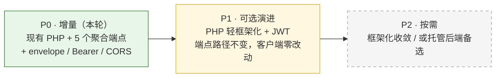

# BACKEND-RECOMMENDATION — Mei-V2 后端选型建议

> 版本：v1.0 ｜ 作者：高见远（Gao，架构师）｜ 状态：待业务方拍板
> 范围：`Mei-V2`（Flutter mobile + Flutter web）所依赖的后端 REST 服务
> 配套：`docs/ARCHITECTURE.md`（§1.3 后端决策、§3.3 新端点契约、§9 结论摘要）
> 本文档**仅规划**，不含实现代码；印尼语业务术语与端点名保留原文。

---

## 1. 目的与范围

`Mei-V2` 把老 Android App 迁移为 Flutter，并新增 Web 监控 Dashboard。两个客户端都依赖**同一个**后端 REST 服务。本轮需明确：

1. 后端是**复用现有 PHP 增量扩展**，还是**重构/换栈**；
2. 若增量，需要补齐哪些**契约与安全**短板（响应体、鉴权、分页、CORS）；
3. P1/P2 的演进路线与迁移路径。

**不在本范围**：老仓库 `dhimasbebe/Mei-V` 的任何改动（冻结只读）、Flutter 前端实现细节（见 ARCHITECTURE.md）。

---

## 2. 现状盘点与风险

### 2.1 现有端点（老 Android 通过 Retrofit2 调用）

| 端点 | 方法 | 用途 | 备注 |
|---|---|---|---|
| `login.php` | POST(form) | 登录 | 老 App 用 form POST |
| `formregistrasi.php` | POST(form) | 注册 | form POST |
| `updatepassword.php` | **GET+query** | 改密 | **GET 写库** |
| `cari_id_alat.php` | GET+query | 扫码反查设备 | 读 |
| `detail_alat.php` | GET+query | 设备详情 | 读 |
| `get_lokasi.php` | GET+query | 位置列表 | 读 |
| `history_maintenance.php` | GET+query | 维护历史 | 读 |
| `input_data_{ac\|petir\|panel\|apar\|alarm\|hydrant}.php` | **GET+query** | 提交 6 类维护表单 | **GET 写库**，6 张表字段各异 |
| `download_report.php` | GET+query | 报表文件流下载 | 读（文件流） |

### 2.2 风险清单

| # | 风险 | 说明 | 严重度 |
|---|---|---|:-:|
| R1 | **GET 写库** | 6 类 `input_data_*.php` 与 `updatepassword.php` 用 GET+query 写数据：① 易被浏览器/代理/CDN **缓存或预取**造成重复写；② **CSRF** 面大（GET 无 body、无 token）；③ **非幂等**，网络重试即产生重复记录 | 高 |
| R2 | **无鉴权 token** | 端点无 Bearer/会话校验，任何人拿到 URL 即可写库/读全量数据 | 高 |
| R3 | **返回格式不规则** | 端点返回纯数组 / 裸字符串 / 混格式，无统一 envelope；客户端需 `legacy_adapter` 逐端点适配 | 中 |
| R4 | **无分页 / 无聚合** | 历史与记录只能全量拉取；Dashboard 所需的 KPI/趋势/分布/逾期**没有任何聚合端点** | 高（P0 阻塞） |
| R5 | **数据模型异构** | 6 类设备各自一张表、字段不同（`suhu_ac` / `grounding_test` / `voltage_rs`…），跨类型统计需后端 UNION/映射 | 中 |
| R6 | **无 CORS** | 老 App 是原生客户端，无跨域问题；**Flutter Web** 从浏览器发起请求会被 CORS 拦截 | 高（Web 阻塞） |
| R7 | **逾期口径无字段** | 逾期/完成率依赖「设备维护周期」，现有表**无 `maintenance_cycle` 字段**，无法按类型算逾期（关联 PRD Q6） | 高（KPI 核心） |
| R8 | **无结构化导出** | 只有 `download_report.php` 文件流，Records 表格/CSV 导出无 JSON 数据源 | 中 |

---

## 3. 候选方案对比

> 评估维度：改造量、迁移成本、风险、是否满足 P0/P1、跨端（Flutter Web CORS）适配度、运维/成本。

| 维度 | ① 保留 PHP + 加 5 端点（**推荐**） | ② PHP 轻框架化 + JWT | ③ Node/Express + TS + Postgres 重写 | ④ 托管后端（Supabase/Firebase 直连） |
|---|---|---|---|---|
| **做法** | 复用现有 PHP 与数据库，仅**新增 5 个只读聚合端点** + 在增量层补 envelope/token/CORS | 用 Slim/Laravel 精简版重构路由与中间件，端点路径保持兼容，加 JWT + 统一响应 | 全量重写后端与数据模型，迁移到 Postgres，Flutter 直连新 API | 前端直连托管 BaaS（Postgres/RLS 或 Firestore），免自建后端 |
| **改造量** | **低**（新增 5 端点 + 中间件） | 中（重写路由/中间件，业务 SQL 复用） | **高**（重写全部端点 + 数据迁移 + 双写） | 中高（数据模型重建 + RLS/规则 + 6 表迁移） |
| **迁移成本** | **近零**（老端点原样保留，客户端零改动） | 中（端点兼容，逐步切换） | 高（老数据迁移 + 客户端联调 + 回归全量） | 高（数据导出/导入 + 鉴权重做 + 老 PHP 弃用） |
| **风险** | 低（不动存量，风险隔离在新端点） | 中（重构引入回归，需灰度） | **高**（一次性大爆炸，回归面最大） | 中高（厂商锁定、RLS 误配泄露、迁移丢失） |
| **满足 P0** | ✅ 5 端点即覆盖 P0-08~10 | ✅ | ✅ | ✅ |
| **满足 P1** | ✅（增量继续加端点）；P1 增强端点仍在 PHP | ✅ 更易扩展 | ✅ | ⚠️ 自定义报表/PDF 逻辑受 BaaS 限制 |
| **Flutter Web CORS 适配** | ⚠️ **需手动加 CORS 白名单**（必做项） | ✅ 框架中间件统一处理 | ✅ 框架中间件 | ✅ 平台内置 |
| **鉴权（Bearer/token）** | ⚠️ 增量层自建（需做） | ✅ JWT 原生 | ✅ | ✅ 内置 |
| **运维/成本** | **最低**（沿用现有 PHP 主机/运维习惯） | 低（同栈，仅依赖变更） | 中高（新运行时 + DB 运维） | 中（SaaS 订阅 + 出网依赖） |
| **团队熟悉度** | 高（现有 PHP 数据与运维） | 中高 | 低（需 Node/TS 技能） | 中 |
| **与「只 2 个客户端、内部工具」契合** | ✅ 最契合 | ✅ | ❌ 过度设计 | ⚠️ 收益有限 |

### 3.1 结论

- **方案 ③（重写）**：内部工具、仅 2 个客户端、存量数据与运维都在 PHP，重写的迁移与回归成本远超收益 —— **排除**。
- **方案 ④（托管后端）**：虽省后端运维，但需重建数据模型/鉴权/RLS，且自定义聚合与报表逻辑受平台约束、存在厂商锁定 —— **不作为 P0 首选**（可列为远期备选）。
- **方案 ②（PHP 框架化 + JWT）**：方向正确但**不宜在 P0 做**（重构回归风险与排期冲突）—— 作为 **P1 演进目标**。
- **方案 ①（保留 PHP + 加 5 端点）**：**推荐**。

### 3.2 语言/框架选型：PHP vs Laravel vs Go vs 其他（面向 Flutter 客户端）

> **前置事实**：Flutter 只依赖 HTTP/JSON 契约，**不依赖后端语言**。真正影响跨端体验的是：统一 envelope、Bearer 鉴权、**CORS**（Flutter Web Dashboard 跑在浏览器里，这是与老 Android 最大的差异）、ISO 8601 时间、分页、HTTPS。语言只在「交付速度 / 运维成本 / 团队技能 / 报表聚合便利度」四个维度上产生差异。

| 维度 | PHP 原生（现有） | **Laravel（推荐目标）** | Go（Fiber/Gin + sqlc） | Node/NestJS + TS | Supabase/Firebase |
|---|---|---|---|---|---|
| **与 Flutter 对接** | 需手写 CORS + token | 全部原生支持 | 需手写 token/CORS（生态包可选） | 全部原生支持 | 平台内置 |
| **鉴权方案** | 自建（易出错） | Sanctum/Passport token，开箱即用 | JWT 库 + 自写中间件 | Passport/JWT | 内置 + RLS |
| **数据层复用** | ✅ 现有 SQL 直接用 | ✅ 同库同 SQL，Query Builder 包一层 | ⚠️ 需 sqlc/sqlx 重写查询 | ⚠️ Prisma/TypeORM 重写 | ❌ 迁库 + 重建模型 |
| **报表/聚合查询** | 手写 SQL，可维护性差 | Query Builder + Eloquent，聚合最省事 | 手写 SQL + scan，样板多 | 中等 | 受限（复杂聚合难） |
| **校验/错误处理** | 无框架，靠自觉 | FormRequest + 统一异常处理 | 需 validator 库自建 | class-validator | 平台规则 |
| **迁移/版本管理** | 无 | `php artisan migrate` 内置 | golang-migrate 外挂 | Prisma Migrate | 平台内置 |
| **部署/运维** | 沿用现有主机 | 同栈，仅加 Composer 依赖 | 单二进制、内存占用最低 | 需 Node 运行时 | 免运维（订阅制） |
| **交付速度（本范围）** | **最快（P0）** | 快（P1 起） | 慢（样板多） | 中 | 快（但迁移成本高） |
| **团队/生态（印尼本地托管）** | 高 | **高（PHP 生态最成熟）** | 低 | 中 | 中 |
| **本范围适配度** | ✅ P0 够用 | ✅ **最佳平衡** | ⚠️ 过度设计 | ⚠️ 无额外收益 | ❌ 数据已在 MySQL |

**选型结论**：
1. **P0（本轮）**：沿用 **PHP 原生 + 5 个只读端点**，最快、零迁移（见 §4）。
2. **P1 演进目标：Laravel** —— 在 PHP / Go / Node 三选一中，Laravel 对本项目**最合适**：语言与运维栈不变（可与老 PHP 脚本在同一台主机、同一个 MySQL 上并行跑，逐端点灰度切换），却白得 CORS 中间件、Sanctum token、FormRequest 校验、统一异常处理、`artisan migrate`、Query Builder 聚合 —— 正好补齐老 PHP 最缺的四项（B1/B2/B3 硬要求 + 迁移管理）。且端点路径可保持兼容，**Flutter 客户端零改动**。
3. **Go 什么时候才选**：需要高并发/极低内存/单二进制部署，且团队已熟悉 Go。本项目是「2 个客户端 + 内部工具 + 聚合报表」，Go 的优势用不上，却要多写鉴权、校验、迁移、ORM 样板，交付更慢 —— **不作首选**。
4. **Node/NestJS**：团队若 TS 强可选，但相对 Laravel 在本范围**没有额外收益**（同样要重写数据访问层）。
5. **Supabase/Firebase**：数据已在 MySQL，迁库 + 厂商锁定，且复杂聚合与 PDF 报表受限 —— 仅列远期备选。

**无论最终选哪个后端，Flutter 侧的对接要求一致（必须满足）**：
- 鉴权用 **Bearer token**（不要 cookie session —— Flutter mobile 与 Web 共用一套逻辑，Web 还要过 CORS 预检）。
- 响应体统一 `{code, data, message}`，错误码表固定（见 §6.4）。
- 时间统一 **ISO 8601 带时区**（老端点是本地时间字符串，需在 adapter 归一）。
- 列表端点必须支持分页参数（`page`/`per_page` + `total`），否则 Dashboard 表格无法用。
- **CORS 白名单 + OPTIONS 预检**必须显式配置（这是 Flutter Web 与老 Android 唯一的硬差异，也是最容易踩的坑）。
- 报表下载走 HTTPS 直链或签名 URL，不要走 GET-with-side-effects（老 `input_data_*.php` 用 GET 写库的做法**禁止在新端点沿用**）。

---

## 4. 推荐方案与理由

### 4.1 推荐

**保留现有 PHP 与数据库，仅增量新增 5 个只读聚合端点；同时在「增量层」补齐统一响应体、Bearer 鉴权、分页与 CORS。**

### 4.2 理由

1. **规模匹配**：内部设备维护工具、2 个客户端（Flutter mobile + web），无需为扩展性引入新栈。
2. **数据与运维存量在 PHP**：老数据、6 张设备表、运维习惯都在现有环境，复用即零迁移。
3. **P0 缺口明确且小**：只差 `dashboard_kpi / trend / distribution`、`maintenance_paged`、`dashboard_overdue` 5 个**只读**端点（契约见 ARCHITECTURE.md §3.3），增量即可交付。
4. **风险隔离**：老端点原样保留（客户端零改动），新逻辑集中在新端点，可独立灰度、独立回滚。
5. **客户端已做兼容**：Flutter 侧 `legacy_adapter` 已把不规则老响应归一为 `Result<T>`，老端点无需改造即可用。

### 4.3 增量层 3 条硬要求（必须做）

| # | 要求 | 说明 |
|---|---|---|
| B1 | **统一响应体** `{code, data, message}`（`code=0` 成功） | 仅**新增端点**遵守；老端点保持原样 |
| B2 | **Bearer token 鉴权 + 服务端 role 校验** | 新端点强制校验；Teknisi 仅返回本人数据（后端按 token 强制加 `username` 条件，前端隐藏菜单不算权限） |
| B3 | **CORS 白名单** | 允许 Flutter Web Dashboard 的来源（含预检 OPTIONS） |

### 4.4 应急分支：若旧后端与数据库无法恢复（2026-10-14 新增情况）

**已核实事实**：
- 旧后端域名 **`meivtelpro.my.id` 已 NXDOMAIN**（PANDI 权威 DNS `b.dns.id` 返回 Status 3），站点与全部 `*.php` 端点不可达，Wayback 亦无快照。
- 仓库 `dhimasbebe/Mei-V` 已恢复，`ApiClient.java` 确认 `BASE_URL = "https://meivtelpro.my.id/"`。
- 本地无 MySQL、无 `.sql`、无 PHP 文件 ⇒ 数据只在远程托管上。

**分支判定**：

| 情况 | 后端方案 |
|---|---|
| 找到托管账号并成功导出 DB | **§4.1 推荐不变**：PHP 增量 + 5 聚合端点，P1 再 Laravel 化 |
| 托管无法恢复（账号失效、备份过期） | **改为 P0 直接新建 Laravel 11 + Sanctum** —— 此时"复用旧后端"已不成立，没有可复用的后端 |

**P0 直接新建 Laravel 时的调整**：
1. 表结构以 `docs/db/schema-reconstructed.sql`（9 表 + `v_maintenance_all` 视图）为起点，用 `artisan migrate` 落地。
2. 端点无需再兼容 `*.php` 路径，直接采用 `/api/v1/...`（避免带着历史包袱开工）。
3. 5 个聚合端点（`dashboard_kpi/trend/distribution`、`maintenance_paged`、`dashboard_overdue`）仍属 P0，改为原生 Laravel 实现（Query Builder + API Resource + `paginate()`）。
4. 客户端契约不变：Flutter 侧仍只依赖 base URL + Bearer + `{code,data,message}`；`legacy_adapter` 保留以备将来兼容。
5. 历史数据若日后找回 dump，写一次性 import command 补齐（不影响上线）。

**关键结论**：无论最终走哪个分支，**Flutter 端契约一致**，因此客户端任务 T03/T04 不被阻塞，可以立即开工；只有后端任务需要等 Q6 口径 + 托管账号查找结果。

---

## 5. 分阶段迁移路径



### P0（本轮交付）

- 现有 PHP 不动业务端点；新增 5 个聚合端点（只读）。
- 新增端点统一 `{code,data,message}` + Bearer + role 校验。
- 配置 CORS 允许 Dashboard 来源。
- 为逾期口径补 `maintenance_cycle` 字段（或等价配置表）—— **依赖业务方 Q6 拍板**。
- `get_alat.php` 设备列表端点如缺则补（ARCHITECTURE.md §8 附加项）。

### P1（可选，视需要）

- 将 PHP 渐进重构为轻量框架（Slim/Laravel 精简版）+ JWT 中间件。
- **端点路径保持不变**，Flutter 客户端零改动；按端点灰度切换。
- 新增 P1 增强端点（`dashboard_anomaly.php`、`maintenance_export.php`）。

### P2（按需）

- 若框架化仍不满足（如审计日志、复杂报表），再评估独立服务或托管后端；届时以**契约不变**为迁移前提。

---

## 6. 接口契约配套

### 6.1 统一响应体（仅新增端点）

```json
{ "code": 0, "message": "ok", "data": { } }
```

`code` 语义见 §6.4。老端点保持原样，由客户端 `legacy_adapter` 归一。

### 6.2 鉴权

```
Header: Authorization: Bearer <token>
```

- 新端点**强制**校验 token 与 role。
- 401 → 客户端清会话跳登录；403 → 越权（如 Teknisi 访问 KPI）。

### 6.3 分页参数

| 参数 | 默认 | 说明 |
|---|---|---|
| `page` | 1 | 从 1 起 |
| `per_page` | 20 | PRD 性能项；上限建议 100 |

返回结构：`{ page, per_page, total, items: [...] }`。

### 6.4 错误码表（建议）

| code | 含义 | HTTP | 客户端处理 |
|---|---|---|---|
| 0 | 成功 | 200 | 正常 |
| 1001 | 参数缺失/非法 | 400 | `ValidationException` |
| 1002 | 未登录/token 失效 | 401 | 清会话跳登录 |
| 1003 | 越权 | 403 | 403 页 |
| 1004 | 资源不存在 | 404 | 空态/提示 |
| 2000 | 服务端错误 | 500 | `ApiException` + 重试入口 |

> 客户端映射见 ARCHITECTURE.md §7-2（`AppException` 体系）。

### 6.5 CORS（Flutter Web 关键）

- `Access-Control-Allow-Origin`：**白名单**（Dashboard 域名 + 本地开发 `http://localhost:*`），**禁止** `*` 配合凭证。
- `Access-Control-Allow-Headers`：`Authorization, Content-Type`。
- `Access-Control-Allow-Methods`：`GET, POST, OPTIONS`。
- 必须正确处理 **OPTIONS 预检**（返回 204）。

### 6.6 5 个新增端点归属

| 端点 | 归属 | 说明 |
|---|---|---|
| `dashboard_kpi.php` | **现有 PHP 增量** | 只读聚合，role=supervisor/admin |
| `dashboard_trend.php` | **现有 PHP 增量** | 只读 |
| `dashboard_distribution.php` | **现有 PHP 增量** | 只读，`dimensi=tipe\|lokasi` |
| `maintenance_paged.php` | **现有 PHP 增量** | 只读，Teknisi 后端强制 `username` 条件 |
| `dashboard_overdue.php` | **现有 PHP 增量** | 只读，依赖 `maintenance_cycle`（Q6） |
| （P1）`dashboard_anomaly.php`、`maintenance_export.php` | 现有 PHP 增量 | P1 |

---

## 7. 部署与运维建议

| 项 | 建议 |
|---|---|
| 域名 / HTTPS | Dashboard 与 API 走 HTTPS；`API_BASE_URL` 由 `--dart-define` 注入（禁止硬编码）。同域或跨域二选一，跨域必须配 CORS 白名单。 |
| 环境区分 | 至少 dev / prod 两套 `API_BASE_URL` 与数据库；配置走环境变量或 `--dart-define`。 |
| 备份 | 现有 MySQL/PHP 数据库沿用既有备份策略；新增端点**只读**，不改变写入路径，备份风险不新增。 |
| 日志 | 新增端点记录：请求时间、用户、role、查询区间、耗时（便于 <3s 首屏性能核查）。 |
| 缓存 | 聚合端点可加短 TTL 缓存（如 30–60s）减轻压力；因是只读，缓存安全。**老写端点（GET 写库）必须禁用任何缓存**（R1）。 |
| Flutter Web 静态托管 | Dashboard 产物 `flutter build web` 输出静态文件，托管在 nginx / 静态托管（与 API 同机或 CDN）；需保证 `web/index.html` 与路由 fallback（go_router 用 hash 或 nginx try_files）。 |
| 安全加固（P1） | 老写端点从 GET 改为 POST + token（R1/R2），此改动属 P1，需与客户端同步（客户端已按端点族封装，切换成本低）。 |

---

## 8. 对 PRD Open Questions 的影响

| PRD 项 | 推荐方案下的结论 |
|---|---|
| **Q1**（复用 or 重构） | **复用**：保留现有 PHP，增量加端点；重写不在范围 |
| **Q2**（5 个聚合端点谁开发/命名） | 由**现有 PHP 团队**实现，端点命名沿用 `dashboard_*.php`（契约见 ARCHITECTURE.md §3.3） |
| **Q3**（分页筛选端点） | `maintenance_paged.php` 由现有 PHP 增量实现，契约已给 |
| **Q5**（role 取值/注册） | 增量层统一 token + role 校验约定；具体 role 取值需查 `login.php` 实际返回 |
| **Q6**（**逾期/完成率口径**） | **需后端新增 `maintenance_cycle`（或配置表）**；口径未定前按默认假设（分母=设备总数、逾期=距上次维护 >30 天）实现，**最高优先级待业务方拍板** |
| 附加（`get_alat.php`） | 若缺则随增量一并补 |
| 附加（`login.php` 是否含 token） | 增量层要求返回 token；若老端仅返回用户 JSON，则由增量层补发 token |

---

## 9. 待拍板事项

| # | 事项 | 建议 | 需谁拍板 |
|---|---|---|---|
| D1 | 是否采纳「保留 PHP + 5 端点」方案（§4） | 采纳 | 业务方 / 运维 |
| D2 | **Q6 逾期/完成率口径**（分母定义、周期字段 `maintenance_cycle` 是否新增） | 分母=设备总数；新增周期字段 | **业务方（最高优先级）** |
| D3 | CORS 允许来源白名单（Dashboard 域名 + 本地开发） | 明确列出 | 运维 / 后端 |
| D4 | 5 个端点的开发归属与排期 | 现有 PHP 团队 | 后端 / PM 许清楚 |
| D5 | P1 是否启动 PHP 轻框架化 + JWT（R1/R2 加固） | P1 视情况启动，端点路径不变 | 业务方 / 后端 |

---

*产出：高见远（Gao·架构师）｜ 配套：`docs/ARCHITECTURE.md`（§9 结论摘要）*
