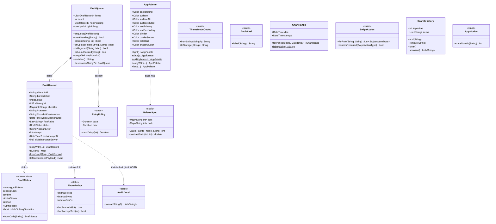
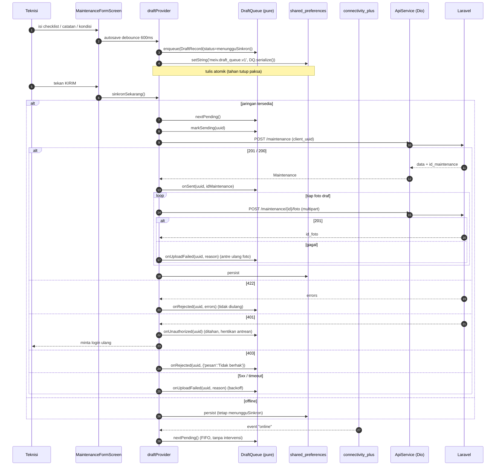
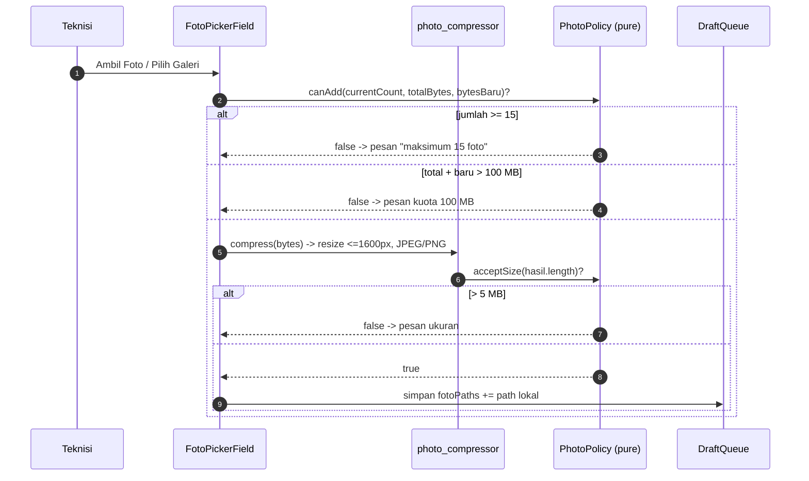
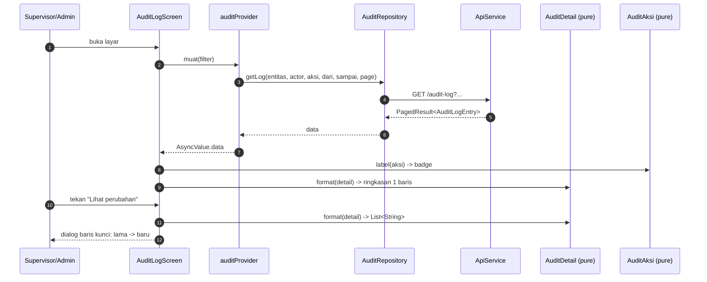
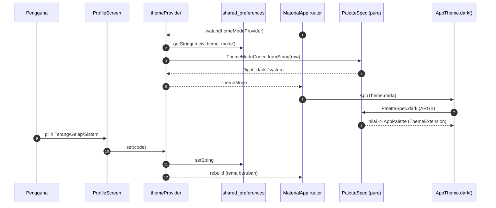
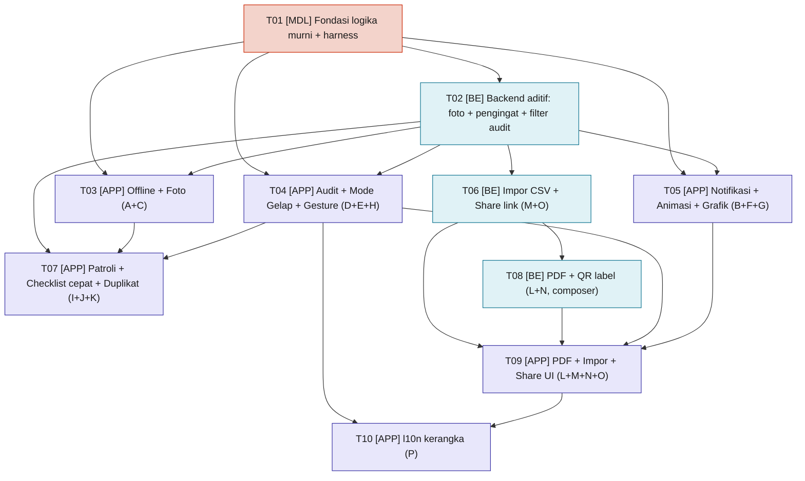

# DESIGN — Mei-V2 Fitur Tahap 3 (Offline · Notifikasi · Foto · Audit Log · Mode Gelap · Animasi · Grafik · Gesture)

> Versi: v3.0 ｜ Penulis: 高见远 (Gao) — Architect ｜ Status: siap diturunkan ke engineer
> Sumber kebutuhan: `docs/PRD-FEATURES-V3.md` (v3.0, 许清楚/Xu)
> Basis keputusan: `docs/DESIGN-ROLE-UI-V2.md`, `docs/PRD-ROLE-UI-V2.md` §7, `docs/LEGACY-ANALYSIS.md` §11–§12, `docs/TEAM-STANDARDS.md`
> Bahasa: Indonesia ｜ Terminologi domain tetap bahasa Indonesia

---

## 0. Ringkasan Keputusan (satu halaman)

| WS | Keputusan inti | Berkas kunci baru |
|---|---|---|
| **A. Offline** | Antrean draf = **satu string JSON** di `shared_preferences` (bukan `hive`, belum disetujui). Logika antrean di Dart murni, I/O di provider. Idempotensi lewat `client_uuid` yang sudah ada. | `core/offline/{draft_status,draft_queue,retry_policy}.dart` |
| **B. Notifikasi** | Lapis in-app = lencana + banner (tanpa paket). Lapis OS = opsional, di balik flag paket. | `core/notif/notif_schedule.dart`, `providers/notif_provider.dart` |
| **C. Foto** | Foto ikut **antrean A**; unggah **setelah** `POST /maintenance` sukses (butuh `id_maintenance`). Kompresi via `dart:ui` (**PNG**, bukan JPEG — lihat §5) sebagai jalur cadangan, `flutter_image_compress` sebagai jalur utama bila disetujui. | `core/media/photo_policy.dart`, `core/media/photo_compressor.dart` |
| **D. Audit** | `detail` JSON diurai murni → `kunci: lama → baru`. Filter baru `dari/sampai` aditif. Backend perlu menyimpan nilai lama (aditif). | `core/audit/{audit_detail,audit_aksi}.dart` |
| **E. Mode gelap** | **Dua lapis**: token brand tetap `const` di `AppColors`; token permukaan/teks pindah ke `ThemeExtension<AppPalette>` yang nilainya dibaca dari spec Dart murni. `AppColors` tetap ada sebagai fallback light. | `core/theme/{app_palette_spec,app_palette,theme_mode_codec}.dart` |
| **F. Animasi** | Durasi/kurva di Dart murni; visual `Hero`, `AnimatedBuilder`, `CustomPainter` (tanpa Lottie). | `core/motion/app_motion.dart` |
| **G. Grafik** | Rentang periode di Dart murni; interaksi sentuh `fl_chart` (paket sudah ada). | `core/charts/chart_range.dart` |
| **H. Gesture** | Tabel aksi geser per-role di Dart murni; satu widget bersama `SwipeCard`. | `core/gesture/swipe_action.dart`, `core/search/search_history.dart` |
| **I. Patroli** | Antrian patroli = pola yang SAMA dengan WS A (satu string JSON, `meiv.patrol_queue.v1`); kamera tidak berhenti; laporan memakai antrean draf A — **tanpa jalur sinkron kedua**. | `core/patrol/patrol_queue.dart`, `providers/patrol_provider.dart` |
| **J. Checklist cepat** | `markAllOk` mengisi HANYA item pilihan yang opsi memuat "Baik/OK"; tidak menimpa isian user; item angka/teks tetap kosong. **Prasyarat: perbaikan warna token form (deviasi D3)**. | `core/maintenance/checklist_quick_fill.dart` |
| **K. Duplikat laporan** | `DraftTemplate.fromReport` → draf baru dengan `client_uuid` BARU (bukan replay), foto KOSONG, waktu = waktu duplikasi; masuk antrean A. | `core/maintenance/draft_template.dart` |
| **L. Ekspor PDF** | Generate di **backend** (dompdf composer, bukan Flutter). App memakai pola Dio `ResponseType.bytes` yang sudah ada (CSV). Pubspec Flutter tidak bertambah. | `backend/app/Http/Controllers/Api/PdfController.php` |
| **M. Impor CSV** | Preview → commit dua tahap server-side (`fgetcsv`); aksi audit baru `import` (string, tanpa skema). | `backend/.../AlatImportController.php`, `domain/models/alat_import.dart` |
| **N. Label QR** | Infrastruktur PDF L + `simple-qrcode` (composer). `POST /dashboard/export/qr-labels`. | `backend/.../QrLabelController.php` |
| **O. Share tautan** | Tabel `share_links` (token ≥32 unik, revocable, `expires_at` opsional) + halaman publik `GET /share/{token}` di `routes/web.php` — **di luar** prefix `/api/v1`, tanpa Sanctum, respons HTML (bukan envelope). | `backend/.../ShareController.php`, `domain/models/share_link.dart` |
| **P. Multi-bahasa** | Kerangka l10n SDK (`flutter_localizations` + ARB) + 1 layar dwibahasa (Login). **Wajib paling akhir** — setelah migrasi dark mode T04 selesai. | `core/locale/locale_codec.dart`, `app/lib/l10n/*.arb` |

**Aturan mengikat yang TIDAK boleh dilanggar:** palet brand `#CB2400`, top bar hitam, radius pil `50dp` tetap sama di kedua tema; migrasi DB **aditif**; **tidak** menambah paket pub tanpa persetujuan (hanya boleh yang sudah terpasang + paket di §5 yang menunggu keputusan); **tidak** merancang langkah verifikasi yang bergantung pada `flutter analyze`/`flutter test`.
**Pembaruan v3.1:** user telah menyetujui SEMUA dependensi baru — pub: `share_plus` (O), `file_picker` (M); composer: `barryvdh/laravel-dompdf` + `simplesoftwareio/simple-qrcode` (L, N); `flutter_localizations` = bagian SDK Flutter (P, tanpa persetujuan). `hive` tetap TIDAK dipakai. Detail perluasan WS I–P → **BAGIAN C**.

---

# BAGIAN A — RANCANGAN SISTEM

## 1. Pendekatan Implementasi

### 1.1 Tantangan teknis inti

| # | Tantangan | Penanganan |
|---|---|---|
| T1 | Draf harus **tahan penutupan paksa** tanpa `hive` | Antrean diserialisasi sebagai **satu string JSON** dan ditulis dengan satu `setString` (atomik per operasi di `shared_preferences`). Autosave *debounce* 600 ms + tulis paksa pada `AppLifecycleState.paused/inactive`. |
| T2 | Duplikat record saat jaringan tidak stabil | `client_uuid` (sudah ada, 3000/3000 unik) → server idempoten (201/200). Klien: dedupe `enqueue` + guard `sedangKirim`. |
| T3 | Foto butuh FK ke record yang belum ada saat offline | Foto masuk antrean bersama draf; unggah **hanya** setelah `POST /maintenance` mengembalikan `id_maintenance`. |
| T4 | Dark mode menyentuh 39 berkas token | `ThemeExtension<AppPalette>` + `context.palette`; nilai dari spec Dart murni; `AppColors` dipertahankan sebagai fallback light → tidak ada berkas yang "pecah" saat belum dimigrasi. |
| T5 | Logika harus diuji tanpa Flutter CLI | Seluruh logika di berkas **Dart murni tanpa `package:flutter`**, diimpor `tools/modelcheck/verify_models.dart` lewat path relatif (`../../app/lib/...`). |
| T6 | 401/403/422 tidak boleh diulang otomatis | Status antrean membedakan `ditahan` (401, stop seluruh antrean) dan `ditolakServer` (403/422, terminal). Hanya `menungguSinkron` yang di-retry. |

### 1.2 Pemilihan pola & paket

- **Pola**: `Screen (ConsumerWidget)` → `Provider (Riverpod)` → `Repository` → `ApiService` → `ApiClient (Dio)` → Laravel → envelope `{code, data, message}` → `_unwrap/_unwrapList` → model `fromJson` manual → `AsyncValue` → UI. (Dipertahankan dari `DESIGN-ROLE-UI-V2` §5 — tidak diubah.)
- **Pemisahan baru**: lapisan **pure logic** (`core/offline`, `core/audit`, `core/theme/*_spec`, `core/charts`, `core/motion`, `core/gesture`, `core/search`, `core/media`) → tanpa Flutter, dapat diuji `dart.exe`.
- **Paket**: memakai yang sudah terpasang (`flutter_riverpod`, `go_router`, `dio`, `connectivity_plus`, `flutter_secure_storage`, `shared_preferences`, `mobile_scanner`, `fl_chart`, `intl`). Paket tambahan **hanya** dari §5 dengan **jalur ganda**.

### 1.3 Alternatif yang ditolak

| Alternatif | Alasan ditolak |
|---|---|
| `hive` untuk antrean | Belum disetujui; `shared_preferences` cukup untuk skala lapangan (≤ puluhan draf). |
| SQLite/`sqflite` | Paket baru + codegen; over-engineering untuk kebutuhan ini. |
| Tulis ulang seluruh layar ke `AppColors` dinamis (`static Color`, non-const) | Menyentuh 42 berkas sekaligus, mematikan `const` (biaya rebuild), dan melanggar "migrasi bertahap". |
| `MediaQuery`/sensor untuk tema otomatis | PRD §7 #6: hanya 3 pilihan manual. |
| Push notification FCM | PRD §7 #1: di luar sandbox. |
| WebSocket untuk sinkron | PRD §7 #2: polling saat aktif sudah cukup. |
| Simpan antrean per-draf di key terpisah | Banyak key = risiko antrean separuh-tertulis; satu key = satu operasi atomik. |

---

## 2. Daftar Berkas

### 2.1 Berkas BARU

**Dart murni (tanpa `package:flutter`) — diuji `[MDL]`**

| Path | Isi |
|---|---|
| `app/lib/core/offline/draft_status.dart` | `enum DraftStatus` + kode string |
| `app/lib/core/offline/draft_queue.dart` | `DraftRecord`, `DraftQueue` |
| `app/lib/core/offline/retry_policy.dart` | `RetryPolicy.nextDelay` |
| `app/lib/core/theme/app_palette_spec.dart` | `PaletteSpec` (nilai ARGB light/dark, `contrastRatio`) |
| `app/lib/core/theme/theme_mode_codec.dart` | `ThemeModeCodec` |
| `app/lib/core/audit/audit_detail.dart` | `AuditDetail.format` |
| `app/lib/core/audit/audit_aksi.dart` | `AuditAksi.label` |
| `app/lib/core/charts/chart_range.dart` | `ChartRange` |
| `app/lib/core/motion/app_motion.dart` | `AppMotion` |
| `app/lib/core/gesture/swipe_action.dart` | `SwipeAction` |
| `app/lib/core/search/search_history.dart` | `SearchHistory` |
| `app/lib/core/media/photo_policy.dart` | `PhotoPolicy` |

**Flutter — UI/provider/layanan**

| Path | Isi |
|---|---|
| `app/lib/core/theme/app_palette.dart` | `ThemeExtension<AppPalette>` + `context.palette` |
| `app/lib/core/media/photo_compressor.dart` | Kompresi `dart:ui` (fallback) / `flutter_image_compress` (opsional) |
| `app/lib/core/notif/notif_schedule.dart` | `NotifSchedule` (Dart murni — lihat catatan) |
| `app/lib/core/notif/local_notifier.dart` | Pembungkus OS-notif (di balik flag paket) |
| `app/lib/domain/models/pengingat.dart` | `PengingatPayload`, `PengingatItem` |
| `app/lib/providers/draft_provider.dart` | Persistensi antrean + orkestrasi sinkron |
| `app/lib/providers/theme_provider.dart` | `themeModeProvider` + persistensi |
| `app/lib/providers/notif_provider.dart` | Pengingat + jadwal |
| `app/lib/providers/audit_provider.dart` | Daftar + filter audit |
| `app/lib/data/repositories/foto_repository.dart` | Unggah/hapus/list foto |
| `app/lib/data/repositories/audit_repository.dart` | `GET /audit-log` + filter |
| `app/lib/presentation/screens/offline/sync_queue_screen.dart` | Layar "Antrean Sinkron" |
| `app/lib/presentation/screens/audit/audit_log_screen.dart` | Layar Audit Log |
| `app/lib/presentation/widgets/sync_banner.dart` | Banner draf dipulihkan / status sinkron |
| `app/lib/presentation/widgets/foto_gallery.dart` | Galeri thumbnail + zoom |
| `app/lib/presentation/widgets/foto_picker_field.dart` | Ambil/pilih foto + pratinjau |
| `app/lib/presentation/widgets/audit_detail_dialog.dart` | Dialog "Lihat perubahan" |
| `app/lib/presentation/widgets/swipe_card.dart` | Kartu geser-aksi bersama |
| `app/lib/presentation/widgets/search_history_field.dart` | Kotak pencarian + riwayat |
| `app/lib/presentation/widgets/animated_number.dart` | Angka KPI beranimasi |
| `app/lib/presentation/widgets/success_check.dart` | Animasi centang sukses |
| `app/lib/presentation/widgets/interactive_line_chart.dart` | Grafik garis sentuh |
| `app/lib/presentation/widgets/interactive_pie_chart.dart` | Grafik pie sentuh |

**Backend**

| Path | Isi |
|---|---|
| `backend/database/migrations/2024_01_03_000000_create_maintenance_foto_table.php` | Tabel aditif |
| `backend/app/Models/MaintenanceFoto.php` | Model |
| `backend/app/Http/Controllers/Api/FotoController.php` | store/index/destroy |
| `backend/app/Http/Controllers/Api/PengingatController.php` | `GET /pengingat` |
| `backend/tests/Feature/FotoTest.php` | AC-C1…C7 |
| `backend/tests/Feature/PengingatTest.php` | AC-B1…B3 |

**Harness**

| Path | Isi |
|---|---|
| `app/test/fixtures/pengingat.json` | Fixture respons `/pengingat` |
| `app/test/fixtures/maintenance_foto.json` | Fixture respons foto |
| `app/test/fixtures/audit_log_page.json` | **diperbarui** dengan bentuk `detail` berisi `{lama,baru}` |

### 2.2 Berkas DIUBAH (ringkas)

`app/lib/core/theme/app_theme.dart` · `app/lib/core/theme/app_colors.dart` (hanya anotasi komentar + tandai token fallback) · `app/lib/main.dart` · `app/lib/main_web.dart` · `app/lib/core/router/{routes,route_access,app_router}.dart` · `app/lib/domain/models/maintenance.dart` · `app/lib/data/api/api_service.dart` · `app/lib/data/repositories/maintenance_repository.dart` · `app/lib/presentation/screens/maintenance/{maintenance_form_screen,riwayat_screen}.dart` · `.../screens/home/teknisi_home_screen.dart` · `.../screens/home/supervisor_home_screen.dart` · `.../screens/verifikasi/verifikasi_screen.dart` · `.../screens/profile/profile_screen.dart` · `.../screens/data/{user_management,master_data,alat_management}_screen.dart` · `.../screens/dashboard/{dashboard_overview,dashboard_analytics,dashboard_records}_screen.dart` · `.../shell/{role_shell,web_shell}.dart` · **seluruh 19 widget** di `app/lib/presentation/widgets/` (baca `context.palette`) · `backend/app/Http/Controllers/Api/{AuditLogController,MaintenanceController}.php` · `backend/app/Support/AuditLogger.php` · `backend/routes/api.php` · `backend/tests/Feature/AuditLogTest.php` · `tools/modelcheck/verify_models.dart`.

---

## 3. Struktur Data & Antarmuka

### 3.1 Diagram kelas (inti v3)



> Diagram kelas lengkap (termasuk kelas lama yang tetap) → `docs/class-diagram-v3.mermaid`.

### 3.2 Tanda tangan fungsi kunci (siap dipakai engineer)

**`core/offline/draft_status.dart`**
```dart
enum DraftStatus {
  menungguSinkron('menunggu_sinkron'),
  sedangKirim('sedang_kirim'),
  terkirim('terkirim'),
  ditolakServer('ditolak_server'),
  ditahan('ditahan');

  const DraftStatus(this.code);
  final String code;

  static DraftStatus fromCode(String? code);       // default: menungguSinkron
  bool get bolehDiulangOtomatis => this == DraftStatus.menungguSinkron;
}
```

**`core/offline/draft_queue.dart`**
```dart
class DraftRecord {
  const DraftRecord({ required this.clientUuid, required this.barcodeAlat,
    required this.idLokasi, required this.waktuMaintenance, this.idKategori,
    this.checklist = const {}, this.catatan, this.kondisiKeseluruhan,
    this.fotoPaths = const [], this.status = DraftStatus.menungguSinkron,
    this.pesanError, this.attempt = 0, this.nextAttemptAt, this.idMaintenanceServer });
  // ... field seperti §3.1
  DraftRecord copyWith({ /* semua field opsional */ });
  Map<String, dynamic> toJson();
  factory DraftRecord.fromJson(Map<String, dynamic> json);
  Map<String, dynamic> toMaintenancePayload();   // = bentuk POST /maintenance
}

class DraftQueue {
  DraftQueue([List<DraftRecord> initial = const <DraftRecord>[]]);

  List<DraftRecord> get items;                   // urutan FIFO
  int get count;
  DraftRecord? get nextPending;                  // tertua berstatus menungguSinkron (AC-A18)
  bool get perluLoginUlang;                      // true bila ada status ditahan (AC-A15)

  void enqueue(DraftRecord draft);               // dedupe by clientUuid (AC-A1/A3)
  bool markSending(String uuid);                 // false bila sudah sedangKirim/terkirim (AC-A13)
  bool onSent(String uuid, int idMaintenance);   // -> terkirim
  bool onUploadFailed(String uuid, String reason);            // -> menungguSinkron (AC-A10)
  bool onRejected(String uuid, Map<String, List<String>> e);  // -> ditolakServer (AC-A14/A16)
  bool onUnauthorized(String uuid);                           // -> ditahan (AC-A15)
  void purgeTerkirim({Duration simpan = const Duration(days: 7)});

  String serialize();
  factory DraftQueue.deserialize(String? raw);   // round-trip (AC-A4)
}
```

**`core/offline/retry_policy.dart`**
```dart
abstract class RetryPolicy {
  static const Duration base = Duration(seconds: 5);
  static const Duration max  = Duration(seconds: 60);
  /// attempt 0..n → 5s,10s,20s,40s,60s,60s…  (AC-A11)
  static Duration nextDelay(int attempt) {
    final int ms = base.inMilliseconds * (1 << (attempt < 0 ? 0 : attempt));
    return Duration(milliseconds: ms.clamp(base.inMilliseconds, max.inMilliseconds));
  }
}
```

**`core/theme/app_palette_spec.dart`**
```dart
enum PaletteTheme { light, dark }

abstract class PaletteSpec {
  static const Map<String, int> light = { 'background': 0xFFFFFFFF, /* … */ };
  static const Map<String, int> dark  = { 'background': 0xFF121212, /* … */ };
  static const Set<String> tokens = { 'background','surface','surfaceAlt',
    'surfaceMuted','textPrimary','textSecondary','divider','borderSubtle',
    'fieldDark','shadowColor','primary' };

  static int value(PaletteTheme theme, String token);         // AC-E1/E2/E3
  static double contrastRatio(int argbA, int argbB);          // WCAG, murni (AC-E4)
}
```

**`core/theme/theme_mode_codec.dart`**
```dart
abstract class ThemeModeCodec {
  static const String system = 'system';
  static String fromString(String? raw);   // null/'x' -> 'system' (AC-E5)
  static String toStorage(String code);
}
```

**`core/audit/audit_detail.dart`**
```dart
abstract class AuditDetail {
  /// {"merk_alat":"Daikin"}                -> ["merk_alat: Daikin"]
  /// {"status":{"lama":"menunggu","baru":"disetujui"}} -> ["status: menunggu → disetujui"]
  /// JSON tidak valid                       -> ["<teks mentah>"] (tanpa exception)
  static List<String> format(String? jsonString);             // AC-D5/D6
}
```

**`core/audit/audit_aksi.dart`**
```dart
abstract class AuditAksi {
  static const Map<String, String> labels = {
    'create':'Buat','update':'Ubah','delete':'Hapus',
    'verify':'Verifikasi','assign':'Tugaskan','login':'Masuk' };
  static String label(String aksi);                            // AC-D7
}
```

**`core/charts/chart_range.dart`**
```dart
class ChartRange {
  const ChartRange(this.dari, this.sampai);
  final DateTime dari, sampai;
  static const List<String> periods = ['7d','30d','90d'];
  static ChartRange forPeriod(String period, {DateTime? acuan}); // AC-G2
  static String label(String period);                            // AC-G3
}
```

**`core/motion/app_motion.dart`**
```dart
abstract class AppMotion {
  static const Map<String, int> durations = {
    'home':250,'detail':250,'form':250,'riwayat':220,'verifikasi':220,
    'dashboard':260,'profile':200,'audit':240 };
  static int transitionMs(String pageId);   // dijamin 200..300 (AC-F2)
}
```

**`core/gesture/swipe_action.dart`**
```dart
enum SwipeActionType { setujui, tolak, hapus }

abstract class SwipeAction {
  static List<SwipeActionType> forRole(String role, String layar);  // AC-H2
  static bool confirmRequired(SwipeActionType aksi);                // AC-H3
}
```

**`core/search/search_history.dart`**
```dart
class SearchHistory {
  SearchHistory({this.kapasitas = 10});
  final int kapasitas;
  List<String> get items;
  void add(String query);        // dedupe->depan, bounded (AC-H4/H5)
  void remove(String query);
  void clear();
  List<String> serialize();
  factory SearchHistory.deserialize(List<String> raw);
}
```

**`core/media/photo_policy.dart`**
```dart
abstract class PhotoPolicy {
  static const int maxFotos = 15;
  static const int maxTotalBytes = 100 * 1024 * 1024; // 100 MB per laporan
  static const int maxBytes = 5 * 1024 * 1024;        // 5 MB per berkas
  static const int maxSisiPx = 1600;
  static const int jpegQuality = 80;
  static bool canAdd(int currentCount,
      {int totalBytes = 0, int bytesBaru = 0});       // AC-C9
  static int sisaKuota(int totalBytes);               // sisa kuota (UI)
  static bool acceptSize(int bytes);                  // AC-C10
}
```

**`core/theme/app_palette.dart`**
```dart
class AppPalette extends ThemeExtension<AppPalette> {
  const AppPalette({ required this.background, /* …10 token… */ });
  static AppPalette light();          // baca PaletteSpec.light
  static AppPalette dark();           // baca PaletteSpec.dark
  static AppPalette of(Brightness b);
  @override AppPalette copyWith({ /* … */ });
  @override AppPalette lerp(ThemeExtension<AppPalette>? o, double t);
}

extension AppPaletteX on BuildContext {
  AppPalette get palette =>
      Theme.of(this).extension<AppPalette>() ?? AppPalette.light();
}
```

**Backend — kontrak endpoint baru**

```jsonc
// GET /api/v1/pengingat   (Teknisi|Supervisor|Admin)
{ "code":200, "data": {
  "ringkasan": { "jatuh_tempo": 3, "terlambat": 2, "menunggu_verifikasi": 0 },
  "daftar": [ { "tipe":"jatuh_tempo", "barcode_alat":"AC-001",
               "nama_kategori":"AC", "nama_lokasi":"Aula Besar",
               "jatuh_tempo":"2026-07-20", "terlambat_hari":0 } ] },
  "message":"OK" }
```

```jsonc
// POST /api/v1/maintenance/{id}/foto   (multipart: field "foto")  role:Teknisi,Admin -> 201
{ "code":201, "data": { "id_foto":9, "url":".../storage/foto/ab12.jpg",
  "mime":"image/jpeg", "ukuran": 184320 }, "message":"Foto tersimpan." }

// GET /api/v1/maintenance/{id}  -> tambah field (aditif):
// "foto": [ { "id_foto":9, "url":"...", "mime":"image/jpeg", "ukuran":184320 } ]   // [] bila kosong
```

---

## 4. Alur Pemanggilan Program

### 4.1 Alur sinkron offline (WS A + C)



### 4.2 Alur unggah foto terpisah



### 4.3 Alur Audit Log



### 4.4 Alur tema (dark mode)



---

## 5. Keputusan Arsitektur per Workstream

### 5.1 WS A — Mode Offline Penuh

**Bentuk antrean.** Satu kelas `DraftQueue` berisi `List<DraftRecord>` FIFO. Setiap `DraftRecord` membawa `clientUuid` (kunci idempotensi), data form, `fotoPaths`, `status`, `pesanError`, `attempt`, `nextAttemptAt`, `idMaintenanceServer`.

**Tempat penyimpanan.** Satu key `shared_preferences`: `meiv.draft_queue.v1` menyimpan `DraftQueue.serialize()` (satu string JSON). Alasan: satu operasi `setString` = satu unit atomik → tidak ada antrean separuh-tertulis. **`hive` tidak dipakai** (belum disetujui).

**Kapan disinkronkan.**
1. Otomatis saat `connectivity_plus` memancarkan "online".
2. Saat aplikasi kembali aktif (`AppLifecycleState.resumed`).
3. Manual: tombol "Kirim Sekarang" di layar Antrean Sinkron.

**Idempotensi.** `client_uuid` yang **sudah ada** (dibuat `MaintenancePayload._uuid()`) dipakai apa adanya. Kirim ulang → server mengembalikan record lama (HTTP 200); pertama → 201. Klien tidak pernah membuat `client_uuid` baru saat retry (AC-A10).

**Kebijakan backoff.** `RetryPolicy.nextDelay(attempt)` eksponensial dibatasi atas: 5s→10s→20s→40s→60s→60s… `attempt` di-reset saat `markSending` sukses. Pemicu utama tetap **event connectivity**, bukan polling.

**Respons yang TIDAK boleh diulang otomatis.**

| Respons | Status draf | Perilaku |
|---|---|---|
| 201/200 | `terkirim` | hapus dari antrean aktif (simpan 7 hari untuk "Baru terkirim") |
| 5xx / timeout / jaringan putus | `menungguSinkron` | retry + backoff (AC-A10) |
| 422 validasi | `ditolakServer` | simpan pesan error, **berhenti** (AC-A14) |
| 403 role | `ditolakServer` | pesan "Tidak berhak", **berhenti** (AC-A16) |
| 401 token kedaluwarsa | `ditahan` | **hentikan seluruh antrean**, set `perluLoginUlang=true` (AC-A15) |

**Tahan tutup paksa.** Autosave *debounce* 600 ms pada setiap perubahan field (termasuk sebelum tombol kirim — AC-A12) + tulis paksa pada `AppLifecycleState.paused/inactive` (`WidgetsBindingObserver`). Draf belum lengkap pun tersimpan.

### 5.2 WS C — Foto Lampiran

**Urutan relatif ke record maintenance.** Buat `maintenance` dulu → dapat `id_maintenance` → baru unggah foto (`POST /maintenance/{id}/foto`). Alasan: foto butuh FK.

**Kaitan ke antrean A.** `fotoPaths` disimpan **di dalam** `DraftRecord`. Foto diunggah otomatis setelah `onSent` berhasil; bila unggah gagal, hanya foto yang diantre ulang (record maintenance tidak dikirim ulang).

**Kompresi tanpa paket tambahan — CATATAN PENTING.** `dart:ui` (`instantiateImageCodec` + `Image.toByteData`) **hanya** dapat menghasilkan `ImageByteFormat.png` / `rawRgba` — **bukan JPEG**. Jadi permintaan PRD "JPEG kualitas 80 via `dart:ui`" **tidak dapat dipenuhi apa adanya** (lihat §10 penyimpangan #1).

- **Jalur utama (bila `flutter_image_compress` disetujui):** resize sisi terpanjang ≤ 1600 px + encode JPEG kualitas 80 (native).
- **Jalur cadangan (tanpa paket):** `dart:ui` resize sisi terpanjang ≤ 1600 px + encode **PNG**. Ukuran turun drastis karena dimensi berkurang; batas 5 MB per berkas tetap diberlakukan. Bila hasil masih > 5 MB (foto sangat besar), turunkan target sisi bertahap (1600→1280→1024) sampai ≤ 5 MB. Hasil jalur cadangan ditandai (`melebihiBatas`/`jalurCadangan`) agar foto yang melanggar kuota 100 MB per laporan tidak dikirim diam-diam.

**Jalur ganda paket.**

| Paket | Bila DISETUJUI | Bila DITOLAK |
|---|---|---|
| `image_picker` | Aktif: ambil kamera + galeri (AC-C12) | **WS C dikesampingkan** ke versi berikutnya (tidak ada alternatif) |
| `path_provider` | Foto offline tersimpan di direktori dokumen app (tahan tutup) | Foto hanya disimpan di cache sementara; draf foto tidak dijamin tahan tutup |
| `flutter_image_compress` | Kompresi JPEG native (jalur utama) | Fallback `dart:ui` resize + PNG |

### 5.3 WS D — Layar Audit Log

**Penguraian `detail`.** `AuditDetail.format(jsonString)` mengembalikan `List<String>`:
- Map biasa → `"kunci: nilai"` (mis. `{"merk_alat":"Daikin"}` → `"merk_alat: Daikin"`).
- Nilai berbentuk perubahan → `"kunci: lama → baru"`. Bentuk yang dikenali: `{"lama":X,"baru":Y}` atau `{"from":X,"to":Y}`.
- JSON tidak valid / bukan objek → satu baris berisi **teks mentah** (tanpa exception).

**Filter.** entitas (dropdown, nilai diturunkan dari data termuat), aktor (pencarian teks), aksi (chip: Buat/Ubah/Hapus/Verifikasi/Tugaskan/Masuk), rentang tanggal `dari`–`sampai`, paginasi "Muat lebih banyak".

**Perluasan aditif endpoint.** `GET /audit-log` menerima `dari` & `sampai` (whereDate `created_at`). **Tidak ada** perubahan bentuk respons.

**Perluasan aditif backend untuk "lama → baru" (WAJIB).** Saat ini `AuditLogger::log()` menyimpan **hanya nilai baru** (mis. `{"merk_alat":"Daikin"}`). Agar tampilan `lama → baru` bermakna, panggilan audit untuk aksi `update` diperluas menjadi `{"merk_alat":{"lama":"X","baru":"Daikin"}}`. Ini **aditif** (bentuk lama tetap tampil sebagai `kunci: nilai`).

### 5.4 WS E — Mode Gelap (paling berisiko)

**Masalah.** 42 berkas memakai `AppColors.*`; 39 di antaranya memakai token permukaan/teks (`textPrimary`, `textSecondary`, `surface`, `background`, `divider`, …). Token tersebut mayoritas `static const Color`, dipakai langsung di `const TextStyle(color: AppColors.textPrimary)` → tidak akan berubah saat tema berganti.

**Strategi dua lapis (dipilih).**

1. **Token brand tetap `const` dan TIDAK berubah antar tema** (batasan mengikat): `primary`, `primaryDark`, `primarySoft`, `black`, `tableBorder`, `tableHeader`, `gradientBrand*`, warna role, warna kondisi/status/verifikasi/overdue. Semua tetap di `AppColors` sebagai `static const Color`.
2. **Token permukaan & teks menjadi tema-aware** lewat `ThemeExtension<AppPalette>`: `background`, `surface`, `surfaceAlt`, `surfaceMuted`, `textPrimary`, `textSecondary`, `divider`, `borderSubtle`, `fieldDark`, `shadowColor`. Nilai **light = nilai sekarang**; nilai **dark = varian gelap baru**. Nilai inti (ARGB) hidup di `app_palette_spec.dart` (**Dart murni**, diuji `dart.exe`).
3. **Migrasi bertahap tanpa memecah layar.** `AppColors` tetap diekspor sebagai fallback light. Layar yang belum disentuh tetap **berkompilasi dan berjalan** (tidak crash) — namun untuk memenuhi AC-E8 (tidak ada teks gelap di atas latar gelap), seluruh layar & widget yang memakai token permukaan/teks **harus** migrasi ke `context.palette` dalam tahap ini.

**Berkas yang HARUS diubah (token permukaan/teks → `context.palette`):**
- Tema & entry: `app_theme.dart` (tambah `dark()` + `extensions`), `main.dart`, `main_web.dart`.
- Shell: `role_shell.dart`, `web_shell.dart`.
- **Seluruh 20 layar** di `presentation/screens/**` (login, 3 beranda + home_header, scan, detail alat, form, riwayat, profil, verifikasi, data×4, dashboard×3, 403).
- **Seluruh 19 widget** di `presentation/widgets/**`.
- `app_colors.dart`: **hanya** komentar + tandai token yang kini punya padanan tema-aware sebagai "fallback light" (nilai tidak berubah).

**Berkas yang TIDAK diubah (wajib tetap):**
- Nilai token brand di `app_colors.dart` (`primary`, role, status, dll).
- `app_tokens.dart` (spacing/radius/durasi/ukuran — tidak ada warna tema-aware kecuali `AppShadows` yang membaca `AppColors.shadowColor`; `AppShadows` boleh tetap karena bayangan hitam 8% masih wajar di kedua tema, atau dibaca dari `context.palette.shadowColor` bila dikehendaki).
- Semua berkas rute (`routes.dart`, `route_access.dart`), seluruh model domain, seluruh berkas backend.

**Pemasangan tema.** `MaterialApp.router(theme: AppTheme.light(), darkTheme: AppTheme.dark(), themeMode: ref.watch(themeModeProvider))`.

**Palet (nilai inti, ARGB):**

| Token | Light | Dark | Tema-aware |
|---|---|---|---|
| `background` | `0xFFFFFFFF` | `0xFF121212` | ya |
| `surface` | `0xFFFFFFFF` | `0xFF1E1E1E` | ya |
| `surfaceAlt` | `0xFFF5F6FA` | `0xFF181818` | ya |
| `surfaceMuted` | `0xFFF4F4F4` | `0xFF2A2A2A` | ya |
| `textPrimary` | `0xFF1A1A1A` | `0xFFEDEDED` | ya |
| `textSecondary` | `0xFF6B6B6B` | `0xFFAFAFAF` | ya |
| `divider` | `0xFFE0E0E0` | `0xFF2E2E2E` | ya |
| `borderSubtle` | `0xFFEEEEEE` | `0xFF262626` | ya |
| `fieldDark` | `0xFF2B2B2B` | `0xFF2B2B2B` | ya |
| `shadowColor` | `0x14000000` | `0x40000000` | ya |
| `primary` (brand) | `0xFFCB2400` | `0xFFCB2400` | **tidak** (konstan) |

Top bar tetap **hitam** di kedua tema.

**Uji tanpa `package:flutter`.** `PaletteSpec` adalah Dart murni → AC-E1…E5 diuji di `tools/modelcheck`. `AppPalette` (Flutter) hanya **membaca** spec, jadi tidak ada duplikasi nilai.

### 5.5 WS H — Gesture & Aksi Cepat

**Komponen bersama.** Satu widget `SwipeCard` membungkus `Dismissible` + `RefreshIndicator` + `LongPress`:
- Aksi ditentukan `SwipeAction.forRole(role, layar)` (Dart murni).
- `SwipeAction.confirmRequired(aksi)` → `hapus` wajib dialog konfirmasi ganda, `setujui/tolak` tidak (namun `tolak` wajib isi komentar).
- `SearchHistoryField` membungkus kotak pencarian + `SearchHistory` (Dart murni, kapasitas 10, dedupe ke depan).

**Tempat pemasangan.**

| Layar | Gesture |
|---|---|
| `verifikasi_screen` | geser → Setujui/Tolak (tolak wajib komentar) |
| `data/{user_management,master_data,alat_management}_screen` | geser → Hapus (konfirmasi ganda) |
| `riwayat_screen` | tarik-segarkan + riwayat kueri pencarian |
| `home/*` (3 beranda) | tarik-segarkan + ketuk-lama (menu konteks: "Salin barcode", "Lihat detail") |
| semua daftar | tarik-segarkan (`RefreshIndicator`) |

---

## 6. Paket yang Diperlukan

**Sudah terpasang (tidak perlu persetujuan):** `flutter_riverpod ^2.5.1`, `go_router ^14.2.0`, `dio ^5.7.0`, `connectivity_plus ^6.0.3`, `flutter_secure_storage ^9.2.2`, `shared_preferences ^2.3.2`, `mobile_scanner ^5.2.3`, `fl_chart ^0.69.0`, `intl ^0.19.0`.

**Menunggu keputusan pengguna — rancangan jalur ganda:**

```
- image_picker@^1.1.0            : [C] ambil kamera/galeri — TIDAK ada alternatif; tolak = C dikesampingkan
- path_provider@^2.1.0           : [A,C] direktori dokumen app — tolak = draf foto tidak tahan tutup
- flutter_local_notifications@^17: [B] notif OS — tolak = hanya notif in-app (P2)
- timezone@^0.9.0                : [B] zona Asia/Jakarta — ikut paket di atas
- flutter_image_compress@^2.3.0  : [C] JPEG native — tolak = fallback dart:ui (PNG)
- hive@^2.2.0 / hive_flutter     : [A] alternatif antrean — TIDAK dipakai; shared_preferences cukup
```

**Keputusan: `hive` tidak akan dipakai** (PRD sudah menetapkan alternatif `shared_preferences`).

---

# BAGIAN B — DEKOMposisi TUGAS

> **Batasan arsitektur: maksimum 5 tugas.** Setiap tugas dikelompokkan per modul/lapisan (bukan per berkas), minimal 3 berkas, tugas pertama = fondasi (logika murni + harness + kontrak). Urutan eksekusi wajib: **T01 → T02 → (T03 ∥ T04 ∥ T05)**.

## 7. Daftar Tugas

### T01 — Fondasi: Logika Murni + Harness Verifikasi  `[MDL]`
**Tujuan:** menyediakan seluruh modul logika Dart murni (tanpa `package:flutter`) dan memperluas `tools/modelcheck/verify_models.dart` sehingga AC `[MDL]` dapat dibuktikan lewat `dart.exe`.
**Prasyarat:** tidak ada.
**Berkas:**
- Baru: `app/lib/core/offline/{draft_status,draft_queue,retry_policy}.dart`, `app/lib/core/theme/{app_palette_spec,theme_mode_codec}.dart`, `app/lib/core/audit/{audit_detail,audit_aksi}.dart`, `app/lib/core/charts/chart_range.dart`, `app/lib/core/motion/app_motion.dart`, `app/lib/core/gesture/swipe_action.dart`, `app/lib/core/search/search_history.dart`, `app/lib/core/media/photo_policy.dart`.
- Diubah: `tools/modelcheck/verify_models.dart` (impor modul baru + tambah seksi pemeriksaan), `app/test/fixtures/pengingat.json`, `app/test/fixtures/maintenance_foto.json` (fixture boleh ditulis manual dulu, direkam ulang di T02), `app/pubspec.yaml` (hanya komentar, **tanpa** paket baru).
**Definisi selesai:** `cd tools/modelcheck && dart run verify_models.dart` **lulus** semua pemeriksaan baru untuk AC-A1…A4, A7, A10…A16, A18, B4–B5, C9–C10, D5–D8, E1–E5, F2, G2–G3, H2–H5; tidak ada impor `package:flutter` di modul murni.

### T02 — Backend Aditif: Foto + Pengingat + Filter Audit  `[BE]`
**Tujuan:** menyediakan endpoint & migrasi aditif; mempertahankan 70 uji lama.
**Prasyarat:** T01 (kontrak fixture).
**Berkas:**
- Baru: `backend/database/migrations/2024_01_03_000000_create_maintenance_foto_table.php`, `backend/app/Models/MaintenanceFoto.php`, `backend/app/Http/Controllers/Api/{FotoController,PengingatController}.php`, `backend/tests/Feature/{FotoTest,PengingatTest}.php`.
- Diubah: `backend/routes/api.php`, `backend/app/Http/Controllers/Api/AuditLogController.php` (filter `dari/sampai`), `backend/app/Http/Controllers/Api/MaintenanceController.php` (`show()` sertakan `foto`, `pending()` tambah `jumlah_foto`), `backend/app/Support/AuditLogger.php` (dukung `{lama,baru}` — aditif), `backend/tests/Feature/AuditLogTest.php`.
- Fixture: rekam ulang `app/test/fixtures/{pengingat,maintenance_foto,audit_log_page}.json`.
**Definisi selesai:** `php artisan test` hijau termasuk **regresi 70 uji / 464 assertion lama**; AC-B1–B3, C1–C7, D1–D4 lulus; `php artisan migrate` pada DB lama tidak menghapus/mengubah kolom lama.

### T03 — App: Offline + Foto (WS A + C)  `[APP]`
**Tujuan:** antrean draf, banner status, layar Antrean Sinkron, pengambilan/unggah foto.
**Prasyarat:** T01, T02.
**Berkas:**
- Baru: `app/lib/providers/draft_provider.dart`, `app/lib/presentation/screens/offline/sync_queue_screen.dart`, `app/lib/presentation/widgets/{sync_banner,foto_gallery,foto_picker_field}.dart`, `app/lib/core/media/photo_compressor.dart`, `app/lib/data/repositories/foto_repository.dart`.
- Diubah: `app/lib/presentation/screens/maintenance/{maintenance_form_screen,riwayat_screen}.dart`, `app/lib/presentation/screens/home/teknisi_home_screen.dart`, `app/lib/presentation/screens/verifikasi/verifikasi_screen.dart`, `app/lib/domain/models/maintenance.dart` (field `foto`), `app/lib/data/api/api_service.dart` (foto endpoints), `app/lib/data/repositories/maintenance_repository.dart`, `app/lib/core/router/{routes,route_access,app_router}.dart` (rute `/sinkron`), `app/lib/main.dart`, `app/lib/main_web.dart`.
**Definisi selesai:** `[KERNEL]` kompilasi `main.dart` & `main_web.dart` bersih; jalur foto ganda (image_picker bila disetujui, atau C dikesampingkan) terdokumentasi di kode; AC-A5, A6, A8–A9, A19, C11–C15 siap diverifikasi.

### T04 — App: Audit Log + Mode Gelap + Gesture (WS D + E + H)  `[APP]`
**Tujuan:** layar Audit Log, tema gelap dua lapis, geser-aksi & riwayat pencarian. **Tugas terbesar & paling berisiko.**
**Prasyarat:** T01, T02.
**Berkas:**
- Baru: `app/lib/core/theme/app_palette.dart`, `app/lib/providers/{theme_provider,audit_provider}.dart`, `app/lib/data/repositories/audit_repository.dart`, `app/lib/presentation/screens/audit/audit_log_screen.dart`, `app/lib/presentation/widgets/{audit_detail_dialog,swipe_card,search_history_field}.dart`.
- Diubah: `app/lib/core/theme/app_theme.dart` (`dark()` + `extensions`), `app/lib/core/theme/app_colors.dart` (anotasi fallback), `app/lib/main.dart`, `app/lib/main_web.dart`, `app/lib/core/router/{routes,route_access,app_router}.dart` (rute `/audit`), `app/lib/presentation/shell/{role_shell,web_shell}.dart`, `app/lib/presentation/screens/profile/profile_screen.dart` (sakelar tema), **seluruh 20 layar** & **19 widget** (token permukaan/teks → `context.palette`), `app/lib/presentation/screens/verifikasi/verifikasi_screen.dart` + `.../data/*_management_screen.dart` + `.../maintenance/riwayat_screen.dart` + `.../home/*` (pasang `SwipeCard`/`RefreshIndicator`).
**Definisi selesai:** `[KERNEL]` kompilasi bersih; AC-D9, E6, H1 lulus kompilasi; tidak ada `Color(0xFF...)` brand baru di layar (AC-E9); AC-D10–D12, E7–E9, H6–H10 siap diverifikasi manual.

### T05 — App: Notifikasi + Animasi + Grafik (WS B + F + G)  `[APP]`
**Tujuan:** pengingat (in-app wajib, OS opsional), animasi polish, grafik interaktif.
**Prasyarat:** T01, T02.
**Berkas:**
- Baru: `app/lib/domain/models/pengingat.dart`, `app/lib/core/notif/notif_schedule.dart`, `app/lib/core/notif/local_notifier.dart`, `app/lib/providers/notif_provider.dart`, `app/lib/presentation/widgets/{animated_number,success_check,interactive_line_chart,interactive_pie_chart}.dart`.
- Diubah: `app/lib/presentation/shell/role_shell.dart` (lencana), `app/lib/presentation/screens/profile/profile_screen.dart` (sakelar pengingat), `app/lib/presentation/screens/home/supervisor_home_screen.dart`, `app/lib/presentation/screens/dashboard/{dashboard_overview,dashboard_analytics,dashboard_records}_screen.dart`, `app/lib/presentation/widgets/{skeleton,kpi_card}.dart`, `app/lib/presentation/screens/maintenance/{detail_alat_screen,maintenance_form_screen}.dart`, `app/lib/core/router/app_router.dart` (Hero/transisi), `app/lib/data/api/api_service.dart` (`/pengingat`).
**Definisi selesai:** `[KERNEL]` kompilasi bersih; AC-B6, F1, G1 lulus kompilasi; jalur ganda notifikasi OS terdokumentasi (disetujui vs in-app saja); AC-B7–B9, F3–F7, G4–G7 siap diverifikasi manual.

---

## 8. Pengetahuan Bersama (Shared Knowledge)

```
- Envelope API: { code, data, message }  (422 menambah "errors")
- Autentikasi: Bearer token Sanctum; 401 = login ulang; 403 = tidak berhak (jangan diulang)
- Idempotensi: POST /maintenance wajib kirim client_uuid; 201 pertama, 200 kirim ulang
- Tanggal server: ISO-8601 / "Y-m-d H:i:s"; zona Asia/Jakarta
- Warna: HANYA lewat AppColors (brand) atau context.palette (permukaan/teks). Dilarang Color(0xFF...) literal di layar
- Radius pil tombol = 50dp; top bar = hitam; brand = #CB2400 (konstan di kedua tema)
- Layar di dalam shell TIDAK boleh punya Scaffold/AppBar sendiri
- Logika murni WAJIB tanpa import package:flutter (agar dapat diuji dart.exe)
- Satu pemilik per berkas bersama: app_theme.dart, app_router.dart, api_service.dart, role_shell.dart, verify_models.dart
- Migrasi DB: aditif saja (tabel/kolom baru; tidak mengubah/menghapus yang ada)
- Gerbang verifikasi TERSEDIA: php artisan test | tools/modelcheck (dart.exe) | gen_kernel (main.dart + main_web.dart)
  Gerbang TIDAK tersedia di sandbox: flutter analyze / flutter test (named pipe diblokir)
```

---

## 9. Grafik Ketergantungan Tugas

**v3.1:** grafik di bawah mencakup T01–T05 (tahap pertama) dan T06–T10 (perluasan WS I–P, detail di BAGIAN C §C.5). Batasan penjadwalan: **T06 & T08 (backend) boleh paralel dengan T04/T05** karena backend tidak tersentuh Flutter; **T07, T09, T10 (Flutter) wajib SETELAH T04 & T05 selesai**; T10 selalu terakhir.



**Urutan eksekusi yang disarankan (v3.1):** T06 → T08 (backend, bisa dimulai sekarang) ∥ T07 (setelah T04/T05) → T09 → T10.

**Catatan konkurensi (risiko R8).** T03/T04/T05 dapat dikerjakan paralel, tetapi **berkas bersama harus satu pemilik**:

| Berkas bersama | Pemilik | Aturan |
|---|---|---|
| `app_router.dart`, `routes.dart`, `route_access.dart` | **T04** | T03 & T05 menitipkan tambahan rute ke T04 (atau merge berurutan) |
| `role_shell.dart`, `web_shell.dart` | **T04** (tema) | T05 menitipkan lencana setelah T04 selesai |
| `api_service.dart` | **T03** | T04/T05 menitipkan method baru |
| `main.dart`, `main_web.dart` | **T04** (tema) | T03 menitipkan `connectivity` observer |
| `profile_screen.dart` | **T04** | T05 menitipkan sakelar pengingat |
| `verify_models.dart`, `app/test/fixtures/**` | **T01** | T02 merekam fixture; T03–T05 menitipkan seksi pemeriksaan |

Bila ingin mutlak tanpa konflik, jalankan berurutan **T04 → T03 → T05** (T04 menyentuh berkas bersama terbanyak).

---

## 10. Rencana Backend

### 10.1 Migrasi (aditif)

```php
// 2024_01_03_000000_create_maintenance_foto_table.php
Schema::create('maintenance_foto', function (Blueprint $table) {
    $table->bigIncrements('id_foto');
    $table->unsignedBigInteger('id_maintenance');
    $table->string('path');                 // relatif thd disk 'public'
    $table->string('mime', 50);
    $table->unsignedBigInteger('ukuran');   // byte
    $table->string('username', 50);         // pengunggah (hak akses kepemilikan)
    $table->timestamp('created_at')->useCurrent();
    $table->index('id_maintenance');
    $table->foreign('id_maintenance')
          ->references('id_maintenance')->on('maintenance')->cascadeOnDelete();
});
```
**Tidak ada** perubahan pada tabel `maintenance`, `users`, `alat`, `kategori`, `lokasi`, `spesifikasi`, `audit_log`.

### 10.2 Endpoint baru / berubah

| Metode | Endpoint | Role | Aturan |
|---|---|---|---|
| `GET` | `/api/v1/pengingat` | Teknisi, Supervisor, Admin | ringkasan + daftar; Teknisi→tugas, Supervisor/Admin→menunggu verifikasi |
| `POST` | `/api/v1/maintenance/{id}/foto` | Teknisi, Admin | multipart `foto`; `mimes:jpg,jpeg,png`, `max:5120` (5 MB/berkas); maks 15 foto & total ≤ 100 MB per laporan; 404 bila id tak ada; 403 bila bukan miliknya; 201 |
| `GET` | `/api/v1/maintenance/{id}/foto` | semua (kepemilikan) | daftar foto |
| `DELETE` | `/api/v1/maintenance/foto/{id_foto}` | Supervisor, Admin | hapus baris + berkas; Teknisi → 403 |
| `GET` | `/api/v1/audit-log?dari=&sampai=` | Admin, Supervisor | **perluasan filter** (aditif) |

**Perubahan respons aditif:** `GET /maintenance/{id}` → `foto: [...]`; `GET /maintenance/pending` → `jumlah_foto` per item.

**Storage:** `backend/storage/app/public/foto/`; URL via `Storage::url()`; wajib `php artisan storage:link` saat deploy.

### 10.3 Uji backend yang harus ditulis

| Berkas | Cakupan |
|---|---|
| `FotoTest.php` | AC-C1 (201 + bentuk), C2 (404/403 kepemilikan), C3 (422 >5 MB), C4 (422 foto ke-16 & kuota 100 MB terlampaui; foto ke-15 & kuota pas diterima), C5 (list + `foto` di detail), C6 (hapus 200 + berkas hilang; Teknisi 403), C7 (regresi migrasi aditif) |
| `PengingatTest.php` | AC-B1 (bentuk payload Teknisi), B2 (Supervisor = pending count), B3 (403 silang) |
| `AuditLogTest.php` (perluas) | AC-D1 (200/403), D2 (filter entitas/actor/aksi AND), D3 (`dari/sampai`), D4 (regresi verify) |

**Regresi wajib:** 70 uji / 464 assertion lama tetap lulus.

---

## 11. Rencana Verifikasi (AC → gerbang)

| Gerbang | AC | Cara jalan |
|---|---|---|
| `[BE]` `php artisan test` | A17, B1–B3, C1–C7, D1–D4 | perluas suite; regresi 70 uji wajib hijau |
| `[MDL]` `tools/modelcheck` (`dart.exe`) | A1–A4, A7, A10–A16, A18, B4–B5, C8–C10, D5–D8, E1–E5, F2, G2–G3, H2–H5 | `cd tools/modelcheck && dart run verify_models.dart` |
| `[KERNEL]` `gen_kernel` | A5, B6, C11, D9, E6, F1, G1, H1 | `scripts/verify-all.ps1` (kompilasi `lib/main.dart` + `lib/main_web.dart`) |
| `[MANUAL]` terminal pengguna | A6, A8–A9, A19, B7–B9, C12–C15, D10–D12, E7–E9, F3–F7, G4–G7, H6–H10 | `flutter run` + `flutter analyze` + `flutter test` |

**Tidak ada** langkah verifikasi yang bergantung pada `flutter analyze`/`flutter test` di sandbox. Semua logika berisiko diletakkan di modul murni `[MDL]`.

---

## 12. Hal yang Belum Jelas / Asumsi

| # | Butir | Asumsi / tindakan |
|---|---|---|
| U1 | Persetujuan paket (`image_picker`, `path_provider`, `flutter_local_notifications`, `timezone`, `flutter_image_compress`) | Belum diputuskan. Semua workstream terkait dirancang **jalur ganda** (§5.2, §6). WS C dikesampingkan bila `image_picker` ditolak. |
| U2 | Bentuk `detail` audit untuk aksi `update` | Saat ini hanya nilai baru. Perluasan aditif `{lama,baru}` diasumsikan **disetujui**; bila tidak, `AuditDetail.format` tetap menampilkan `kunci: nilai`. |
| U3 | Kapasitas riwayat pencarian & retensi draf terkirim | Diasumsikan 10 kueri dan retensi 7 hari (dapat disetel konstanta). |
| U4 | Ambang "jatuh tempo" pengingat | Mengikuti siklus kategori + `GET /tugas-hari-ini` yang ada; diasumsikan stabil. |
| U5 | iOS | Di luar lingkup (PRD §7 #8); `SettingsChannel` mengembalikan `false` bila tak tersedia. |

---

## 13. Penyimpangan PRD vs Keadaan Kode Nyata

| # | Temuan | Dampak | Tindakan |
|---|---|---|---|
| **D1** | `dart:ui` **tidak dapat** meng-encode JPEG (hanya PNG/rawRgba). PRD §5 menjanjikan "JPEG kualitas 80 via `dart:ui`". | Kompresi cadangan menghasilkan **PNG**, bukan JPEG | Jalur cadangan = resize ≤1600px + PNG (turunkan dimensi bertahap sampai ≤5 MB); JPEG hanya bila `flutter_image_compress` disetujui. Didokumentasikan §5.2. |
| **D2** | Batas foto diubah dari 5 foto / 5 MB total → **15 foto / 100 MB total per laporan** (permintaan user, tahap T03). | Semua lapisan selaras | `PhotoPolicy` (maxFotos=15, maxTotalBytes=104857600, `canAdd` cek kuota), `verify_models.dart` (AC-C9 kuota), `FotoController.php` (MAX_FOTO=15, MAX_TOTAL_UKURAN=104857600), PRD §C.2/C.3 & tabel endpoint. |
| **D2** | `AuditLogger::log()` menyimpan **hanya nilai baru**, tidak ada nilai lama. PRD §D.2 menjanjikan "`kunci: lama → baru`". | Tanpa perubahan backend, diff lama→baru tidak dapat ditampilkan | Perluasan **aditif** `detail = {field:{lama,baru}}` untuk aksi `update` (T02). |
| **D3** | `maintenance_form_screen.dart` masih memakai warna hardcode (`Colors.green/orange/red/grey.shade*`) di `_KondisiSelector` & `_ProgresChecklist`. | Melanggar aturan token (AC-E9) dan **akan rusak di dark mode** | Wajib diganti ke `AppColors.kondisi*` + `context.palette` pada T04. |
| **D4** | `scripts/verify-all.ps1` header menyebut "19 uji, 173 assertion / 80 pemeriksaan" — **basi**; kenyataan 70 uji/464 assertion, 146 pemeriksaan model. | Dokumentasi menyesatkan | Perbarui komentar header skrip (dapat digabung ke T02). |
| **D5** | 39 dari 42 berkas memakai token permukaan/teks yang harus jadi tema-aware; PRD §E.2 menyatakan "layar yang belum disentuh tidak pecah". | Fallback hanya mencegah **crash**, bukan mencegah **teks gelap di latar gelap** | AC-E8 menuntut migrasi **penuh** 20 layar + 19 widget dalam T04; fallback `AppColors` hanya jaring pengaman kompilasi. |
| **D6** | Tanpa `path_provider`, biner foto offline tidak punya direktori permanen. | Draf foto tidak dijamin tahan penutupan paksa | Draf **teks** tetap tahan (shared_preferences); draf **foto** hanya dijamin bila `path_provider` disetujui (§5.2). |
| **D7** | Model `Maintenance` belum punya field `foto`; `fromJson` belum memetakannya. | AC-C8 gagal tanpa perubahan model | Field `foto` (List) ditambahkan di T03; `[]` bila kosong. |

---

# BAGIAN C — PERLUASAN v3.1: WORKSTREAM I–P

> Sumber: `docs/PRD-FEATURES-V3.md` v3.1 §I–§P. Semua keputusan di BAGIAN A/B tetap berlaku.
> Dependensi baru telah DISETUJUI user: `share_plus`, `file_picker` (pub); `barryvdh/laravel-dompdf`, `simplesoftwareio/simple-qrcode` (composer); `flutter_localizations` (SDK).

## C.1 Modul Dart murni baru (dapat diuji `dart.exe`)

Gaya mengikuti 14 modul `app/lib/core/` yang sudah ada: satu tanggung jawab per berkas, tanpa impor `package:flutter` (impor dibolehkan: `dart:convert`, `dart:math`; model domain boleh `intl` — sudah jadi dependensi `tools/modelcheck`).

### C.1.1 `app/lib/core/patrol/patrol_queue.dart` — WS I

```dart
enum PatrolStatus { tervalidasi, belumValidasi }

class PatrolItem {
  const PatrolItem({ required this.barcode, required this.ditambahkanPada,
    this.status = PatrolStatus.belumValidasi });
  final String barcode;
  final DateTime ditambahkanPada;
  final PatrolStatus status;
  PatrolItem copyWith({PatrolStatus? status});
  Map<String, dynamic> toJson();
  factory PatrolItem.fromJson(Map<String, dynamic> json);
}

/// Antrian patroli satu sesi kerja — FIFO, dedupe, dapat diserialisasi.
/// Pola penyimpanan SAMA dengan DraftQueue: satu string JSON di
/// shared_preferences (key 'meiv.patrol_queue.v1').
class PatrolQueue {
  PatrolQueue([List<PatrolItem> initial = const <PatrolItem>[]]);

  List<PatrolItem> get items;                    // FIFO (AC-I2)
  int get count;
  int get jumlahBelumValidasi;

  /// Tambah barcode. Kembalikan false bila duplikat (TIDAK menduplikasi) — AC-I1.
  bool add(String barcode, {DateTime? pada});

  void remove(String barcode);                   // urutan item lain tetap — AC-I2
  void clear();

  /// 404 dari GET /alat/{barcode} -> tandai belumValidasi, item TIDAK dihapus — AC-I4.
  bool tandaiBelumValidasi(String barcode);
  bool tandaiTervalidasi(String barcode);        // sukses -> tervalidasi

  String serialize();
  factory PatrolQueue.deserialize(String? raw);  // round-trip — AC-I3
}
```

Laporan hasil patroli **memakai antrean draf WS A** (`draft_provider`) — tidak ada jalur sinkron kedua (PRD I.2).

### C.1.2 `app/lib/core/maintenance/checklist_quick_fill.dart` — WS J

```dart
/// Nilai satu item checklist yang sedang diisi (peta dari Spesifikasi UI).
/// Sengaja struct terpisah agar modul tetap murni (Spesifikasi mengimpor intl — tetap boleh,
/// tetapi struct ini membuat uji tidak tergantung fixture).
class QuickFillItem {
  const QuickFillItem({ required this.idSpesifikasi, required this.tipeInput,
    this.opsi = const [], this.nilai });
  final int idSpesifikasi;
  final String tipeInput;            // 'select' | 'text' | 'number'
  final List<String> opsi;           // hasil pecah '|' — hanya untuk select
  final String? nilai;               // isian user saat ini
}

abstract class ChecklistQuickFill {
  /// Opsi yang dianggap "normal". Pencocokan case-insensitive, trim.
  static const Set<String> opsiBaik = {'baik', 'ok', 'baik/ok', 'normal'};
  static const String defaultNilai = 'Baik';

  /// Isi item pilihan yang punya opsi "Baik/OK".
  /// ATURAN (AC-J1/J2):
  ///  - item bertipe != 'select'  -> TIDAK disentuh (angka/teks tetap kosong);
  ///  - item tanpa opsi == opsiBaik -> TIDAK disentuh;
  ///  - item yang sudah diisi user -> TIDAK ditimpa;
  ///  - sisanya diisi [defaultNilai].
  /// Kembalikan jumlah item yang BENAR-BENAR diisi (untuk snackbar AC-J7).
  static int markAllOk(List<QuickFillItem> items, {String defaultNilai = defaultNilai});

  /// Progres = item yang benar-benar terisi; dijamin <= items.length — AC-J3.
  static int hitungTerisi(List<QuickFillItem> items);
}
```

**Prasyarat T07:** `maintenance_form_screen.dart` masih memakai hardcode `Colors.green/orange/red/grey.shade*` (`_KondisiSelector`, `_ProgresChecklist` — deviasi **D3** §13). Perbaikan ke token (`AppColors.kondisi*` + `context.palette`) adalah **bagian dari T07**, karena tombol "Semua Baik" menyentuh berkas yang sama — satu pemilik, satu perubahan.

### C.1.3 `app/lib/core/maintenance/draft_template.dart` — WS K

```dart
abstract class DraftTemplate {
  /// Bentuk draf BARU dari laporan terakhir (AC-K1..K3):
  ///  - clientUuid WAJIB baru (bukan salinan) -> duplikat = laporan baru;
  ///  - fotoPaths selalu const [] (foto tidak disalin — bukti harus aktual);
  ///  - waktuMaintenance = waktuDuplikasi ?? DateTime.now() (AC-K2: != waktu asal);
  ///  - barcodeAlat, idLokasi, idKategori, checklist (id->status), catatan,
  ///    kondisiKeseluruhan tersalin utuh (AC-K3).
  static DraftRecord fromReport(
    Maintenance report, {
    String? Function() buatUuid,        // WAJIB: generator uuid ter-inject agar murni & teruji
    DateTime? waktuDuplikasi,
  });
}
```

`buatUuid` di-inject (bukan dipanggil langsung dari modul) supaya uji `[MDL]` dapat menegaskan `clientUuid` hasil **≠** uuid asal tanpa bergantung waktu. Draf hasil duplikat masuk `draftProvider` (antrean A) — kirim langsung bila online; server mengembalikan **201** karena `client_uuid` baru (AC-K7, regresi BE).

### C.1.4 `app/lib/domain/models/alat_import.dart` — WS M (model murni, pola `domain/models/*`)

```dart
class AlatImportError {
  final int baris; final String pesan;
  factory AlatImportError.fromJson(Map<String, dynamic> json);
}

class AlatImportResult {
  final int total;              // jumlah baris CSV
  final int jumlahValid;
  final List<AlatImportError> error;
  factory AlatImportResult.fromJson(Map<String, dynamic> json);   // AC-M6
  Map<String, dynamic> toJson();
}
```

### C.1.5 `app/lib/domain/models/share_link.dart` — WS O (model murni)

```dart
class ShareLink {
  final int idShare;
  final int idMaintenance;
  final String token;           // >=32 karakter
  final String url;             // URL halaman publik lengkap
  final DateTime? expiresAt;    // opsional
  final DateTime? revokedAt;    // != null berarti dicabut
  final DateTime createdAt;

  bool get aktif => revokedAt == null &&
      (expiresAt == null || expiresAt!.isAfter(DateTime.now()));

  factory ShareLink.fromJson(Map<String, dynamic> json);          // AC-O6
  Map<String, dynamic> toJson();
}
```

### C.1.6 `app/lib/core/locale/locale_codec.dart` — WS P

```dart
abstract class LocaleCodec {
  static const String defaultLocale = 'id';
  /// 'en' -> 'en'; 'id' -> 'id'; 'en_US'/'id-ID' -> normalisasi 2 huruf;
  /// null / tidak dikenal -> 'id' (PRD P.2: Indonesia bawaan). Round-trip stabil — AC-P5.
  static String fromString(String? raw);
  static String toStorage(String code);
  static bool isValid(String code);
}
```

## C.2 Backend — keputusan kunci

### C.2.1 Halaman publik `GET /share/{token}` — ANALISIS KONFLIK (wajib dibaca engineer)

Hasil telaah `backend/bootstrap/app.php` + `backend/routes/web.php`:

1. **Envelope global AMAN.** Handler exception global memakai penjaga `if (! $request->is('api/*')) return null;` — rute di `routes/web.php` TIDAK akan dibungkus envelope JSON. Tidak perlu mengubah `bootstrap/app.php`.
2. **Letak rute:** `routes/web.php` (bukan `api.php`) → otomatis di luar prefix `/api` + middleware group `api` (tanpa `EnsureFrontendRequestsAreStateful`/Sanctum stateful). Tidak ada `auth:sanctum` → 200 tanpa token (AC-O2).
3. **CSRF tidak mengganggu.** `ValidateCsrfToken` hanya untuk POST/PUT/DELETE/PATCH; `GET /share/{token}` aman.
4. **Penting — 404 halaman khusus.** JANGAN pakai `firstOrFail()`/`abort(404)` (akan me-render halaman 404 bawaan Laravel, bukan "Tautan tidak berlaku"). Pola yang benar:

```php
// ShareController@show (routes/web.php)
$link = ShareLink::with(['maintenance.alat.kategori', 'maintenance.lokasi',
            'maintenance.user', 'maintenance.detail.spesifikasi', 'maintenance.foto'])
    ->where('token', $token)->first();

$valid = $link !== null && $link->revoked_at === null
    && ($link->expires_at === null || $link->expires_at->isFuture());

if (! $valid) {
    return response()->view('share.invalid', [], 404);   // AC-O3
}
return response()->view('share.maintenance', ['m' => $link->maintenance]);
```

5. **Halaman TIDAK menampilkan** email/NIP lengkap — hanya `nama_users` (PRD O.2). Thumbnail foto lewat `Storage::url($path)`.
6. Rute terproteksi (buat/cabut) tetap di `routes/api.php` dalam grup `role:Supervisor,Admin` → envelope normal.

### C.2.2 Skema `share_links` (aditif)

```php
// 2024_01_03_000001_create_share_links_table.php
Schema::create('share_links', function (Blueprint $table) {
    $table->bigIncrements('id_share');
    $table->unsignedBigInteger('id_maintenance');
    $table->string('token', 64)->unique();      // acak >=32: Str::random(40)
    $table->string('created_by', 50);           // username pembuat
    $table->timestamp('expires_at')->nullable();
    $table->timestamp('revoked_at')->nullable();
    $table->timestamp('created_at')->useCurrent();
    $table->foreign('id_maintenance')
          ->references('id_maintenance')->on('maintenance')->cascadeOnDelete();
});
```

Validasi `POST /maintenance/{id}/share`: body opsional `{ "expires_at": "Y-m-d H:i:s" }`; token dibuat dengan loop retry terhadap unique index; **dua permintaan = dua token berbeda** (AC-O1). `DELETE /api/v1/share/{token}` set `revoked_at = now()` (soft revoke — baris dipertahankan untuk jejak audit).

### C.2.3 Audit — nilai aksi baru (tanpa perubahan skema)

| Aksi | Entitas | Detail |
|---|---|---|
| `import` (M) | `alat` | `{total, valid, gagal}` |
| `create` (O) | `share_link` | `{id_maintenance, token, expires_at}` |
| `delete` (O) | `share_link` | `{token}` (dicabut) |

`audit_log.aksi`/`entitas` bertipe string 50 → nilai baru **aditif**, tanpa migrasi.

### C.2.4 Ekspor PDF/QR (L, N)

- `PdfController` + `QrLabelController` mengembalikan **biner** — pola yang SAMA dengan `DashboardController::export` (CSV): tanpa envelope, `Content-Type: application/pdf`, body diawali `%PDF` (AC-L1). Klien Flutter memakai Dio `ResponseType.bytes` seperti `exportLaporan()` yang sudah ada.
- Validasi gagal (422 rentang/barcode) tetap di rute `api/*` → kena envelope global otomatis (AC-L3, AC-N2, N3).
- **Pengaman dompdf (R11):** `GET /dashboard/export/pdf` wajib membatasi rentang (maks 90 hari **dan** maks 500 baris) → 422 bila melebihi; render dipaginasi per laporan di blade.
- `GET /maintenance/{id}/pdf` tidak perlu batas (satu laporan).
- `POST /dashboard/export/qr-labels`: body `{ "barcode": ["AC-001", ...] }`; barcode tak dikenal → 422 dengan daftar; daftar kosong → 422; label = grid (mis. 2×4 per halaman A4), QR via `QrCode::format('png')->size(220)->generate($barcode)` ditanam sebagai data-URI di blade.
- Blade view PDF memakai palet brand (`#CB2400` header) + logo Mei-V (AC-L4) — batasan mengikat tetap berlaku di PDF.

### C.2.5 Impor CSV (M)

- `AlatImportController`: `preview` (baca `fgetcsv`, validasi per baris: kolom kosong, barcode duplikat di DB **dan** dalam berkas, `nama_kategori`/`nama_lokasi` tak dikenal → resolve ke id di commit) **tanpa menulis DB** (AC-M1); `commit` menulis hanya baris valid dalam `DB::transaction`, 0 baris valid → 422 (AC-M3); kolom CSV: `barcode_alat, merk_alat, nama_kategori, nama_lokasi`.
- App mengunggah multipart (pola foto WS C) di web, atau **tempel teks CSV ke textarea** di ponsel (AC-M9; `file_picker` dipakai bila tersedia).

## C.3 Tugas baru (T06–T10)

> Format mengikuti §7. T06–T08 backend; T07/T09/T10 Flutter. **T06 & T08 boleh mulai sekarang** (backend tidak tersentuh T04/T05); T07/T09/T10 wajib SETELAH T04 & T05 selesai; T10 terakhir.

### T06 — Backend: Impor CSV + Share Link (WS M + O)  `[BE]`
**Tujuan:** endpoint impor dua tahap + tautan bagikan publik + audit aksi baru; tanpa paket composer.
**Prasyarat:** T02 (pola uji + AuditLogger).
**Berkas:**
- Baru: `backend/app/Http/Controllers/Api/AlatImportController.php`, `backend/app/Http/Controllers/Api/ShareController.php`, `backend/app/Models/ShareLink.php`, `backend/database/migrations/2024_01_03_000001_create_share_links_table.php`, `backend/resources/views/share/maintenance.blade.php`, `backend/resources/views/share/invalid.blade.php`, `backend/tests/Feature/AlatImportTest.php`, `backend/tests/Feature/ShareLinkTest.php`, `app/lib/domain/models/alat_import.dart`, `app/lib/domain/models/share_link.dart`, fixture `app/test/fixtures/{alat_import_preview,share_link}.json`.
- Diubah: `backend/routes/api.php`, `backend/routes/web.php` (rute publik share — pola §C.2.1), `backend/app/Support/AuditLogger.php` (nilai aksi `import`/entitas `share_link`), `tools/modelcheck/verify_models.dart` (AC-M6, O6).
**Definisi selesai:** `php artisan test` hijau termasuk regresi seluruh uji lama; AC-M1–M6, O1–O6 lulus; `php artisan migrate` aditif; pemetaan publik `GET /share/{token}` mengembalikan HTML tanpa envelope (dibuktikan uji `ShareLinkTest::test_halaman_publik_html`).

### T07 — App: Patroli + Checklist Cepat + Duplikat (WS I + J + K)  `[APP]`
**Tujuan:** layar patroli (kamera berkelanjutan), tombol "Semua Baik", aksi "Duplikat".
**Prasyarat:** T02, T03 (antrean draf), **T04 (migrasi dark mode — berkas form harus sudah pakai token)**; T06 tidak diperlukan.
**Berkas:**
- Baru: `app/lib/core/patrol/patrol_queue.dart`, `app/lib/core/maintenance/checklist_quick_fill.dart`, `app/lib/core/maintenance/draft_template.dart`, `app/lib/providers/patrol_provider.dart`, `app/lib/presentation/screens/patrol/patrol_screen.dart`, `app/lib/presentation/screens/patrol/patrol_queue_screen.dart`, `app/lib/presentation/widgets/quick_fill_button.dart`.
- Diubah: `app/lib/core/router/{routes,route_access,app_router}.dart` (`/patroli` khusus Teknisi → guard role), `app/lib/presentation/screens/home/teknisi_home_screen.dart` (tombol "Mode Patroli"), `app/lib/presentation/widgets/scan/*` (reuse overlay), `app/lib/presentation/screens/maintenance/maintenance_form_screen.dart` (tombol quick-fill + **perbaikan deviasi D3**: `Colors.*` → token/palette + penanda "Salinan dari laporan #N"), `app/lib/presentation/screens/maintenance/riwayat_screen.dart` (aksi duplikat), `app/lib/providers/{maintenance_provider,draft_provider}.dart`, `tools/modelcheck/verify_models.dart` (AC-I1–I4, J1–J3, K1–K3).
**Definisi selesai:** `[KERNEL]` kompilasi bersih kedua entry point; tidak ada `Color(0xFF...)`/`Colors.*` literal tersisa di form (D3 tertutup); laporan patroli memakai `draftProvider` (AC-I8); AC-I5, J4, K4 lulus; AC-I6–I9, I11, J5–J7, K5–K6 siap manual.

### T08 — Backend: PDF + QR Label (WS L + N, composer)  `[BE]`
**Tujuan:** infrastruktur PDF dompdf + QR untuk ekspor laporan dan label.
**Prasyarat:** T06 (pemilik awal `routes/api.php` — suntingan berurutan, bukan paralel).
**Berkas:**
- Baru: `backend/app/Http/Controllers/Api/PdfController.php`, `backend/app/Http/Controllers/Api/QrLabelController.php`, `backend/resources/views/pdf/maintenance.blade.php`, `backend/resources/views/pdf/periode.blade.php`, `backend/resources/views/pdf/qr-labels.blade.php`, `backend/tests/Feature/PdfExportTest.php`, `backend/tests/Feature/QrLabelTest.php`.
- Diubah: `backend/routes/api.php`, `backend/composer.json` (+ `barryvdh/laravel-dompdf`, `simplesoftwareio/simple-qrcode`).
**Definisi selesai:** `composer install` + `php artisan test` hijau termasuk regresi; AC-L1–L5, N1–N4 lulus; batas rentang PDF (90 hari/500 baris → 422) teruji; CSV lama tidak rusak (AC-L5).

### T09 — App: PDF + Impor + Share (WS L + M + N + O, sisi UI)  `[APP]`
**Tujuan:** tombol unduh PDF (pola bytes), layar impor, multi-pilih label QR, tombol bagikan tautan.
**Prasyarat:** T06 + T08 (endpoint), T04 (tema/dark mode — layar records & alat sudah pakai `context.palette`), T05 (berkas dashboard bebas konflik).
**Berkas:**
- Baru: `app/lib/presentation/screens/data/alat_import_screen.dart`, `app/lib/presentation/widgets/share_link_button.dart`.
- Diubah: `app/lib/data/api/api_service.dart` (`getMaintenancePdf`, `getPeriodePdf`, `postQrLabels`, `previewImpor`, `commitImpor`, `buatShareLink`, `cabutShareLink` — pola `ResponseType.bytes` seperti `exportLaporan`), `app/lib/data/repositories/{dashboard_repository,alat_repository,maintenance_repository}.dart`, `app/lib/presentation/screens/dashboard/dashboard_records_screen.dart` (tombol PDF per baris & per periode + share), `app/lib/presentation/screens/data/{alat_management,data}_screen.dart` (multi-pilih + tombol QR + pintasan impor), `app/lib/presentation/screens/maintenance/detail_alat_screen.dart` (share link), `app/lib/data/repositories/maintenance_repository.dart` (duplikat → draft), `tools/modelcheck/verify_models.dart` (fixture baru bila ada).
**Definisi selesai:** `[KERNEL]` kompilasi bersih; **pubspec Flutter tidak bertambah paket** (AC-L6 — diverifikasi diff pubspec); `share_plus` dipakai dengan fallback `Clipboard.setData` bila gagal; AC-M7, O7 lulus; AC-L7, M8–M9, N5, N7, O8–O9 siap manual.

### T10 — App: Kerangka l10n (WS P)  `[APP]`
**Tujuan:** kerangka dwibahasa (ID bawaan) + layar Login penuh dwibahasa + pemilih bahasa.
**Prasyarat:** **T04 selesai penuh** (39 berkas sudah `context.palette` — l10n menyentuh berkas yang sama; menerapkan lebih dulu = konflik merge besar, R13) **dan T09 selesai** (Login/Profile stabil).
**Berkas:**
- Baru: `app/lib/core/locale/locale_codec.dart`, `app/lib/l10n/app_id.arb`, `app/lib/l10n/app_en.arb`, `app/l10n.yaml`.
- Diubah: `app/pubspec.yaml` (`generate: true`), `app/lib/main.dart`, `app/lib/main_web.dart` (`localizationsDelegates`, `supportedLocales: [id, en]`, `locale` dari `localeProvider`), `app/lib/presentation/screens/auth/login_screen.dart` (semua string → ARB, AC-P3), `app/lib/presentation/screens/profile/profile_screen.dart` (pemilih bahasa + preferensi tersimpan via `LocaleCodec`), `app/lib/providers/` (localeProvider baru), `tools/modelcheck/verify_models.dart` (AC-P5).
**Definisi selesai:** `[KERNEL]` kompilasi bersih dengan `flutter_localizations` (AC-P1); tanpa setelan → Indonesia (AC-P2); preferensi persisten (AC-P4); **scope disiplin**: hanya kerangka + Login — penerjemahan menyeluruh di luar rilis ini (PRD §7 #3).

## C.4 Pemilik berkas bersama (T06–T10)

| Berkas bersama | Pemilik | Aturan |
|---|---|---|
| `backend/routes/api.php` | **T06** → T08 | T08 menyunting SETELAH T06 merge |
| `backend/routes/web.php` | **T06** | T08/T09/T10 tidak menyentuh |
| `tools/modelcheck/verify_models.dart` | **T06** → T07 → T09 → T10 | berurutan, satu seksi per tugas |
| `api_service.dart` | **T09** | T07 tidak menyentuh (patroli/j/duplikat tak butuh endpoint baru) |
| `app_router.dart`, `routes.dart`, `route_access.dart` | **T07** | T09/T10 menitipkan (rute impor tak perlu rute baru; T10 tidak menambah rute) |
| `main.dart`, `main_web.dart` | **T10** | T07/T09 menitipkan observer/init |
| `profile_screen.dart` | **T10** | T09 menitipkan hanya jika perlu |
| `maintenance_form_screen.dart`, `riwayat_screen.dart` | **T07** | termasuk penutupan deviasi D3 |
| `dashboard_records_screen.dart` | **T09** | T05 sudah selesai saat T09 mulai |

## C.5 Verifikasi gerbang untuk WS I–P

| Gerbang | AC | Cara jalan |
|---|---|---|
| `[BE]` `php artisan test` | I10, K7, L1–L5, M1–M5, N1–N4, O1–O5 | `AlatImportTest`, `ShareLinkTest`, `PdfExportTest`, `QrLabelTest` + regresi seluruh uji lama |
| `[MDL]` `tools/modelcheck` | I1–I4, J1–J3, K1–K3, M6, O6, P5 | `PatrolQueue`, `ChecklistQuickFill`, `DraftTemplate`, `AlatImportResult`, `ShareLink`, `LocaleCodec` |
| `[KERNEL]` `gen_kernel` | I5, J4, K4, L6, M7, N6, O7, P1 | kompilasi `main.dart` + `main_web.dart` |
| `[MANUAL]` terminal pengguna | I6–I9, I11, J5–J7, K5–K6, L7, M8–M9, N5, N7, O8–O9, P2–P4, P6 | `flutter run` / `flutter analyze` / `flutter test` |

## C.6 Catatan integrasi & risiko baru (aditif ke §8 PRD)

1. **Urutan terhadap T04/T05 (mengikat):** T06/T08 backend boleh paralel sekarang; T07/T09/T10 Flutter menunggu T04+T05 selesai. Alasan: T04/T05 sedang menyentuh 39+ berkas UI yang sama dengan T07/T09/T10.
2. **Deviasi D3 = prasyarat T07.** Tombol "Semua Baik" (J) menyentuh `maintenance_form_screen.dart` yang masih hardcode warna — perbaikan token dilakukan DALAM T07 oleh pemilik yang sama (satu perubahan, bukan dua).
3. **l10n (P) setelah migrasi dark mode.** P menerapkan ARB pada berkas yang sedang dimigrasi T04; menerapkan lebih dulu menjamin konflik merge besar (R13). Karena itu T10 selalu terakhir, setelah T09.
4. **Dompdf di shared hosting** (R11): batas 90 hari/500 baris + fallback halaman HTML print-friendly bila render gagal — sudah masuk definisi selesai T08.
5. **`share_links.token` unik + revocable + `expires_at` opsional** — skema §C.2.2; pencabutan bersifat soft (baris dipertahankan untuk audit); aksi buat/cabut tercatat di audit log (R12).
6. **Halaman publik tanpa envelope** — telaah §C.2.1: handler exception global sudah mengecualikan `api/*` saja; jangan mengubah `bootstrap/app.php`; 404 khusus lewat `response()->view(..., 404)`, bukan `firstOrFail()`.

---

*Dokumen ini adalah keluaran Architect untuk diturunkan ke engineer. Tanda tangan fungsi, skema DB, dan bentuk JSON sengaja ditulis; kode implementasi bukan tanggung jawab dokumen ini.*
