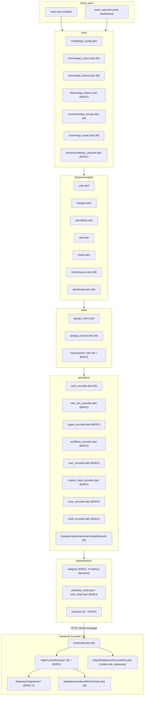
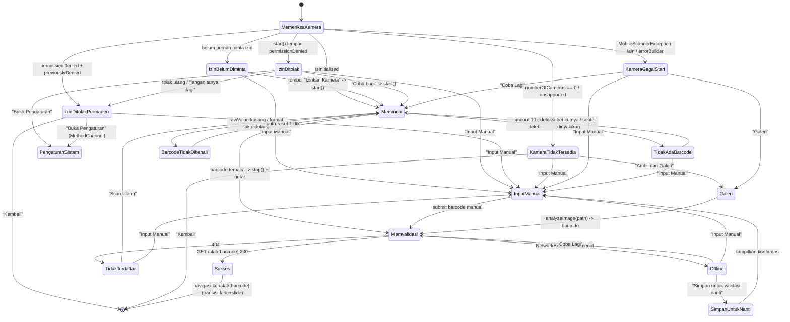
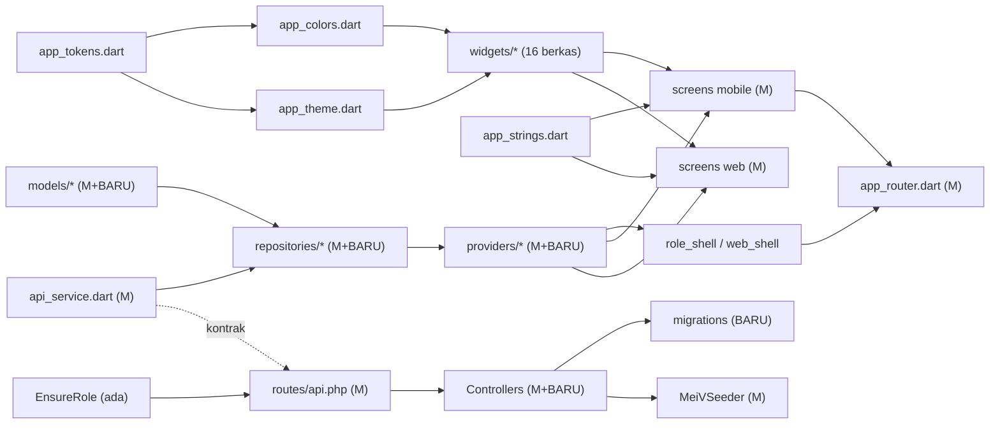
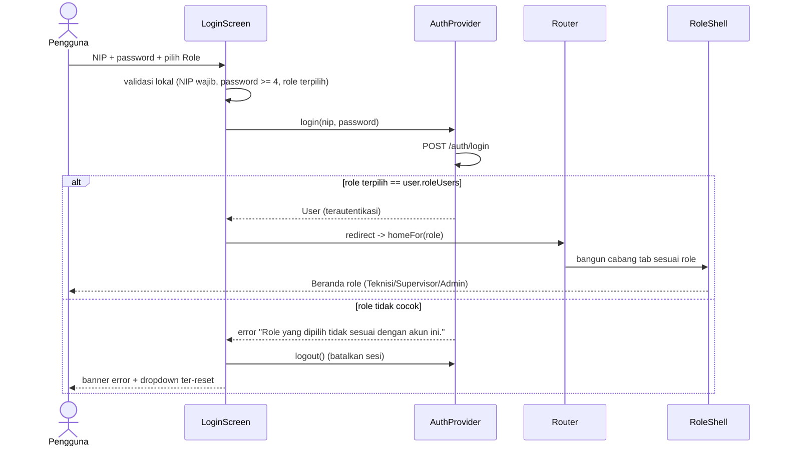
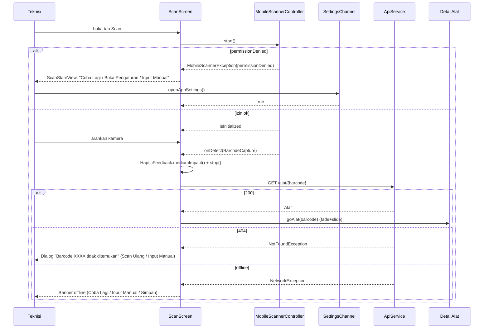
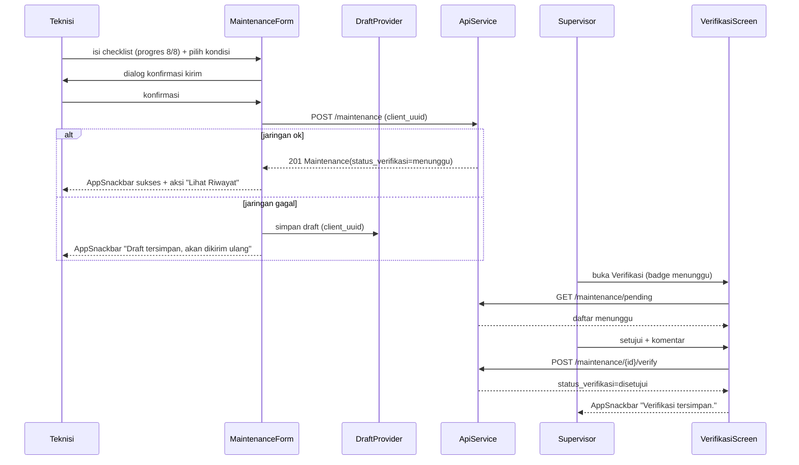

# DESAIN ARSITEKTUR — Mei-V2: Redesign UI Berbasis Role + Interaktivitas

> Versi: v1.0 ｜ Penulis: 高见远 (Gao) — Architect ｜ Status: Siap implementasi
> Sumber kebutuhan: `docs/PRD-ROLE-UI-V2.md` (AC-01 … AC-53) + `docs/TEAM-STANDARDS.md`
> Ruang lingkup: Flutter app (`app/`) + web dashboard + Laravel API (`backend/`)
> Bahasa dokumen: Indonesia ｜ Tanpa emoji ｜ **Tanpa dependensi pub baru**

---

## 0. Ringkasan Keputusan

| # | Keputusan | Alasan |
|---|---|---|
| D1 | Peran ditentukan dari `User.roleUsers` (sudah ada `isAdmin`/`isSupervisor`/`isTeknisi`); dropdown role di login hanya disambiguasi UX, backend tetap sumber kebenaran | AC-05, asumsi PRD §2.1 |
| D2 | Satu `RoleShell` berbasis `StatefulShellRoute.indexedStack` (go_router 14.2.0) membangun cabang tab **dinamis menurut role**; tiga layar beranda terpisah di baliknya | AC-09, G1 |
| D3 | Guard per-role dipasang sebagai fungsi `redirect` kedua di `app_router.dart` memakai tabel akses statis `RouteAccess`; pelanggaran → rute `/403` | AC-10, AC-11 |
| D4 | Semua state kamera ditangani di klien; **tidak ada** widget error bawaan `MobileScanner` yang ditampilkan; izin/settings/galeri lewat `MethodChannel` milik sendiri (bukan dependensi baru) | AC-17…AC-28, batasan "tanpa dependensi baru" |
| D5 | Verifikasi maintenance = kolom baru pada tabel `maintenance` (bukan tabel terpisah) + endpoint `pending`/`verify` di balik middleware `role:Supervisor,Admin` | S2, AC-16 |
| D6 | "Tugas Hari Ini" dan papan overdue **dihitung di server** dari `maintenance` + `kategori.maintenance_cycle_days`; tanpa tabel baru | T2, S3 |
| D7 | Ekspor laporan = CSV yang dibangkitkan PHP (tanpa pustaka), `Content-Type: text/csv` di dalam envelope tidak dipakai — endpoint khusus mengembalikan berkas | AC-50, larangan dependensi baru |
| D8 | Gerbang mutu otomatis = `scripts/verify-all.ps1` + `php artisan test`. `flutter analyze` / `flutter test` **hanya** dapat dijalankan pengguna di terminalnya; desain tidak boleh bergantung padanya | batasan sandbox |

---

## 1. Ringkasan Arsitektur

### 1.1 Lapisan setelah perubahan

Struktur folder dipertahankan (core / domain / data / providers / presentation). Yang bertambah hanya sub-folder dan berkas di dalamnya; tidak ada perpindahan lapisan.



### 1.2 Aliran data (tetap)

`Screen (ConsumerWidget)` → `Provider (Riverpod)` → `Repository` → `ApiService` → `ApiClient (Dio)` → `Laravel` → envelope `{code, data, message}` → `_unwrap/_unwrapList` → model `fromJson` manual → `AsyncValue` → UI (`when(data/loading/error)`).

Perubahan penting: setiap `when(error:)` **wajib** memakai widget bersama `ErrorView` (tombol `Coba Lagi`), dan setiap `when(loading:)` **wajib** memakai `Skeleton*` — bukan `CircularProgressIndicator` polos (I3, I7, AC-13, AC-41, AC-47).

### 1.3 Matriks pemetaan AC → komponen desain

| AC | Dijamin oleh |
|---|---|
| AC-01…AC-08 | `login_screen.dart` (M) + `AppSizes.logoLogin/logoTelproLogin` + `AppSnackbar` + `AppTextField` (toggle mata) |
| AC-09…AC-16 | `RoleShell` + `teknisi/supervisor/admin_home_screen.dart` + `RouteAccess` guard + `SkeletonCard` + `EmptyState` + `RoleBadge` |
| AC-17…AC-28 | `scan_screen.dart` + `scan/scan_state_view.dart` + `scan/scan_control_bar.dart` + `scan/scan_overlay.dart` + `SettingsChannel` |
| AC-29…AC-32 | `detail_alat_screen.dart` (M) + `StatusBadge` + `SkeletonCard` |
| AC-33…AC-37 | `maintenance_form_screen.dart` (M) + `draft_provider.dart` + `AppSnackbar` |
| AC-38…AC-41 | `riwayat_screen.dart` (M) + `FilterChipBar` + `EmptyState` + `SkeletonListTile` |
| AC-42…AC-44 | `profile_screen.dart` (M) + `RoleBadge` + endpoint `POST /auth/change-password` |
| AC-45…AC-50 | `web_shell.dart` + dashboard 3 layar (M) + `KpiCard` + `responsive.dart` + `GET /dashboard/export` |
| AC-51…AC-53 | Semua warna/tipe dari `AppColors`/`AppTheme`/`AppTokens`; target sentuh `AppSizes.touchTarget` |

---

## 2. Token Desain

Semua nilai di bawah **mempertahankan palet brand** `#CB2400` / hitam / putih / border `#AFAFAF` dan radius pil 50dp. Penambahan diberi alasan eksplisit.

### 2.1 `core/theme/app_colors.dart` (diperluas)

```dart
// ---- SUDAH ADA (jangan diubah) ----
primary      = 0xFFCB2400   primaryDark  = 0xFF9E1C00   primarySoft = 0xFFF3D3CB
black        = 0xFF000000   textPrimary  = 0xFF1A1A1A   textSecondary = 0xFF6B6B6B
background   = 0xFFFFFFFF   surface      = 0xFFFFFFFF   fieldDark = 0xFF2B2B2B
tableBorder  = 0xFFAFAFAF   tableHeader  = primary      divider = 0xFFE0E0E0
statusOk     = 0xFF2E7D32   statusWarning= 0xFFEF6C00   statusDanger = primary
statusUnknown= 0xFF9E9E9E

// ---- BARU: warna per peran ----
roleAdmin            = 0xFF3730A3   // indigo — netral, tidak menyaingi brand merah
roleSupervisor       = 0xFF0E7490   // teal gelap — "pengawas", beda jelas dari merah
roleTeknisi          = 0xFFCB2400   // = primary; teknisi = pengguna utama, memakai brand
roleAdminSoft        = 0xFFE8E7FB   // latar chip Admin (alpha ~0.12 dari roleAdmin)
roleSupervisorSoft   = 0xFFE0F2F6   // latar chip Supervisor
roleTeknisiSoft      = 0xFFF3D3CB   // = primarySoft, latar chip Teknisi

// ---- BARU: kondisi maintenance (menggantikan hardcode Colors.green/orange/red) ----
kondisiBaik          = 0xFF2E7D32   // = statusOk
kondisiKurangBaik    = 0xFFEF6C00   // = statusWarning
kondisiRusak         = 0xFFCB2400   // = statusDanger
kondisiBaikSoft      = 0xFFE8F5E9
kondisiKurangBaikSoft= 0xFFFFF3E0
kondisiRusakSoft     = 0xFFFBE9E7

// ---- BARU: status verifikasi (S2) ----
verifikasiMenunggu      = 0xFFEF6C00
verifikasiDisetujui     = 0xFF2E7D32
verifikasiDitolak       = 0xFFCB2400
verifikasiMenungguSoft  = 0xFFFFF3E0
verifikasiDisetujuiSoft = 0xFFE8F5E9
verifikasiDitolakSoft   = 0xFFFBE9E7

// ---- BARU: overdue / tepat waktu ----
overdue          = 0xFFCB2400   overdueSoft     = 0xFFFDECEA
tepatWaktu       = 0xFF2E7D32   tepatWaktuSoft  = 0xFFE8F5E9

// ---- BARU: netral & permukaan ----
surfaceAlt      = 0xFFF5F6FA   // latar dashboard web (saat ini hardcode di 3 layar)
surfaceMuted    = 0xFFF4F4F4   // = fillColor input pada app_theme
borderSubtle    = 0xFFEEEEEE
overlayScrim    = 0x8A000000   // 54% hitam — overlay dim saat barcode terdeteksi
shadowColor     = 0x14000000   // 8% hitam

// ---- BARU: stop gradien ----
gradientBrandStart = 0xFFCB2400
gradientBrandEnd   = 0xFF9E1C00   // = primaryDark
```

Alasan: AC-51 melarang hardcode warna di luar `AppColors`. Nilai `Colors.green/orange/red` serta `Color(0xFFF5F6FA)` yang kini tersebar di `detail_alat_screen`, `maintenance_form_screen`, `dashboard_*` dipindahkan ke konstanta di atas. Warna peran dipilih dari keluarga warna yang **tidak** bersaing dengan merah brand agar chip role tetap terbaca (kontras AA) namun brand tetap dominan.

### 2.2 `core/theme/app_tokens.dart` (BARU)

Dipisah dari `app_colors.dart`/`app_theme.dart` supaya token non-warna tidak mencampuri definisi tema.

```dart
class AppSpacing {   // skala 4dp — AC-52 (semua jarak kelipatan 4)
  xxs = 2; xs = 4; sm = 8; md = 12; lg = 16; xl = 24; xxl = 32; xxxl = 48;
}
class AppRadius {
  xs = 8;  sm = 10;  md = 12;  lg = 16;  xl = 20;  xxl = 24;  pill = 50;
}
class AppDurations {
  instant = 100ms; fast = 150ms; normal = 250ms; slow = 400ms;   // I1: 200-300ms
  scanLine = 1800ms;   // loop garis scan, halus
  splash   = 600ms;
}
class AppCurves {
  standard    = Curves.easeOutCubic;
  emphasized  = Curves.easeInOutCubic;
  decelerate  = Curves.fastOutSlowIn;
  scanLine    = Curves.linear;   // wajib linear agar loop tidak "menabrak"
}
class AppSizes {
  logoLogin = 60;        // AC-01 (toleransi ±2px)
  logoTelproLogin = 32;  // AC-02
  logoTelproFooter = 24; // AC-46 (header web)
  logoAppBar = 32;
  avatarRadius = 36;  avatarRadiusLg = 48;
  iconSm = 18; iconMd = 22; iconLg = 28; iconXl = 48;
  touchTarget = 48;      // AC-52 (minimum semua InkWell/IconButton)
  scanBoxWidth = 280; scanBoxHeight = 180; scanCorner = 24;
  appBarHeight = 56; bottomNavHeight = 64;
  breakpointSm = 768; breakpointLg = 1200;   // AC-49
}
class AppShadows {
  card   = [BoxShadow(color: shadowColor, blurRadius: 8,  offset: Offset(0,2))];
  raised = [BoxShadow(color: shadowColor, blurRadius: 16, offset: Offset(0,6))];
}
```

### 2.3 `core/theme/app_theme.dart` (diperluas)

```dart
class AppGradients {
  static const LinearGradient brand = LinearGradient(
    begin: Alignment.topLeft, end: Alignment.bottomRight,
    colors: [AppColors.gradientBrandStart, AppColors.gradientBrandEnd]);
  static const LinearGradient surface = LinearGradient(   // header kartu KPI
    begin: Alignment.topCenter, end: Alignment.bottomCenter,
    colors: [AppColors.surface, AppColors.surfaceAlt]);
}
```

Skala tipografi lengkap (`TextTheme`) — memperluas yang sudah ada:

| Style | Size | Weight | LetterSpacing | Dipakai |
|---|---|---|---|---|
| `displaySmall` | 28 | w700 | 0 | angka KPI besar (mobile) |
| `headlineSmall` | 22 | w700 | 0 | judul beranda / header hero |
| `titleLarge` | 20 | w700 | 0 | judul layar (sudah ada) |
| `titleMedium` | 16 | w600 | 0 | header seksi (sudah ada) |
| `titleSmall` | 14 | w600 | 0 | judul kartu |
| `bodyLarge` | 16 | w400 | 0 | isi utama |
| `bodyMedium` | 14 | w400 | 0 | isi (sudah ada) |
| `bodySmall` | 12 | w400 | 0 | keterangan (sudah ada) |
| `labelLarge` | 14 | w600 | 0.4 | label tombol |
| `labelMedium` | 12 | w600 | 0.6 | label chip/badge |
| `labelSmall` | 11 | w700 | 0.8 | label mikro (sudah ada) |

Perubahan tema komponen (selain yang sudah ada):
- `bottomNavigationBarTheme`: tinggi `AppSizes.bottomNavHeight`, `backgroundColor: AppColors.surface`, `indicatorColor: AppColors.primarySoft`, ikon terpilih `AppColors.primary`, label terpilih w700. (dipakai `RoleShell`)
- `navigationRailTheme` + `navigationDrawerTheme`: untuk `WebShell` (sidebar putih, item aktif latar `primarySoft`, teks `primary`).
- `dialogTheme`: `shape` `AppRadius.lg`, `titleTextStyle: titleMedium`. (dialog konfirmasi, I9)
- `chipTheme`: latar `surfaceMuted`, terpilih `primarySoft` + teks `primary`, `side: none`, radius `pill`.
- `progressIndicatorTheme`: `color: primary`, `linearTrackColor: primarySoft`. (progres form AC-33)
- `snackBarTheme`: tambah `shape` radius `AppRadius.md`, `margin` `AppSpacing.lg` (dipakai `AppSnackbar`).
- `tooltipTheme` + `pageTransitionsTheme`: `PageTransitionsTheme` dengan `CupertinoPageTransitionsBuilder` untuk Android/iOS agar transisi geser konsisten 250 ms (I1).

---

## 3. Inventaris Widget Bersama

Semua berkas di `app/lib/presentation/widgets/` (kecuali `scan/` di sub-folder). Kolom "Pemakai" membuktikan komponen benar-benar dipakai.

| # | Berkas | Kelas | Properti utama | Kapan dipakai | Pemakai (layar) |
|---|---|---|---|---|---|
| W1 | `app_card.dart` | `AppCard` | `child`, `onTap`, `padding`, `elevation`, `borderColor`, `gradient`, `radius` | Kartu permukaan standar (radius 12, border `divider`, elevasi 0/1) | beranda 3 role, detail alat, riwayat, verifikasi, dashboard web |
| W2 | `stat_tile.dart` | `StatTile` | `label`, `value`, `icon`, `color`, `onTap`, `loading`, `trend` | Tile statistik mikro (jumlah tugas, overdue milik sendiri, teknisi aktif) | `teknisi_home_screen`, `supervisor_home_screen`, `admin_home_screen` |
| W3 | `section_header.dart` | `SectionHeader` | `title`, `subtitle`, `actionLabel`, `onAction`, `icon` | Judul seksi + aksi kanan ("Lihat semua", "Muat lebih banyak") | beranda, riwayat, dashboard web, verifikasi |
| W4 | `empty_state.dart` | `EmptyState` | `icon`, `illustration`, `title`, `message`, `actionLabel`, `onAction` | I6/AC-15/AC-39 — ikon + penjelasan + tombol, bukan teks polos | beranda, riwayat, verifikasi, records, dashboard |
| W5 | `skeleton.dart` | `SkeletonBox`, `SkeletonLine`, `SkeletonCard`, `SkeletonListTile` | `width`, `height`, `radius`, `lines` | I3/AC-13/AC-41/AC-47 — shimmer via `AnimationController` + `TweenAnimationBuilder` (tanpa paket) | semua daftar/kartu beranda, riwayat, detail, dashboard web |
| W6 | `role_badge.dart` | `RoleBadge` | `role`, `size`, `showIcon`, `outlined` | Chip peran berwarna (AC-43) | login (preview), beranda header, profil, sidebar web |
| W7 | `status_badge.dart` | `StatusBadge` | `label`, `color`, `softColor`, `icon`, `dense` | Badge status overdue/tepat waktu (AC-29) & kondisi/verifikasi | detail alat, riwayat, records, verifikasi |
| W8 | `press_button.dart` | `PressButton` | `label`, `onPressed`, `variant`, `icon`, `isLoading`, `expand` | Tombol dengan animasi skala tekan (`AnimatedScale` 0.97 / 120 ms) + haptic ringan (I2, I8) | login, detail alat, form, verifikasi, dialog |
| W9 | `app_snackbar.dart` | `AppSnackbar` | `show(context, message, type, actionLabel, onAction, duration)` | I5 — snackbar terpadu (sukses/gagal/info) ber-ikon + aksi lanjutan | form (AC-36), login, verifikasi, CRUD admin, scan |
| W10 | `filter_chip_bar.dart` | `FilterChipBar`, `FilterPanel` | `items`, `selected`, `onChanged`, `multi`, `labelBuilder` | I/AC-38 — chip filter (kategori, lokasi, tanggal, teknisi) | riwayat, records web, verifikasi |
| W11 | `kpi_card.dart` | `KpiCard` | `label`, `value`, `icon`, `color`, `delta`, `loading`, `onTap`, `animate` | Kartu KPI dashboard web (skeleton saat memuat, animasi angka saat berubah) | `dashboard_overview_screen`, `supervisor_home_screen`, `admin_home_screen` |
| W12 | `error_view.dart` | `ErrorView` | `message`, `onRetry`, `compact` | I7/AC-47 — selalu ada `Coba Lagi` | semua layar ber-`AsyncValue` |
| W13 | `scan/scan_overlay.dart` | `ScanOverlay` | `boxWidth`, `boxHeight`, `cornerColor`, `dimmed`, `lineProgress` | Kotak scan + 4 sudut + garis animasi horizontal (AC-27) | `scan_screen` |
| W14 | `scan/scan_control_bar.dart` | `ScanControlBar` | `torchOn`, `onToggleTorch`, `showCameraSwitch`, `onSwitchCamera`, `zoom`, `onZoomChanged`, `onManual`, `onGallery` | Bar kontrol kamera: senter, ganti kamera (disembunyikan bila 1 kamera), slider zoom 1x-4x, tombol Input Manual + Galeri | `scan_screen` |
| W15 | `scan/scan_state_view.dart` | `ScanStateView` | `state` (`ScanUiState`), `title`, `message`, `icon`, `primaryAction`, `secondaryActions` | Panel penuh untuk SC-1…SC-5, SC-8 (izin/ketersediaan/gagal/offline) — selalu ada minimal satu tombol | `scan_screen` |
| W16 | `responsive.dart` | `ResponsiveLayout`, `Breakpoint` | `narrow`, `medium`, `wide` builder | AC-49 — tata letak web >=1200 / 768-1199 / <768 | `web_shell`, dashboard 3 layar |

Catatan: `AppButton`, `AppTextField`, `AppScaffold` (sudah ada) dipertahankan; `AppButton` **dibungkus** `PressButton` untuk animasi tekan, `AppScaffold` tetap dipakai layar mobile.

---

## 4. Peta Navigasi per Role

### 4.1 Shell bersama

`RoleShell` (`presentation/shell/role_shell.dart`) memakai `StatefulShellRoute.indexedStack`. Cabang (`StatefulShellBranch`) dibangun **dinamis** dari `user.roleUsers`. Router di-`ref.watch(authProvider)` sehingga perpindahan akun membangun ulang cabang.

| Role | Tab 1 (default) | Tab 2 | Tab 3 | Tab 4 | FAB |
|---|---|---|---|---|---|
| Teknisi | `Tugas Hari Ini` → `/tugas` | `Scan` → `/scan` | `Riwayat` → `/riwayat` | `Profil` → `/profil` | FAB `SCAN` besar di tengah (centerFloat) |
| Supervisor | `Dashboard` → `/dashboard` | `Verifikasi` → `/verifikasi` (badge jumlah menunggu) | `Riwayat` → `/riwayat` | `Profil` → `/profil` | tidak ada |
| Admin | `Dashboard` → `/dashboard` | `Data` → `/data` | `Riwayat` → `/riwayat` | `Profil` → `/profil` | tidak ada |

### 4.2 Tabel akses rute (sumber `RouteAccess` di `app_router.dart`)

| Rute | Teknisi | Supervisor | Admin | Catatan |
|---|---|---|---|---|
| `/login` | ya (unauth) | ya (unauth) | ya (unauth) | redirect ke beranda bila sudah login |
| `/403` | ya | ya | ya | halaman "akses ditolak" + tombol `Kembali ke Beranda` |
| `/tugas` | ya | tidak | tidak | beranda Teknisi |
| `/scan` | ya | tidak | tidak | hanya Teknisi yang memulai scan dari tab; Admin tetap boleh scan via `/alat/:barcode` manual |
| `/riwayat` | ya (hanya milik sendiri) | ya (semua) | ya (semua) | filter `username` dipaksa = user sendiri bila Teknisi |
| `/profil` | ya | ya | ya | |
| `/alat/:barcode` | ya | tidak | ya | Supervisor "lihat saja" lewat Riwayat, bukan detail aksi |
| `/maintenance/form` | ya | tidak | ya | |
| `/dashboard` | **tidak** | ya | ya | AC-10 |
| `/dashboard/analytics` | **tidak** | ya | ya | |
| `/dashboard/records` | **tidak** | ya | ya | |
| `/verifikasi` | **tidak** | ya | ya | AC-11 untuk `/data/*` |
| `/data` | **tidak** | **tidak** | ya | hub master data + user |
| `/data/users` | **tidak** | **tidak** | ya | AC-11 |
| `/data/master` | **tidak** | **tidak** | ya | kategori/lokasi/spesifikasi/siklus |
| `/data/alat` | **tidak** | **tidak** | ya | |

### 4.3 Perilaku guard `app_router.dart`

```dart
redirect: (context, state) {
  final user = auth.user;
  final loc  = state.matchedLocation;
  final onLogin = loc == Routes.login;

  // 1) Belum login -> ke /login (kecuali sudah di /login)
  if (user == null) return onLogin ? null : Routes.login;
  // 2) Sudah login tapi di /login -> beranda role
  if (onLogin) return RouteAccess.homeFor(user.roleUsers);

  // 3) Guard per-role: rute terlarang -> /403 (BUKAN diam-diam ke beranda,
  //    supaya pengguna tahu kenapa; /403 punya tombol kembali)
  final allowed = RouteAccess.allowedRolesFor(loc);
  if (allowed != null && !allowed.contains(user.roleUsers)) {
    return Routes.forbidden;
  }
  return null;
}
```

Aturan `RouteAccess`:
- Pencocokan **prefiks terpanjang** (`/data/users` menang atas `/data`).
- `allowedRolesFor` mengembalikan `null` = bebas untuk semua pengguna terautentikasi.
- 403 dari server (mis. token role berubah di backend) ditangkap `ApiException` `ForbiddenException` di klien → `AppSnackbar(type: gagal)` + `context.go(Routes.forbidden)`.

### 4.4 `web_shell.dart` (dashboard web)

Sidebar (NavigationRail/Drawer responsif) dengan item sesuai role:

| Item sidebar | Teknisi | Supervisor | Admin |
|---|---|---|---|
| Overview `/dashboard` | tidak | ya | ya |
| Analytics `/dashboard/analytics` | tidak | ya | ya |
| Records `/dashboard/records` | tidak | ya | ya |
| Users `/data/users` | tidak | tidak | ya |
| Master Data `/data/master` | tidak | tidak | ya |
| Alat `/data/alat` | tidak | tidak | ya |
| Keluar | — | ya | ya |

Header: logo Mei-V (`logohitam.png`, tinggi 28) + pemisah + logo Telkom Property (tinggi 24) + `RoleBadge`. `main_web.dart` memakai `WebShell` bila role tidak diizinkan masuk dashboard → tampilkan `EmptyState` "Dashboard tidak tersedia untuk peran Anda".

---

## 5. Matriks Fitur per Role vs Endpoint

Legenda: **ADA** = endpoint sudah ada (15 endpoint saat ini) ｜ **BARU** = endpoint harus dibuat (`eng-api`, task #6) ｜ **LUAS** = endpoint ada tetapi perlu parameter/kolom tambahan.

### 5.1 Teknisi

| Fitur | Endpoint | Status |
|---|---|---|
| T1 Scan barcode + senter/zoom/galeri/input manual | klien saja; validasi `GET /alat/{barcode}` | ADA |
| T2 Tugas Hari Ini (overdue/terjadwal milik teknisi) | `GET /tugas-hari-ini` | **BARU** |
| T3 Form dinamis per kategori | `GET /kategori/{id}/spesifikasi` + `GET /alat/{barcode}` | ADA |
| T4 Draft offline + kirim ulang | `POST /maintenance` (idempoten `client_uuid`) | ADA |
| T5 Riwayat saya (filter tanggal/alat) | `GET /maintenance?username=<diri>&barcode_alat=&dari=&sampai=` | LUAS (paksa `username`) |
| T6 Detail alat | `GET /alat/{barcode}` | ADA |
| T7 Input manual barcode | `GET /alat/{barcode}` | ADA |
| T8 Profil + ganti password | `GET /auth/me` + `POST /auth/change-password` | **BARU** (ganti password) |

### 5.2 Supervisor

| Fitur | Endpoint | Status |
|---|---|---|
| S1 Dashboard KPI | `GET /dashboard/kpi` | ADA |
| S2 Verifikasi maintenance | `GET /maintenance/pending`, `GET /maintenance/pending/count`, `POST /maintenance/{id}/verify` | **BARU** |
| S3 Papan overdue + tandai ditugaskan | `GET /dashboard/overdue` + `POST /alat/{barcode}/assign` | ADA + **BARU** |
| S4 Riwayat seluruh teknisi + filter | `GET /maintenance?username=&id_kategori=&dari=&sampai=` | LUAS (`username` sudah ada di controller) |
| S5 Analitik tren + distribusi + pemilih periode | `GET /dashboard/trends?days=7|30|90` + `GET /dashboard/distribution` | ADA |
| S6 Ekspor laporan periode (CSV) | `GET /dashboard/export?format=csv&dari=&sampai=` | **BARU** |
| S7 Sorotan parameter abnormal | `GET /dashboard/parameter-abnormal` | **BARU** |
| S8 Profil | `GET /auth/me` + `POST /auth/change-password` | ADA + **BARU** |

### 5.3 Admin

| Fitur | Endpoint | Status |
|---|---|---|
| A1 Manajemen user CRUD + assign role + reset password | `GET/POST /users`, `PUT/DELETE /users/{username}`, `POST /users/{username}/reset-password` | **BARU** |
| A2 Master data kategori/lokasi/spesifikasi | `POST/PUT/DELETE /kategori`, `/lokasi`, `/spesifikasi` | **BARU** |
| A3 Manajemen alat CRUD + barcode | `POST/PUT/DELETE /alat` | **BARU** |
| A4 Konfigurasi siklus per kategori | `PUT /kategori/{id}/cycle` | **BARU** |
| A5 Dashboard penuh | `GET /dashboard/kpi|trends|distribution|overdue` | ADA |
| A6 Riwayat + log audit | `GET /audit-log` | **BARU** |
| A7 Ekspor laporan | `GET /dashboard/export?format=csv` | **BARU** |
| A8 Profil | `GET /auth/me` + `POST /auth/change-password` | ADA + **BARU** |

---

## 6. Rancangan Perubahan Backend

### 6.1 Migrasi baru

**M1. `2024_01_02_000000_add_verification_to_maintenance_table.php`**

| Kolom | Tipe | Null | Default | Indeks |
|---|---|---|---|---|
| `status_verifikasi` | `enum('menunggu','disetujui','ditolak')` | tidak | `'menunggu'` | `index` (untuk filter pending) |
| `diverifikasi_oleh` | `string(50)` | ya | null | FK → `users.username` `nullOnDelete` |
| `waktu_verifikasi` | `dateTime` | ya | null | — |
| `komentar_verifikasi` | `text` | ya | null | — |

`down()`: drop FK + drop kolom. Baris lama otomatis `'menunggu'` (aman untuk 19 uji backend yang sudah ada).

**M2. `2024_01_02_000001_create_audit_log_table.php`**

| Kolom | Tipe | Null | Indeks |
|---|---|---|---|
| `id_audit` | `bigIncrements` PK | tidak | PK |
| `actor_username` | `string(50)` | tidak | `index` |
| `aksi` | `string(50)` (create/update/delete/verify/assign/login) | tidak | — |
| `entitas` | `string(50)` (users/alat/kategori/lokasi/spesifikasi/maintenance) | tidak | — |
| `entitas_id` | `string(100)` | tidak | `index(entitas, entitas_id)` komposit |
| `detail` | `text` | ya | — |
| `ip_address` | `string(45)` | ya | — |
| `created_at` | `timestamp` | tidak | `index` |

**M3. `2024_01_02_000002_add_penanggung_jawab_to_alat_table.php`**

| Kolom | Tipe | Null | Indeks |
|---|---|---|---|
| `penanggung_jawab` | `string(50)` | ya | `index`; FK → `users.username` `nullOnDelete` |
| `ditugaskan_pada` | `dateTime` | ya | — |

### 6.2 Controller: baru / berubah

| Berkas | Status | Method | Ringkas |
|---|---|---|---|
| `Api/AuthController.php` | M | `changePassword(Request)` | verifikasi `password_lama`, simpan `password` baru (min 4), hapus token lain |
| `Api/MaintenanceController.php` | M | `pending(Request)`, `pendingCount()`, `verify(Request,$id)`, `overdue(Request)` | daftar/verifikasi + papan overdue |
| `Api/AlatController.php` | M | `store`, `update`, `destroy`, `assign(Request,$barcode)`, `index` (tambah filter `overdue`, `penanggung_jawab`) | CRUD alat + tindak lanjut |
| `Api/KategoriController.php` | M | `store`, `update`, `destroy`, `updateCycle(Request,$id)` | master data + siklus |
| `Api/LokasiController.php` | M | `store`, `update`, `destroy` | master data |
| `Api/SpesifikasiController.php` | **BARU** | `index(Request)`, `store`, `update`, `destroy`, `reorder(Request)` | checklist per kategori |
| `Api/UserController.php` | **BARU** | `index`, `store`, `update`, `destroy`, `resetPassword(Request,$username)` | manajemen user Admin |
| `Api/TugasController.php` | **BARU** | `today(Request)` | Tugas Hari Ini (Teknisi) |
| `Api/DashboardController.php` | M | `export(Request)`, `parameterAbnormal(Request)` | CSV + sorotan abnormal |
| `Api/AuditLogController.php` | **BARU** | `index(Request)` | log audit Admin |
| `Support/AuditLogger.php` | **BARU** | `log(string $aksi, string $entitas, string $id, array $detail = [])` | helper tulis `audit_log` (dipanggil controller CRUD) |

Aturan validasi (contoh kunci):
- `users.store`: `username` required|string|max:50|unique:users,username ｜ `nama_users` required|max:100 ｜ `role_users` required|in:Admin,Supervisor,Teknisi ｜ `email_users` nullable|email ｜ `password` required|min:4.
- `users.reset-password`: `password` required|min:4 (default acak bila kosong → dikembalikan pada respons).
- `maintenance.verify`: `status` required|in:disetujui,ditolak ｜ `komentar` nullable|string|max:500 ｜ `status=disetujui|ditolak` wajib bukan `menunggu`.
- `alat.store/update`: `barcode_alat` required|max:100|unique ｜ `merk_alat` required|max:100 ｜ `id_kategori` required|exists ｜ `id_lokasi` nullable|exists.
- `kategori.updateCycle`: `maintenance_cycle_days` required|integer|min:1|max:3650.
- Semua aksi destruktif (DELETE) menulis `AuditLogger::log('delete', ...)`.
- **Pencegahan self-delete**: Admin tidak boleh `DELETE /users/{username}` untuk username dirinya sendiri (guard 422).

### 6.3 Pemetaan rute + middleware role

```php
Route::prefix('v1')->group(function () {
    Route::post('/auth/login', [AuthController::class, 'login']);

    Route::middleware('auth:sanctum')->group(function () {
        Route::post('/auth/logout', [AuthController::class, 'logout']);
        Route::get('/auth/me', [AuthController::class, 'me']);
        Route::post('/auth/change-password', [AuthController::class, 'changePassword']);   // BARU (semua role)

        Route::get('/kategori', [KategoriController::class, 'index']);
        Route::get('/kategori/{id}/spesifikasi', [KategoriController::class, 'spesifikasi']);
        Route::get('/lokasi', [LokasiController::class, 'index']);

        Route::get('/alat', [AlatController::class, 'index']);            // +filter overdue/penanggung_jawab
        Route::get('/alat/{barcode}', [AlatController::class, 'show']);

        Route::get('/maintenance', [MaintenanceController::class, 'index']);   // Teknisi dipaksa username sendiri
        Route::post('/maintenance', [MaintenanceController::class, 'store']);  // role:Admin,Teknisi
        Route::get('/maintenance/{id}', [MaintenanceController::class, 'show']);

        Route::get('/dashboard/kpi|trends|distribution|overdue', ...);         // role:Admin,Supervisor

        // --- Teknisi ---
        Route::get('/tugas-hari-ini', [TugasController::class, 'today'])
            ->middleware('role:Teknisi');

        // --- Supervisor + Admin ---
        Route::middleware('role:Supervisor,Admin')->group(function () {
            Route::get('/maintenance/pending', [MaintenanceController::class, 'pending']);
            Route::get('/maintenance/pending/count', [MaintenanceController::class, 'pendingCount']);
            Route::post('/maintenance/{id}/verify', [MaintenanceController::class, 'verify']);
            Route::get('/maintenance/overdue', [MaintenanceController::class, 'overdue']);
            Route::post('/alat/{barcode}/assign', [AlatController::class, 'assign']);
            Route::get('/dashboard/export', [DashboardController::class, 'export']);
            Route::get('/dashboard/parameter-abnormal', [DashboardController::class, 'parameterAbnormal']);
        });

        // --- Admin ---
        Route::middleware('role:Admin')->group(function () {
            Route::get('/users', [UserController::class, 'index']);
            Route::post('/users', [UserController::class, 'store']);
            Route::put('/users/{username}', [UserController::class, 'update']);
            Route::delete('/users/{username}', [UserController::class, 'destroy']);
            Route::post('/users/{username}/reset-password', [UserController::class, 'resetPassword']);

            Route::post('/kategori', [KategoriController::class, 'store']);
            Route::put('/kategori/{id}', [KategoriController::class, 'update']);
            Route::delete('/kategori/{id}', [KategoriController::class, 'destroy']);
            Route::put('/kategori/{id}/cycle', [KategoriController::class, 'updateCycle']);

            Route::post('/lokasi', [LokasiController::class, 'store']);
            Route::put('/lokasi/{id}', [LokasiController::class, 'update']);
            Route::delete('/lokasi/{id}', [LokasiController::class, 'destroy']);

            Route::get('/spesifikasi', [SpesifikasiController::class, 'index']);
            Route::post('/spesifikasi', [SpesifikasiController::class, 'store']);
            Route::put('/spesifikasi/{id}', [SpesifikasiController::class, 'update']);
            Route::delete('/spesifikasi/{id}', [SpesifikasiController::class, 'destroy']);
            Route::put('/spesifikasi/reorder', [SpesifikasiController::class, 'reorder']);

            Route::post('/alat', [AlatController::class, 'store']);
            Route::put('/alat/{barcode}', [AlatController::class, 'update']);
            Route::delete('/alat/{barcode}', [AlatController::class, 'destroy']);

            Route::get('/audit-log', [AuditLogController::class, 'index']);
        });
    });
});
```

Catatan middleware: alias `role` sudah terdaftar di `bootstrap/app.php`. Handler `EnsureRole` sudah mengembalikan envelope 403 `{code:403,...}` sehingga **tidak perlu** ubah `bootstrap/app.php`.

### 6.4 Perubahan seeder

`MeiVSeeder.php` (M):
- `seedUsers`: tambah 2 teknisi lagi (mis. `67891` "Teknisi B", `67892` "Teknisi C") supaya papan verifikasi & riwayat supervisor punya variasi; tetap `updateOrCreate`.
- `seedMaintenance`: isi `status_verifikasi` deterministik (mis. indeks `%3`: sebagian `menunggu`, `disetujui`, `ditolak`) + `diverifikasi_oleh = '11111'` untuk yang disetujui/ditolak, agar badge "menunggu verifikasi" dan layar Verifikasi langsung berisi data.
- Tetap idempoten (`updateOrCreate` / `client_uuid` tetap).

### 6.5 Bentuk JSON respons endpoint baru

Semua memakai envelope `{code, data, message}`; 422 menambah `errors`.

`GET /v1/tugas-hari-ini` (Teknisi) — 200
```json
{ "code": 200, "message": "OK", "data": {
  "ringkasan": { "total": 12, "overdue": 4, "jatuh_tempo_hari_ini": 3 },
  "daftar": [
    { "barcode_alat": "AC-001", "merk_alat": "Daikin 2PK", "nama_kategori": "AC",
      "nama_lokasi": "Ruang Server", "lantai": 2, "terlambat_hari": 6,
      "status": "overdue", "terakhir_maintenance": "2026-06-10 08:12:00" }
  ] } }
```

`GET /v1/maintenance/pending?page=&per_page=` (Supervisor/Admin) — 200
```json
{ "code": 200, "message": "OK", "data": {
  "data": [ { "id_maintenance": 88, "waktu_maintenance": "2026-07-15 09:20:00",
    "barcode_alat": "APAR-004", "nama_users": "Teknisi A", "nama_kategori": "APAR",
    "nama_lokasi": "Aula Besar", "kondisi_keseluruhan": "kurang_baik",
    "status_verifikasi": "menunggu", "detail": [ { "nama_spesifikasi": "Tekanan", "status": "Kurang", "satuan": "Bar" } ] } ],
  "current_page": 1, "last_page": 3, "per_page": 20, "total": 47 } }
```

`GET /v1/maintenance/pending/count` — 200
```json
{ "code": 200, "message": "OK", "data": { "menunggu": 47 } }
```

`POST /v1/maintenance/{id}/verify` — body `{"status":"disetujui","komentar":"Data lengkap."}` — 200
```json
{ "code": 200, "message": "Verifikasi tersimpan.", "data": {
  "id_maintenance": 88, "status_verifikasi": "disetujui",
  "diverifikasi_oleh": "11111", "waktu_verifikasi": "2026-07-15 10:02:11",
  "komentar_verifikasi": "Data lengkap." } }
```

`POST /v1/alat/{barcode}/assign` — body `{"username":"67890"}` — 200
```json
{ "code": 200, "message": "Alat ditugaskan.", "data": {
  "barcode_alat": "AC-001", "penanggung_jawab": "67890",
  "nama_penanggung_jawab": "Teknisi A", "ditugaskan_pada": "2026-07-15 10:10:00" } }
```

`GET /v1/users?q=&role=&page=` (Admin) — 200
```json
{ "code": 200, "message": "OK", "data": {
  "data": [ { "username": "67890", "nama_users": "Teknisi A", "role_users": "Teknisi",
              "email_users": "teknisi.a@meiv.test", "jumlah_maintenance": 34 } ],
  "current_page": 1, "last_page": 1, "total": 4 } }
```

`POST /v1/users` — 201
```json
{ "code": 201, "message": "Pengguna dibuat.", "data": {
  "username": "67893", "nama_users": "Teknisi D", "role_users": "Teknisi",
  "email_users": "teknisi.d@meiv.test" } }
```

`POST /v1/users/{username}/reset-password` — body `{"password":"rahasia123"}` — 200
```json
{ "code": 200, "message": "Password direset.", "data": { "username": "67890" } }
```

`DELETE /v1/users/{username}` — 200
```json
{ "code": 200, "message": "Pengguna dihapus.", "data": null }
```

`POST /v1/auth/change-password` — body `{"password_lama":"password","password_baru":"baru1234"}` — 200
```json
{ "code": 200, "message": "Password diperbarui.", "data": null }
```

`GET /v1/dashboard/parameter-abnormal` (Supervisor/Admin) — 200
```json
{ "code": 200, "message": "OK", "data": [
  { "barcode_alat": "PL-002", "nama_spesifikasi": "Tegangan R-N",
    "nilai": "198", "satuan": "V", "ambang": ">=215", "waktu": "2026-07-14 11:00:00" } ] }
```

`GET /v1/dashboard/export?format=csv&dari=&sampai=` (Supervisor/Admin) — 200
```
Content-Type: text/csv; charset=UTF-8
Content-Disposition: attachment; filename="meiv-laporan-2026-07-01_2026-07-31.csv"

ID,Waktu,Teknisi,Barcode,Kategori,Lokasi,Kondisi,Status Verifikasi
88,2026-07-15 09:20:00,Teknisi A,APAR-004,APAR,Aula Besar,kurang_baik,menunggu
```
(Respons biner; **bukan** envelope — klien memakai `ResponseType.bytes` pada Dio.)

`GET /v1/audit-log?page=&entitas=&actor=` (Admin) — 200
```json
{ "code": 200, "message": "OK", "data": {
  "data": [ { "id_audit": 12, "actor_username": "12345", "aksi": "update",
              "entitas": "alat", "entitas_id": "AC-001",
              "detail": "{\"merk_alat\":\"Daikin 2PK\"}", "created_at": "2026-07-15 09:00:00" } ],
  "current_page": 1, "last_page": 1, "total": 1 } }
```

---

## 7. Rancangan Layar Scan

### 7.1 Diagram state (menutup SELURUH state PRD §5.1)



### 7.2 Tabel state, pemicu, UI, aksi, transisi

| State | Pemicu | UI yang tampil | Aksi tersedia | Transisi keluar |
|---|---|---|---|---|
| `MemeriksaKamera` | layar dibuka | `SkeletonBox` + teks "Menyiapkan kamera..." | tidak ada (auto) | ke salah satu state berikut |
| SC-1 `IzinBelumDiminta` | izin belum diminta | `ScanStateView` ikon `photo_camera`, judul "Akses Kamera Dibutuhkan", pesan alasan + ilustrasi | `Izinkan Kamera` (primary), `Input Manual` (secondary) | `start()` → `Memindai` |
| SC-2 `IzinDitolak` | user menolak sekali | `ScanStateView` ikon `no_photography`, pesan "Kamera tidak diizinkan" | `Coba Lagi`, `Buka Pengaturan`, `Input Manual` | `start()` / `MethodChannel.openAppSettings()` |
| SC-3 `IzinDitolakPermanen` | "jangan tanya lagi"/OS blokir | `ScanStateView` pesan "Aktifkan kamera di Pengaturan sistem" | `Buka Pengaturan`, `Input Manual`, `Kembali` | `MethodChannel.openAppSettings()` / pop |
| SC-4 `KameraTidakTersedia` | `numberOfCameras == 0` / `unsupported` | `ScanStateView` pesan "Kamera tidak tersedia di perangkat ini" + arahkan ke input manual | `Input Manual`, `Ambil dari Galeri`, `Kembali` | manual/gallery |
| SC-5 `KameraGagalStart` | `MobileScannerException` lain / `errorBuilder` | **kartu error kustom** (`ScanStateView`) — bukan widget bawaan | `Coba Lagi`, `Input Manual`, `Galeri` | `controller.start()` ulang |
| SC-6 `TidakAdaBarcode` | 10 dtk tanpa deteksi | overlay kamera tetap + kartu petunjuk "Dekatkan / perjelas cahaya" | `Input Manual`, `Senter`, `Galeri` | deteksi berikutnya |
| SC-7 `TidakTerdaftar` | `GET /alat/{barcode}` → 404 | `AlertDialog` "Barcode XXXX tidak ditemukan" | `Scan Ulang`, `Input Manual` | `controller.start()` ulang / dialog manual |
| SC-8 `Offline` | `NetworkException`/timeout saat validasi | `MaterialBanner` offline + `ScanStateView` | `Coba Lagi`, `Input Manual`, `Simpan untuk validasi nanti` | retry |
| `Sukses` | 200 | overlay dim + spinner → navigasi | — | `context.goAlat(barcode)` |

**Aturan mutlak (AC-17…AC-24):** setiap state di atas menampilkan teks penjelasan **dan** minimal satu tombol aktif. `ScanStateView` menerima `primaryAction` (wajib, non-null) sehingga mustahil merender panel tanpa aksi.

### 7.3 API `mobile_scanner` 5.2.3 yang dipakai

| Kebutuhan | API |
|---|---|
| Inisialisasi & start/stop | `MobileScannerController(facing:, formats:, torchEnabled:)`, `controller.start()`, `controller.stop()` |
| Stream deteksi | `MobileScanner(controller:, onDetect:, errorBuilder:)`; `controller.barcodes` (Stream<BarcodeCapture>) untuk state machine |
| Error kustom | `errorBuilder: (context, error, child) => ...` (`MobileScannerErrorBuilder`), `MobileScannerException`, `MobileScannerErrorCode` (`permissionDenied`, `unsupported`, `controllerAlreadyInitialized`) |
| State internal | `controller.value` (`MobileScannerState`: `isInitialized`, `torchState`, `numberOfCameras`, `zoomScale`, `error`, `size`) |
| Senter | `controller.toggleTorch()` + `controller.value.torchState` (`TorchState.on/off/auto`) |
| Ganti kamera | `controller.switchCamera()`; sembunyikan tombol bila `controller.value.numberOfCameras <= 1` (AC-26) |
| Zoom | `controller.setZoomScale(double)` (rentang efektif 1.0-4.0) + `GestureDetector.onScaleUpdate` (pinch) dan `Slider` (AC-25 pendamping) |
| Galeri | `controller.analyzeImage(String path) → Future<BarcodeCapture?>` |
| Getar | `HapticFeedback.mediumImpact()` (`package:flutter/services.dart`, bawaan) |

### 7.4 `SettingsChannel` (MethodChannel, bukan dependensi baru)

Berkas baru `core/services/settings_channel.dart`:

```dart
class SettingsChannel {
  static const MethodChannel _ch = MethodChannel('com.meiv.meiv2/platform');
  static Future<bool> openAppSettings();      // Intent ACTION_APPLICATION_DETAILS_SETTINGS
  static Future<String?> pickImage();         // Intent ACTION_GET_CONTENT (image/*) -> path salinan
  static Future<bool> vibrate();              // getar pendek opsional (fallback HapticFeedback)
}
```

Sisi Android: `android/app/src/main/kotlin/com/meiv/meiv2/MainActivity.kt` (M) mengimplementasi `MethodChannel` di atas dengan `startActivityForResult` + `onActivityResult` mengembalikan path salinan di cache. **Tanpa `permission_handler`/`image_picker`** — sesuai batasan dependensi.

---

## 8. Daftar Berkas

### 8.1 (a) Berkas BARU

| Berkas | Isi |
|---|---|
| `app/lib/core/theme/app_tokens.dart` | `AppSpacing`, `AppRadius`, `AppDurations`, `AppCurves`, `AppSizes`, `AppShadows` |
| `app/lib/core/services/settings_channel.dart` | `SettingsChannel` (openAppSettings, pickImage, vibrate) |
| `app/lib/presentation/widgets/app_card.dart` | `AppCard` |
| `app/lib/presentation/widgets/stat_tile.dart` | `StatTile` |
| `app/lib/presentation/widgets/section_header.dart` | `SectionHeader` |
| `app/lib/presentation/widgets/empty_state.dart` | `EmptyState` |
| `app/lib/presentation/widgets/skeleton.dart` | `SkeletonBox`, `SkeletonLine`, `SkeletonCard`, `SkeletonListTile` |
| `app/lib/presentation/widgets/role_badge.dart` | `RoleBadge` |
| `app/lib/presentation/widgets/status_badge.dart` | `StatusBadge` |
| `app/lib/presentation/widgets/press_button.dart` | `PressButton` |
| `app/lib/presentation/widgets/app_snackbar.dart` | `AppSnackbar` |
| `app/lib/presentation/widgets/filter_chip_bar.dart` | `FilterChipBar`, `FilterPanel` |
| `app/lib/presentation/widgets/kpi_card.dart` | `KpiCard` |
| `app/lib/presentation/widgets/error_view.dart` | `ErrorView` |
| `app/lib/presentation/widgets/responsive.dart` | `ResponsiveLayout`, `Breakpoint` |
| `app/lib/presentation/widgets/scan/scan_overlay.dart` | `ScanOverlay` |
| `app/lib/presentation/widgets/scan/scan_control_bar.dart` | `ScanControlBar` |
| `app/lib/presentation/widgets/scan/scan_state_view.dart` | `ScanStateView` |
| `app/lib/presentation/shell/role_shell.dart` | `RoleShell` (StatefulShellRoute per role) |
| `app/lib/presentation/shell/web_shell.dart` | `WebShell` (sidebar + header web) |
| `app/lib/presentation/screens/home/teknisi_home_screen.dart` | Beranda Teknisi (Tugas Hari Ini) |
| `app/lib/presentation/screens/home/supervisor_home_screen.dart` | Beranda Supervisor (KPI mikro + antrean verifikasi) |
| `app/lib/presentation/screens/home/admin_home_screen.dart` | Beranda Admin (KPI + pintasan master data) |
| `app/lib/presentation/screens/error/forbidden_screen.dart` | Halaman `/403` + `Kembali ke Beranda` |
| `app/lib/presentation/screens/verifikasi/verifikasi_screen.dart` | Daftar menunggu verifikasi + aksi setujui/tolak + komentar |
| `app/lib/presentation/screens/data/data_screen.dart` | Hub Data (Admin) |
| `app/lib/presentation/screens/data/user_management_screen.dart` | CRUD user + reset password |
| `app/lib/presentation/screens/data/master_data_screen.dart` | Kategori/lokasi/spesifikasi/siklus |
| `app/lib/presentation/screens/data/alat_management_screen.dart` | CRUD alat |
| `app/lib/providers/role_nav_provider.dart` | `roleNavProvider` (cabang tab per role) |
| `app/lib/providers/tugas_provider.dart` | `tugasHariIniProvider` |
| `app/lib/providers/verifikasi_provider.dart` | `pendingListProvider`, `pendingCountProvider`, `verifyProvider` |
| `app/lib/providers/user_provider.dart` | `userListProvider` + CRUD |
| `app/lib/providers/master_data_provider.dart` | kategori/lokasi/spesifikasi/alat CRUD |
| `app/lib/providers/scan_provider.dart` | `ScanUiState` + state machine kamera |
| `app/lib/providers/draft_provider.dart` | Antrean draft offline (SharedPreferences) |
| `app/lib/data/repositories/tugas_repository.dart` | `TugasRepository` |
| `app/lib/data/repositories/verifikasi_repository.dart` | `VerifikasiRepository` |
| `app/lib/data/repositories/user_repository.dart` | `UserRepository` |
| `app/lib/data/repositories/master_data_repository.dart` | `MasterDataRepository` |
| `app/lib/domain/models/tugas.dart` | `TugasHariIni`, `TugasItem` |
| `app/lib/domain/models/verifikasi.dart` | `VerifikasiPayload`, `PendingCount` |
| `app/lib/domain/models/audit_log.dart` | `AuditLogEntry` |
| `backend/database/migrations/2024_01_02_000000_add_verification_to_maintenance_table.php` | M1 |
| `backend/database/migrations/2024_01_02_000001_create_audit_log_table.php` | M2 |
| `backend/database/migrations/2024_01_02_000002_add_penanggung_jawab_to_alat_table.php` | M3 |
| `backend/app/Http/Controllers/Api/UserController.php` | Manajemen user |
| `backend/app/Http/Controllers/Api/SpesifikasiController.php` | Master spesifikasi |
| `backend/app/Http/Controllers/Api/TugasController.php` | Tugas Hari Ini |
| `backend/app/Http/Controllers/Api/AuditLogController.php` | Log audit |
| `backend/app/Support/AuditLogger.php` | Helper audit |
| `backend/app/Models/AuditLog.php` | Model `AuditLog` |

### 8.2 (b) Berkas DIUBAH

| Berkas | Alasan | Sifat |
|---|---|---|
| `app/lib/core/theme/app_colors.dart` | warna per-role, kondisi, verifikasi, overdue, permukaan, gradien (AC-51) | aditif |
| `app/lib/core/theme/app_theme.dart` | skala tipografi lengkap + tema nav/chip/dialog/progress/transisi | aditif |
| `app/lib/core/constants/app_strings.dart` | label tab per role, pesan scan, pesan role tidak cocok, label verifikasi | aditif |
| `app/lib/core/router/app_router.dart` | `StatefulShellRoute` per role, `Routes` baru, `RouteAccess` guard 403 | restrukturisasi |
| `app/lib/main.dart` | bungkus `RoleShell` sebagai home | minor |
| `app/lib/main_web.dart` | bungkus `WebShell` | minor |
| `app/lib/presentation/screens/auth/login_screen.dart` | logo 60/32, dropdown role, toggle password, banner error, loading (AC-01…AC-08) | redesign |
| `app/lib/presentation/screens/home/home_screen.dart` | jadi dispatcher → beranda per role | restrukturisasi |
| `app/lib/presentation/screens/maintenance/scan_screen.dart` | state machine kamera lengkap (AC-17…AC-28) | redesign |
| `app/lib/presentation/screens/maintenance/detail_alat_screen.dart` | header hero, `StatusBadge`, skeleton, tombol `Scan Ulang` (AC-29…AC-32) | redesign |
| `app/lib/presentation/screens/maintenance/maintenance_form_screen.dart` | progress bar, tombol nonaktif, dialog konfirmasi, snackbar, draft offline (AC-33…AC-37) | redesign |
| `app/lib/presentation/screens/maintenance/riwayat_screen.dart` | `FilterChipBar`, pencarian, paginasi, skeleton, empty state (AC-38…AC-41) | redesign |
| `app/lib/presentation/screens/profile/profile_screen.dart` | kartu identitas, `RoleBadge`, ganti password, konfirmasi keluar, footer instansi+versi (AC-42…AC-44) | redesign |
| `app/lib/presentation/screens/dashboard/dashboard_overview_screen.dart` | `WebShell`, `KpiCard`, skeleton, `ErrorView`, responsif (AC-45…AC-49) | redesign |
| `app/lib/presentation/screens/dashboard/dashboard_analytics_screen.dart` | periode + ekspor + skeleton | redesign |
| `app/lib/presentation/screens/dashboard/dashboard_records_screen.dart` | filter + pencarian + paginasi + ekspor + kolom kondisi berwarna | redesign |
| `app/lib/providers/auth_provider.dart` | tambah `changePassword`, validasi role terpilih vs server | aditif |
| `app/lib/providers/maintenance_provider.dart` | filter `username` (Teknisi dipaksa sendiri), status verifikasi | aditif |
| `app/lib/data/api/api_service.dart` | +18 method endpoint baru | aditif |
| `app/lib/data/repositories/maintenance_repository.dart` | parameter `username`, `statusVerifikasi` | aditif |
| `app/lib/domain/models/maintenance.dart` | kolom `statusVerifikasi`, `diverifikasiOleh`, `waktuVerifikasi`, `komentarVerifikasi` | aditif |
| `app/lib/domain/models/user.dart` | tak berubah struktural; dipakai `roleBadgeColor` (ekstensi di `role_badge.dart`) | — |
| `app/android/app/src/main/kotlin/com/meiv/meiv2/MainActivity.kt` | `MethodChannel` openAppSettings/pickImage | aditif |
| `backend/routes/api.php` | +28 endpoint + middleware `role` | restrukturisasi |
| `backend/app/Http/Controllers/Api/AuthController.php` | `changePassword` | aditif |
| `backend/app/Http/Controllers/Api/MaintenanceController.php` | `pending`, `pendingCount`, `verify`, `overdue`; filter status | aditif |
| `backend/app/Http/Controllers/Api/AlatController.php` | `store/update/destroy/assign`; filter `overdue`/`penanggung_jawab` | aditif |
| `backend/app/Http/Controllers/Api/KategoriController.php` | `store/update/destroy/updateCycle` | aditif |
| `backend/app/Http/Controllers/Api/LokasiController.php` | `store/update/destroy` | aditif |
| `backend/app/Http/Controllers/Api/DashboardController.php` | `export`, `parameterAbnormal` | aditif |
| `backend/app/Models/Maintenance.php` | `fillable` + cast kolom verifikasi | aditif |
| `backend/app/Models/Alat.php` | `fillable` `penanggung_jawab`, `ditugaskan_pada`; accessor `nama_penanggung_jawab` | aditif |
| `backend/database/seeders/MeiVSeeder.php` | 2 teknisi tambahan + `status_verifikasi` contoh | aditif |
| `backend/tests/Feature/ApiSmokeTest.php` | uji endpoint baru + 403 per role | aditif |
| `app/test/models_test.dart` | uji kontrak model baru (`tugas`, `verifikasi`, `audit_log`, `maintenance` verifikasi) | aditif |
| `app/tools/modelcheck/verify_models.dart` | tambah pemeriksaan kontrak model baru | aditif |
| `docs/ARCHITECTURE.md` | tautan ke dokumen ini | aditif |

### 8.3 (c) Berkas DIHAPUS / digabung

Tidak ada penghapusan. `home_screen.dart` **dipertahankan** sebagai dispatcher tipis (bukan dihapus) agar rute lama `/` tetap valid; isi lama (grid kategori) dipindah ke `teknisi_home_screen.dart` (mode "pilih kategori → scan").

---

## 9. Graf Dependensi & Urutan Implementasi

### 9.1 Graf dependensi berkas



### 9.2 Gelombang kerja

**Gelombang 0 — Token (pembuka, satu pemilik, cepat).**
`app_tokens.dart` (BARU) + `app_colors.dart` (M) + `app_theme.dart` (M). Pemilik: **eng-ui**. Semua gelombang lain menunggu berkas ini selesai karena warna/ukuran peran dipakai di mana-mana.

**Gelombang 1 — Paralel penuh (himpunan berkas tidak bertumpang tindih).**

| Engineer | Berkas yang dimiliki (eksklusif) |
|---|---|
| **eng-ui** | `core/constants/app_strings.dart`, `presentation/widgets/*` (16), `presentation/screens/auth/login_screen.dart` |
| **eng-role** | `core/router/app_router.dart`, `main.dart`, `presentation/shell/role_shell.dart`, `presentation/screens/home/*` (4), `presentation/screens/error/forbidden_screen.dart`, `presentation/screens/verifikasi/verifikasi_screen.dart`, `presentation/screens/data/*` (4), `providers/role_nav_provider.dart`, `providers/tugas_provider.dart`, `providers/verifikasi_provider.dart`, `providers/user_provider.dart`, `providers/master_data_provider.dart` |
| **eng-flow** | `core/services/settings_channel.dart`, `presentation/widgets/scan/*` (3), `presentation/screens/maintenance/*` (4: scan, detail, form, riwayat), `presentation/screens/profile/profile_screen.dart`, `providers/scan_provider.dart`, `providers/draft_provider.dart`, `providers/maintenance_provider.dart`, `android/.../MainActivity.kt` |
| **eng-api** | `backend/**` (routes, controllers, migrations, seeder, model, tests), `data/api/api_service.dart`, `data/repositories/*`, `domain/models/*` (M+BARU), `app/test/models_test.dart`, `tools/modelcheck/verify_models.dart` |
| **eng-web** | `main_web.dart`, `presentation/shell/web_shell.dart`, `presentation/widgets/responsive.dart`, `presentation/screens/dashboard/*` (3) |
| **qa** | `app/test/**` (kecuali `models_test.dart` milik eng-api) — menulis uji widget/back-end baru |

**Gelombang 2 — Integrasi.** eng-role menyatukan `app_router.dart` dengan `RoleShell` + semua layar; eng-api menjalankan `verify-all.ps1`; eng-ui finalisasi tema komponen.

**Gelombang 3 — QA.** `qa` menjalankan uji widget + uji fitur Laravel, verifikasi tiap AC.

### 9.3 Aturan kepemilikan berkas (WAJIB)

1. **Satu berkas hanya boleh dimiliki satu engineer.** Tidak ada dua engineer menulis berkas yang sama pada gelombang yang sama.
2. Berkas bersama ditetapkan pemilik tunggal:
   - `app_colors.dart`, `app_theme.dart`, `app_tokens.dart`, `app_strings.dart` → **eng-ui** (Gelombang 0 untuk token, Gelombang 1 untuk `app_strings.dart`).
   - `app_router.dart` → **eng-role** (Gelombang 1). Engineer lain yang butuh rute baru **mengirim permintaan** ke eng-role, tidak menyunting berkas ini.
   - `api_service.dart` + `repositories/*` + `domain/models/*` → **eng-api** (Gelombang 1). Engineer lain hanya memakainya lewat provider miliknya sendiri.
3. Bila engineer perlu menambah method di berkas milik engineer lain: buat permintaan lewat `SendMessage`; pemilik yang menyunting. Mencegah konflik tulis.
4. `app/test/models_test.dart` dan `tools/modelcheck/verify_models.dart` → **eng-api**; `qa` menambah berkas uji **baru** di `app/test/` (mis. `widget_scan_test.dart`, `widget_role_shell_test.dart`) tanpa menyentuh milik eng-api.

---

## 10. Strategi Pengujian

Gerbang mutu otomatis yang **dapat** dijalankan di sandbox: `scripts/verify-all.ps1` (uji PHP + 80 pemeriksaan kontrak model Dart + kompilasi `gen_kernel` kedua entry point) dan `tools\php\php.exe` / `php artisan test`. `flutter analyze` dan `flutter test` **hanya** dapat dijalankan pengguna di terminalnya.

### 10.1 Uji Dart (harus jalan tanpa Flutter CLI)

| Uji | Berkas | Cara jalan | Cakupan |
|---|---|---|---|
| Kontrak model | `app/test/models_test.dart` (M) + `app/tools/modelcheck/verify_models.dart` (M) | `dart.exe` langsung / `verify-all.ps1` | `TugasHariIni`, `VerifikasiPayload`, `PendingCount`, `AuditLogEntry`, `Maintenance.statusVerifikasi` terhadap fixture JSON baru |
| Uji murni (logika tanpa widget) | `app/test/` berkas baru | `dart.exe` bila tidak impor `flutter/material` | `RouteAccess.allowedRolesFor` (matriks akses), `RoleBadge` warna mapping, `SettingsChannel` signature |
| Fixture baru | `app/test/fixtures/` | — | tangkapan JSON endpoint baru (tugas, pending, verify, users, audit-log) |

Kunci agar uji Dart benar-benar jalan tanpa Flutter CLI: pisahkan logika murni (peta akses, pemetaan warna, format tanggal) ke berkas **tanpa** impor `package:flutter` (mis. `core/router/route_access.dart` sebagai berkas Dart murni) sehingga dapat diuji `dart.exe`. Widget test tetap ditulis di `app/test/widget_*.dart` dan hanya dijalankan pengguna.

### 10.2 Uji fitur Laravel (`php artisan test`)

- Tambah ke `ApiSmokeTest.php` (M) + berkas baru `RoleAccessTest.php`, `VerificationTest.php`, `UserManagementTest.php`, `MasterDataTest.php`, `AuditLogTest.php`.
- Cakupan wajib: 401 tanpa token; **403** untuk `role:Supervisor,Admin` saat login Teknisi (dan sebaliknya); 422 validasi; idempotensi `client_uuid` tetap 200/201; verifikasi mengubah `status_verifikasi` + `waktu_verifikasi`; Admin tidak dapat menghapus dirinya sendiri; ekspor CSV `Content-Type: text/csv`; **19 uji lama tetap lulus** (regresi).

### 10.3 Yang hanya dapat diverifikasi pengguna di terminal

- `flutter analyze` (AC-53, AC-51) dan `flutter test`.
- Interaksi kamera nyata: izin, senter, ganti kamera, zoom, getar, `analyzeImage` galeri, `openAppSettings` (AC-17…AC-28) — butuh perangkat/emulator.
- Build APK & web, ukuran berkas, first paint dashboard (NFR performa).

---

## 11. Risiko Teknis & Mitigasi

| # | Risiko | Dampak | Mitigasi |
|---|---|---|---|
| R1 | Kamera gagal di perangkat/emulator (tidak ada kamera, kamera dipakai proses lain, emulator tanpa webcam) | Layar Scan buntu (keluhan asli) | State `KameraTidakTersedia`/`KameraGagalStart` + `Input Manual` + `Galeri` selalu aktif; `errorBuilder` mengganti widget bawaan; uji manual di emulator tanpa kamera |
| R2 | Izin ditolak permanen ("jangan tanya lagi") | Tombol izin ulang tidak memunculkan dialog OS | Deteksi `permissionDenied` berulang → tampilkan `IzinDitolakPermanen` + `Buka Pengaturan` via `SettingsChannel.openAppSettings()`; sediakan `Input Manual` sebagai jalur tetap |
| R3 | Sinkronisasi offline: draft hilang saat jaringan putus | Data pemeliharaan hilang | Antrean lokal `draft_provider` (SharedPreferences) + `client_uuid` idempoten yang sudah terbukti 3000/3000 unik; kirim ulang otomatis saat online; status "draft tersimpan" ditampilkan |
| R4 | Kompatibilitas `mobile_scanner` 5.2.3 dengan Flutter 3.44 | API berubah → gagal kompilasi | Batasi ke API stabil (`start/stop/toggleTorch/switchCamera/setZoomScale/analyzeImage/errorBuilder`); diverifikasi otomatis oleh `gen_kernel` (kompilasi kedua entry point) di `verify-all.ps1`; **tidak menambah/menaikkan dependensi** |
| R5 | Ukuran APK (66,8 MB saat ini) bertambah akibat banyak widget baru | Distribusi lapangan | Tidak ada dependensi baru; widget baru murni Dart; animasi memakai API bawaan (`AnimatedContainer`, `AnimationController`, `TweenAnimationBuilder`, `Hero`); pantau ukuran di `build-app.ps1` |
| R6 | Regresi 19 uji backend / 173 assertion | Gerbang mutu merah | Migrasi bersifat aditif (kolom baru nullable/default); `EnsureRole` dipasang hanya di rute baru; jalankan `php artisan test` setiap perubahan; `verify-all.ps1` sebagai gerbang |
| R7 | Konflik tulis berkas bersama (`app_router.dart`, `app_theme.dart`, `api_service.dart`) oleh beberapa engineer paralel | Perubahan saling menimpa | Aturan kepemilikan berkas §9.3 (satu pemilik/berkas) + gelombang 0 token lebih dulu + permintaan lewat `SendMessage` ke pemilik |
| R8 | `MethodChannel` di `MainActivity.kt` tidak cocok di iOS | Fitur settings/galeri hilang di iOS | `SettingsChannel` mengembalikan `false`/`null` bila channel tidak tersedia → jatuh ke state `IzinDitolak` + `Input Manual`; iOS di luar lingkup rilis PRD §10 |
| R9 | Filter role di klien saja (tanpa middleware) dapat dilewati | Kebocoran data | Guard klien untuk UX + middleware `role` di server untuk keamanan (dua lapis); semua endpoint sensitif dipasang `role:Admin` / `role:Supervisor,Admin` |
| R10 | `flutter analyze` tidak dapat dijalankan otomatis di sandbox | AC-53 tak terverifikasi otomatis | Desain tidak bergantung pada `flutter analyze`; andalkan `gen_kernel` (menangkap error tipe) + kontrak model; pengguna menjalankan `flutter analyze` di terminalnya |

---

## Lampiran A — Diagram Kelas (Mermaid)

```mermaid
classDiagram
    class AppColors {
        <<static>>
        +Color primary
        +Color roleAdmin
        +Color roleSupervisor
        +Color roleTeknisi
        +Color kondisiBaik
        +Color kondisiKurangBaik
        +Color kondisiRusak
        +Color verifikasiMenunggu
        +Color verifikasiDisetujui
        +Color verifikasiDitolak
        +Color overdue
        +Color tepatWaktu
        +Color surfaceAlt
        +Color overlayScrim
    }
    class AppTokens {
        <<static>>
        +double touchTarget
        +double logoLogin
        +double logoTelproLogin
        +double scanBoxWidth
        +int breakpointSm
        +int breakpointLg
    }
    class AppTheme {
        <<static>>
        +ThemeData light()
        +double pillRadius
    }
    class RouteAccess {
        <<static>>
        +Set~String~ allowedRolesFor(String location)
        +String homeFor(String role)
    }
    class RoleShell {
        +build()
        +List~StatefulShellBranch~ branchesFor(String role)
    }
    class ScanUiState {
        <<enum>>
        memeriksaKamera
        izinBelumDiminta
        izinDitolak
        izinDitolakPermanen
        kameraTidakTersedia
        kameraGagalStart
        memindai
        tidakAdaBarcode
        barcodeTidakDikenal
        memvalidasi
        tidakTerdaftar
        offline
        sukses
    }
    class ScanController {
        -MobileScannerController _controller
        +ScanUiState state
        +Future~void~ mintaIzin()
        +Future~void~ mulai()
        +Future~void~ toggleSenter()
        +Future~void~ gantiKamera()
        +Future~void~ setZoom(double)
        +Future~void~ ambilDariGaleri()
        +Future~void~ validasi(String barcode)
    }
    class SettingsChannel {
        <<static>>
        +Future~bool~ openAppSettings()
        +Future~String~ pickImage()
        +Future~bool~ vibrate()
    }
    class ApiService {
        +login(username, password) User
        +getAlatByBarcode(barcode) Alat
        +submitMaintenance(payload) Maintenance
        +getMaintenanceList(...) PagedResult
        +getTugasHariIni() TugasHariIni
        +getPendingVerifikasi(page) PagedResult
        +getPendingCount() PendingCount
        +verifyMaintenance(id, payload) Maintenance
        +getUsers(...) PagedResult
        +createUser(...) User
        +updateUser(...) User
        +deleteUser(username) void
        +resetPassword(username, password) void
        +changePassword(lama, baru) void
        +exportLaporan(dari, sampai) List~int~
    }
    class TugasRepository { +getHariIni() TugasHariIni }
    class VerifikasiRepository { +getPending() PagedResult; +getCount() PendingCount; +verify() Maintenance }
    class UserRepository { +list() PagedResult; +create() User; +update() User; +remove() void; +resetPassword() void }
    class MasterDataRepository { +kategoriCrud(); +lokasiCrud(); +spesifikasiCrud(); +alatCrud() }
    class Maintenance {
        +int idMaintenance
        +DateTime waktuMaintenance
        +String barcodeAlat
        +String? statusVerifikasi
        +String? diverifikasiOleh
        +DateTime? waktuVerifikasi
        +String? komentarVerifikasi
    }
    class User {
        +String username
        +String namaUsers
        +String roleUsers
        +bool isAdmin
        +bool isSupervisor
        +bool isTeknisi
    }

    AppTokens --> AppColors
    AppTokens --> AppTheme
    RouteAccess --> RoleShell
    ScanController --> ScanUiState
    ScanController --> SettingsChannel
    ApiService --> Maintenance
    ApiService --> User
    TugasRepository --> ApiService
    VerifikasiRepository --> ApiService
    UserRepository --> ApiService
    MasterDataRepository --> ApiService
    Maintenance "1" --> "0..*" User : username
```



## Lampiran B — Diagram Sekuens (Mermaid)







---

## 12. Ringkasan Serah Terima ke Engineer

- **Berkas desain**: `docs/DESIGN-ROLE-UI-V2.md` (dokumen ini) — satu berkas, tidak menyentuh berkas lain.
- **Gelombang 0 wajib lebih dulu**: `app_tokens.dart` + `app_colors.dart` + `app_theme.dart` (pemilik eng-ui).
- **Tidak ada dependensi pub baru**; animasi memakai API bawaan Flutter; izin/settings/galeri lewat `MethodChannel` milik sendiri.
- **Gerbang mutu otomatis**: `scripts/verify-all.ps1` + `php artisan test`. `flutter analyze`/`flutter test` hanya di terminal pengguna.
- **Aturan berkas**: satu berkas satu pemilik; permintaan perubahan berkas bersama lewat `SendMessage` ke pemiliknya.
