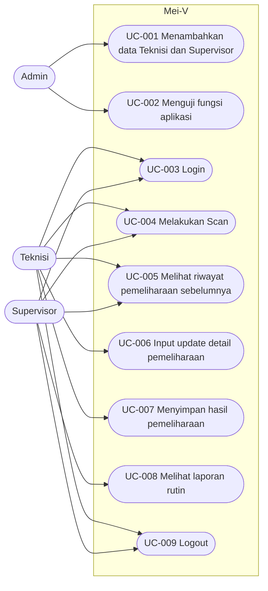
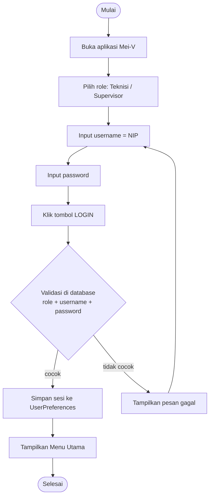
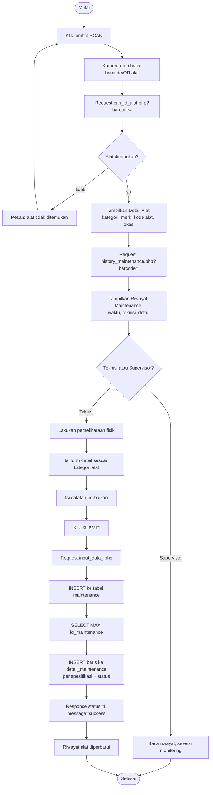
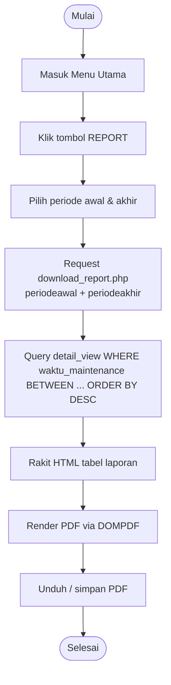
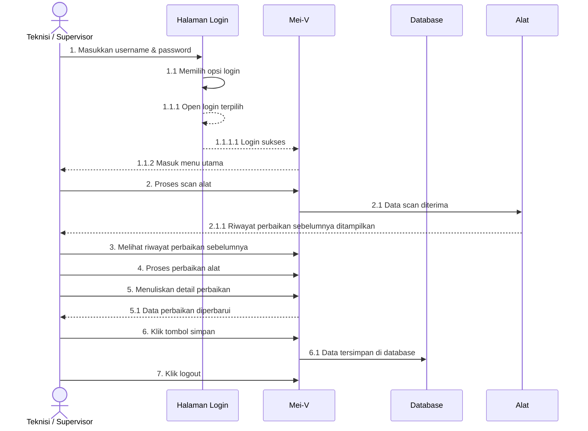
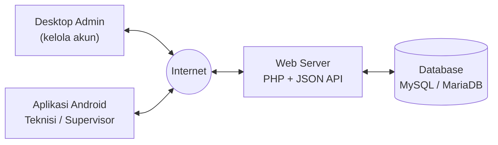
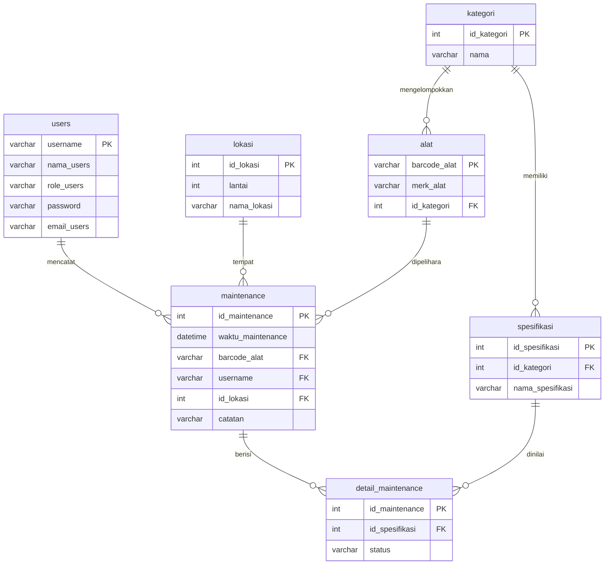

# Analisis Detail Project Lama Mei-V (Buku Tugas Akhir)

> **Sumber**: `D:\RPL - DHIMAS BINTANG BAGASKARA (1201181005) - Buku Tugas Akhir.pdf` — 123 halaman, 6 BAB, dibuat Juli 2022.
> **Tujuan dokumen ini**: menjadikan seluruh perencanaan lama (kebutuhan, use case, alur logika, diagram, ERD, UI/UX, hasil uji) sebagai **referensi resmi** untuk pembangunan Mei-V2 dengan **Flutter (mobile + web dashboard)** dan **Laravel (backend)**.
> Semua diagram lama digambar ulang sebagai Mermaid agar bisa dipakai langsung di dokumen perencanaan baru.

---

## 1. Ringkasan eksekutif

| Item | Isi |
|---|---|
| Nama sistem | **Mei-V** — Aplikasi Pemeliharaan Alat |
| Studi kasus | **Telkom Property Surabaya Utara** (aset Telkom Indonesia wilayah Surabaya Utara & Madura) |
| Masalah | Pencatatan pemeliharaan alat masih **manual di kertas**; Supervisor tidak bisa memantau kondisi alat & kinerja teknisi kapan saja |
| Solusi | Aplikasi mobile yang mencatat detail pemeliharaan per alat (berbasis barcode/QR) + laporan rutin PDF |
| Aktor | **Admin** (pembuat akun), **Teknisi**, **Supervisor** |
| Implementasi lama | Android **Java** (native) + **PHP** (REST/JSON) + **MariaDB 10.3.35**, XAMPP |
| Hosting lama | **https://meivtelpro.my.id/** (domain ini sekarang NXDOMAIN — lihat `DB-RECOVERY.md`) |
| Metode pengembangan | **Spiral Model** |
| Pengujian | Black-box testing (semua skenario **Berhasil**) + Usability Testing → **skor SUS 85,5%** |
| Saran penulis | Penambahan **fitur notifikasi** pengingat jadwal maintenance & pengingat unduh laporan |
| Jumlah layar | 4 rancangan (Login, Menu Utama, Pemeliharaan Alat, User Profile) → **8 layar implementasi** |
| Jumlah use case | **9** (UC-001 … UC-009) |
| Jumlah tabel | **7** + 2 view (`view_maintenance`, `detail_view`) |

---

## 2. Konteks & batasan lama

**Aset yang dipelihara** (dari BAB I & UI Menu Utama): AC, **Genset**, APAR, Penangkal Petir, Panel Listrik, Hydrant, Fire Alarm.
**Kondisi awal**: teknisi menulis hasil pemeliharaan di kertas; supervisor tidak punya akses langsung ke daftar alat yang perlu dipelihara berkala.

**Batasan masalah yang penulis tetapkan** (perlu ditinjau ulang di Mei-V2):

| # | Batasan lama | Status di Mei-V2 |
|---|---|---|
| a | Hanya berbasis Android | ⛔ **diubah** → Flutter (Android + iOS + Web) |
| b | Butuh akses internet | 🔁 tetap, tapi ditambah **mode offline draft** (P1) |
| c | Bahasa pemrograman Java | ⛔ **diubah** → Dart (Flutter) + PHP/Laravel |
| d | Framework Native | ⛔ **diubah** → Flutter |
| e | Hanya untuk Teknisi & Supervisor Telkom Property | 🔁 tetap (multi-role) |
| f | Akun dibuat manual oleh penulis sebagai Admin | 🔁 tetap, tapi lewat **halaman manajemen user** di dashboard |
| g | Alat hanya milik Telkom Property SBU | 🔁 tetap |

---

## 3. Aktor & hak akses

| Aktor | Deskripsi | Hak akses utama |
|---|---|---|
| **Admin** | Pembuat aplikasi / pengelola akun | Menambah data Teknisi & Supervisor (UC-001), menguji fungsi (UC-002) |
| **Teknisi** | Pelaksana pemeliharaan | Login, Scan, lihat riwayat, **input detail**, **simpan hasil**, logout |
| **Supervisor** | Pemantau kinerja & kondisi alat | Login, Scan, lihat riwayat, **lihat & unduh laporan rutin**, logout |

> Catatan: halaman Detail Maintenance punya **dua varian tampilan** — Teknisi (form input) vs Supervisor (tabel riwayat, read-only).

---

## 4. Kebutuhan fungsional (Tabel 3.1)

| # | Kebutuhan fungsional | Deskripsi |
|---|---|---|
| 1 | Menambahkan data Teknisi dan Supervisor | Mendaftarkan username & password untuk Supervisor dan Teknisi |
| 2 | Menguji fungsi aplikasi | Memastikan semua fungsi berjalan normal |
| 3 | Login | Supervisor & Teknisi masuk ke Mei-V |
| 4 | Melakukan Scan | Teknisi scan untuk memelihara; Supervisor scan untuk monitoring kinerja |
| 5 | Melihat riwayat pemeliharaan sebelumnya | Mengetahui kondisi alat sebelumnya |
| 6 | Input update data pemeliharaan | Dasar pemeliharaan selanjutnya |
| 7 | Melihat laporan rutin | Supervisor mengetahui kondisi alat & kinerja teknisi |

**Kebutuhan non-fungsional (Tabel 3.1.3.2)**

1. Teknisi & Supervisor menerima file `.apk` dan wajib menginstalnya → **di Mei-V2 diganti distribusi Play Store / web build**.
2. Mei-V menampilkan riwayat pemeliharaan dan bisa diperbarui setiap kali pemeliharaan.
3. **Username memakai NIP** dan password sesuai keinginan pengguna.

---

## 5. Use case lengkap (9 use case)

### 5.1 Daftar use case (Tabel 3.2)

| Kode | Nama | Aktor |
|---|---|---|
| UC-001 | Menambahkan data Teknisi dan Supervisor | Admin |
| UC-002 | Menguji fungsi aplikasi | Admin |
| UC-003 | Login | Teknisi, Supervisor |
| UC-004 | Melakukan Scan | Teknisi, Supervisor |
| UC-005 | Melihat riwayat pemeliharaan sebelumnya | Teknisi, Supervisor |
| UC-006 | Input update detail pemeliharaan | Teknisi |
| UC-007 | Menyimpan hasil pemeliharaan | Teknisi |
| UC-008 | Melihat laporan rutin | Supervisor |
| UC-009 | Logout | Teknisi, Supervisor |

### 5.2 Use case diagram (Gambar 3.2 → digambar ulang)



### 5.3 Alur normal tiap use case (dari Tabel 3.3–3.11)

| Kode | Kondisi awal → akhir | Alur normal (Aktor / Sistem) |
|---|---|---|
| **UC-001** | Pengguna belum terdaftar → username & password telah terdaftar | Admin memilih tambah database → sistem menampilkan tabel data yang bisa diisi |
| **UC-002** | Kesalahan belum diketahui → kesalahan telah diketahui | Admin menemukan kesalahan login → menemukan kesalahan lain |
| **UC-003** | Kolom username/password kosong → terisi | Memilih kategori/role → isi username (NIP) & password → klik login → sistem memvalidasi & membuka menu utama |
| **UC-004** | Detail alat belum diketahui → detail alat ditampilkan | Scan barcode → data alat muncul |
| **UC-005** | Riwayat belum diketahui → riwayat ditampilkan | Sistem menampilkan detail riwayat di textbox → pengguna membaca |
| **UC-006** | Detail pemeliharaan belum diperbarui → telah diperbarui | Teknisi melakukan pemeliharaan → memasukkan update detail |
| **UC-007** | Hasil belum tersimpan → tersimpan di database | Klik **Simpan** setelah mengisi → database menerima data |
| **UC-008** | Laporan belum tersedia → tersedia & bisa diunduh | Masuk menu utama → klik Laporan rutin → **simpan laporan (PDF)** |
| **UC-009** | Masih login → telah logout | Klik icon profile → klik logout |

### 5.4 Alur logika (activity diagram, Gambar 3.3–3.11 → Mermaid)

**Login (UC-003)** — pola dua lane `Pengguna | Mei-V`:



**Scan & pemeliharaan (UC-004 → UC-005 → UC-006 → UC-007)** — rantai inti sistem:



**Melihat laporan rutin (UC-008)**:



**Menambah akun (UC-001)**, **Uji fungsi (UC-002)**, **Logout (UC-009)** — pola sederhana: aksi aktor → respons sistem (lihat §5.3).

### 5.5 Sequence diagram (Gambar 3.12 → digambar ulang)



---

## 6. Arsitektur sistem lama (Gambar 3.13)



Kutipan perancangan: *"Data alat-alat … dibuatkan database baru di MySQL. Semua data tersebut bisa diambil kembali dari MySQL melalui satu web server yang terhubung dengan Android dan diterima dalam bentuk JSON."*

> ⚠️ **Inkonsistensi di dalam buku TA**: §3.2.1 menyebut bahasa pemrograman **Dart**, sedangkan §4.1.2 & seluruh daftar kode program (§4.3) menyebut **Java + PHP**. Implementasi yang benar-benar ada di repo `dhimasbebe/Mei-V` adalah **Java (Android native)**. Jadi rujukan yang valid = **Java**, bukan Dart.

**Tabel Request Web Server (Tabel 3.12)**

| No | Request | Aktor |
|---|---|---|
| 1 | Login | Supervisor & Teknisi |
| 2 | Menu Utama | Supervisor & Teknisi |
| 3 | User Profile | Teknisi |
| 4 (diberi nomor 5 di TA) | Scan Kode QR | Supervisor & Teknisi |
| 5 (6) | Unduh Laporan Rutin | Supervisor |
| 6 (7) | Logout | Supervisor & Teknisi |

---

## 7. Skema basis data asli (Tabel 3.13–3.20 + verifikasi kode PHP)

Desain lama memakai **model generik/checklist** — bukan 6 tabel per jenis alat:



**Tipe data sesuai TA** (Tabel 3.13–3.20):

| Tabel | Kolom | Tipe | Keterangan |
|---|---|---|---|
| `users` | username | Varchar(10) | **PK** |
| | nama_users | Varchar(200) | Nama pengguna |
| | role_users | Varchar(20) | Admin / Teknisi / Supervisor |
| | password | Varchar(20) | ⚠️ **plaintext** (lihat §9) |
| | email_users | Varchar(100) | Email |
| `alat` | barcode_alat | Varchar(10) | **PK** |
| | merk_alat | Varchar(45) | Merk alat |
| | id_kategori | int(10) | **FK** → kategori |
| `kategori` | id_kategori | int(10) | **PK** |
| | nama | Varchar(25) | Nama kategori |
| `spesifikasi` | id_spesifikasi | int(10) | **PK** |
| | id_kategori | int(10) | **FK** → kategori |
| | nama_spesifikasi | Varchar(50) | Nama item checklist |
| `maintenance` | id_maintenance | int(10) | **PK** |
| | waktu_maintenance | datetime | Waktu pemeliharaan |
| | barcode_alat | varchar(10) | **FK** → alat |
| | username | varchar(10) | **FK** → users |
| | id_lokasi | int(10) | **FK** → lokasi |
| | catatan | Varchar(250) | Catatan perbaikan |
| `detail_maintenance` | id_maintenance | int(10) | **PK + FK** |
| | id_spesifikasi | int(10) | **FK** → spesifikasi |
| | status | Varchar(25) | Nilai hasil pengukuran / kondisi |
| `lokasi` | id_lokasi | int(10) | **PK** |
| | lantai | int(3) | Lantai |
| | nama_lokasi | Varchar(200) | Nama lokasi/ruang |

**Dua view yang dipakai kode PHP** (terverifikasi dari kode program):

- `view_maintenance` → dipakai `history_maintenance.php?barcode=` untuk menampilkan riwayat per alat.
- `detail_view` → dipakai `download_report.php` untuk laporan periode; kolom: `id_maintenance`, `waktu_maintenance`, `nama_kategori`, `merk_alat`, `barcode_alat`, `nama_users`, `nama_lokasi`, `catatan`, `nama_spesifikasi`, `status`.

### 7.1 Peta `id_spesifikasi` yang benar-benar dipakai kode lama

| Kategori | id_spesifikasi | Field API | Bukti |
|---|---|---|---|
| AC | 1, 2, 3, 4 | suhu_ac, tekanan_ac, ampere_ac, kondisi_ac | Kode Program 4.7 |
| **Hydrant** | **1, 2** | tekanan, fungsi | Kode Program 4.15 |
| Penangkal Petir | 11, 12 | kondisi_Baut, grouding_test | Kode Program 4.17 |
| Panel Listrik | 13–19 | voltage_rs, voltage_rt, voltage_st, ampere_rs, ampere_rt, ampere_st, kondisi_baut | Kode Program 4.13 |
| **Alarm** | **23, 24, 25** | smoke_test, heat_test, cek_batre | Kode Program 4.9 |
| **APAR** | **23, 24, 25** | tekanan, selang, nossel | Kode Program 4.11 |

> 🐞 **BUG WARISAN (harus diperbaiki di Mei-V2)** — ada **tabrakan ID**:
> - **AC dan Hydrant sama-sama memakai id_spesifikasi 1 & 2**
> - **Alarm dan APAR sama-sama memakai id_spesifikasi 23, 24, 25**
>
> Karena `maintenance` tidak menyimpan `id_kategori` (kategori hanya bisa diturunkan dari `alat`), `detail_view` **tidak bisa membedakan** apakah id 1 berarti "Suhu AC" atau "Tekanan Hydrant". Akibatnya label di laporan PDF bisa salah untuk kategori Hydrant, Alarm, dan APAR. Di Mei-V2: `id_spesifikasi` wajib **unik per kategori** (lihat `docs/db/schema-v2.sql`).
>
> 🐞 **Masalah lain**: parameter `kondisi_Baut` memakai huruf kapital `B` (tidak konsisten dengan field lain) — mudah menimbulkan bug klien.

---

## 8. Kontrak API lama (terverifikasi dari daftar Kode Program)

**Envelope respons**

```json
// sukses baca
{ "status": "1", "message": "success", "data": [ { } ] }
// sukses tulis
{ "status": "1", "message": "success" }
// gagal
{ "status": "0", "message": "error" }
```

**Daftar endpoint** (dari `AntarmukaApi.java` + daftar kode program 4.1–4.21):

| Endpoint | Metode | Parameter | Tabel/View |
|---|---|---|---|
| `login.php` | POST (form) | role, username, password | `users` |
| `formregistrasi.php` | GET | nama, email, role, username, password | `users` |
| `updatepassword.php` | GET | username, old_password, password | `users` |
| `cari_id_alat.php` | GET | barcode | `alat` ⨝ `kategori` |
| `detail_alat.php` | GET | nama | `alat` |
| `history_maintenance.php` | GET | barcode | `view_maintenance` |
| `get_lokasi.php` | GET | — | `lokasi` |
| `input_data_ac.php` | GET | waktu_maintenance, barcode, username, id_lokasi, catatan + (suhu_ac, tekanan_ac, ampere_ac, kondisi_ac) | `maintenance` + `detail_maintenance` |
| `input_data_alarm.php` | GET | … + (smoke_test, heat_test, cek_batre) | idem |
| `input_data_apar.php` | GET | … + (tekanan, selang, nossel) | idem |
| `input_data_panel.php` | GET | … + (voltage_rs/rt/st, ampere_rs/rt/st, kondisi_baut) | idem |
| `input_data_hydrant.php` | GET | … + (tekanan, fungsi) | idem |
| `input_data_petir.php` | GET | … + (kondisi_Baut, grouding_test) | idem |
| `download_report.php` | GET | periodeawal, periodeakhir | `detail_view` → **PDF via DOMPDF** |

**Pola tulis data lama** (semua `input_data_*.php` identik):
1. `INSERT INTO maintenance (...) VALUES (...)`
2. `SELECT MAX(id_maintenance) FROM maintenance` → ambil id terakhir
3. Untuk setiap field yang dikirim: `INSERT INTO detail_maintenance (id_maintenance, id_spesifikasi, status) VALUES (last_id, <ID>, '<nilai>')`

> ⚠️ **Risiko keamanan warisan**: (a) password **plaintext** & dibandingkan di SQL; (b) **SQL injection** pada semua query (`'$username'` disisipkan langsung); (c) operasi **tulis memakai GET** (rawan cache/prefetch/CSRF); (d) tanpa token/sesi di sisi server (sesi hanya `UserPreferences` lokal di HP). Semuanya **wajib diperbaiki** di Mei-V2.

---

## 9. Inventaris UI/UX

### 9.1 Bahasa visual (dari seluruh tangkapan layar)

| Aspek | Nilai pada aplikasi lama |
|---|---|
| Warna utama | **Merah Telkom** (app bar, tombol utama, header tabel) — perkiraan kisaran `#E4002B`–`#EC1C24`, perlu dikonfirmasi dari brand guideline |
| Warna sekunder | **Hitam** (top bar logo "Mei-V", header "Lokasi") |
| Latar | Putih dengan watermark logo Telkom Property di area konten |
| Tombol | Pil / rounded, merah penuh untuk aksi utama (LOGIN, SCAN, SUBMIT, LOGOUT), merah pucat untuk CANCEL |
| Tipografi | Sans-serif, judul layar kapital pada app bar (ALAT, Panel Listrik) |
| Ikon | Ikon alat berbentuk foto/ilustrasi 3D di grid, ikon garis untuk aksi |
| Pola layar | App bar merah + tombol back; konten vertikal; tabel dengan header merah dan teks putih |
| Orientasi | Portrait, satu tangan (teknisi di lapangan) |

### 9.2 Rancangan antarmuka (Gambar 3.17–3.20)

| Gambar | Layar | Isi yang terlihat |
|---|---|---|
| 3.17 | **Login** | Logo Telkom Property + wordmark "Mei-V"; dropdown **Pilihan** (default "Teknisi"); field **Username** (ikon orang); field **Password** (ikon kunci); tombol **LOGIN** merah. Teks TA: username **hanya boleh NIP** |
| 3.18 | **Menu Utama** | Top bar hitam "Mei-V" + ikon profil kanan; band merah **"Maintenance"** + ikon kunci; grid ikon alat: **Hydrant, AC, Genset, APAR, Panel Listrik, Fire Alarm, Penangkal Petir** |
| 3.19 | **Halaman Pemeliharaan Alat** | App bar merah + back "ALAT"; tombol **SCAN** + ikon kamera; field **Tanggal**; tiga field angka **Tekanan / Suhu / Ampere**; dropdown **Kondisi** (contoh nilai: *Kurang Baik*); area teks **Riwayat Maintenance**; tombol **CANCEL** + **SUBMIT** |
| 3.20 | **User Profile** | Avatar bulat; nama (**Adi**); role (**Teknisi**); grup **PENGATURAN → Informasi pribadi**; grup **TENTANG → Tentang kami, Pusat bantuan**; tombol **LOGOUT** merah |

### 9.3 Implementasi antarmuka (Gambar 4.1–4.8)

| Gambar | Layar | Isi yang terlihat |
|---|---|---|
| 4.1 | Login | Versi implementasi dari 3.17 (admin & pengguna) |
| 4.2 | **Home** | Top bar hitam "Mei-V" + ikon profil; band merah "Maintenance"; grid alat: **Hydrant, AC, Penangkal Petir, APAR, Panel Listrik, Fire Alarm** (6 kategori; **Genset tidak ada** di implementasi walau ada di rancangan); dua tombol aksi **REPORT** & **SCAN**; bottom navigation 4 ikon |
| 4.3 | User Profile | Detail role, nama pengguna, NIP, email |
| 4.4 | **Registrasi** (khusus Admin) | Field: nama, email, role, username, password |
| 4.5 | Edit Password | Field: password lama, password baru, role, konfirmasi password |
| 4.6 | **Detail Alat** | App bar merah "Panel Listrik"; gambar alat; **deskripsi fungsi alat** (mis. penjelasan fungsi Panel Listrik); header hitam **"Lokasi"**; tabel 3 kolom: **Kode Alat** (SDP0107) / **Merk Alat** (ATS AMF 16-3200A) / **Detail Lokasi Alat** (Aula Besar Lantai 7) |
| 4.7 | **Detail Maintenance — Teknisi** | App bar merah + back "Panel Listrik"; **timestamp** (2022-07-15 13:02:47); dropdown **Ruang** (Ruang ME Lantai 7); field **Ampere R-S / R-T / S-T**; field **Voltage R-S / R-T / S-T**; dropdown **Kondisi Baut** (Kencang); label **"Catatan Perbaikan:"** + placeholder "input detail perbaikan" |
| 4.8 | **Detail Maintenance — Supervisor** | App bar merah + back; timestamp; tabel **Riwayat Maintenance** kolom **WAKTU / TEKNISI / DETAIL** — contoh baris: `2022-07-15 20:31:50 · Adi Prasetyo · Ruang ME Lantai 7`, `2022-07-14 20:30:25 · Adi Prasetyo · Ruang Staff & Admin` |

**Temuan penting UX**: form maintenance **berbeda per kategori alat** dan isinya berasal dari tabel `spesifikasi` (Panel Listrik → 7 field Ampere/Voltage/Kondisi Baut; AC → Tekanan/Suhu/Ampere/Kondisi). Ini **membenarkan keputusan "form dinamis"** di arsitektur Mei-V2 — bukan 6 form hardcode.

---

## 10. Hasil pengujian lama (BAB V)

**Lingkungan**: Xiaomi Poco X3 NFC, Android 11, 6 GB / 64 GB.

| Uji fungsionalitas (black-box) | Skenario | Hasil | Kesimpulan |
|---|---|---|---|
| Login & Logout | Login benar (T01), login salah (T02), logout (T03) | berhasil login / gagal login / berhasil logout | **Berhasil** |
| Register | Daftar pengguna baru, login dengan data salah | pengguna baru terdaftar | **Berhasil** |
| Masuk Detail Alat | Klik gambar alat di halaman utama | masuk ke detail sesuai yang diklik | **Berhasil** |
| Scan Barcode | Scan dengan barcode sesuai / tidak sesuai | hasil scan tampil | **Berhasil** |
| Input Detail Maintenance | Isi & kirim detail | data tersimpan | **Berhasil** |

**Usability Testing (SUS)** — 4 teknisi + 1 supervisor, 10 pertanyaan:

| Responden | Skor SUS |
|---|---|
| 1 | 80 |
| 2 | 87,5 |
| 3 | 85 |
| 4 | 80 |
| 5 | 95 |
| **Rata-rata** | **85,5%** |

**Saran penulis (BAB VI §6.2)** — satu-satunya saran: **penambahan fitur notifikasi** untuk mengingatkan teknisi melakukan maintenance dalam jangka waktu tertentu, dan mengingatkan supervisor mengunduh laporan. → Ini menjadi **P1 di Mei-V2**.

---

## 11. Matriks ketertelusuran (traceability) lama → Mei-V2

| Use case lama | Layar lama | Endpoint lama | Tabel | Target di Mei-V2 |
|---|---|---|---|---|
| UC-001 Tambah akun | Registrasi (4.4) | `formregistrasi.php` | users | **Web dashboard → Manajemen User** (khusus Admin) + Flutter opsional |
| UC-002 Uji fungsi | — | — | — | **CI + QA test suite** (bukan use case aplikasi) |
| UC-003 Login | Login (3.17 / 4.1) | `login.php` | users | Flutter: Login (Bearer token) + Laravel: `/api/v1/auth/login` |
| UC-004 Scan | Home → SCAN | `cari_id_alat.php` | alat ⨝ kategori | Flutter: scanner + `/api/v1/alat/{barcode}` |
| UC-005 Riwayat | Detail Alat + Riwayat | `history_maintenance.php` | view_maintenance | Flutter: tab Riwayat + `/api/v1/alat/{barcode}/riwayat` |
| UC-006 Input detail | Detail Maintenance Teknisi (4.7) | `input_data_*.php` | maintenance + detail_maintenance | Flutter: **form dinamis per kategori** + `/api/v1/maintenance` |
| UC-007 Simpan hasil | Tombol SUBMIT | idem | idem | idem (transaksi DB di Laravel) |
| UC-008 Laporan rutin | REPORT (PDF) | `download_report.php` | detail_view | **Web dashboard: halaman Reports + grafik**; PDF tetap tersedia |
| UC-009 Logout | User Profile (3.20) | — | — | Flutter: logout (hapus token) + `/api/v1/auth/logout` |
| Edit Password (4.5) | Edit Password | `updatepassword.php` | users | Flutter + Laravel `/api/v1/auth/password` |
| User Profile (4.3) | User Profile | — | users | Flutter: Profil |
| Detail Alat (4.6) | Detail Alat | `detail_alat.php` | alat ⨉ kategori | Flutter: Detail Alat |

**Fitur baru yang tidak ada di sistem lama** (nilai tambah Mei-V2):
1. **Web dashboard monitoring** untuk Supervisor/Admin (KPI, grafik tren, daftar alat overdue, filter & pagination).
2. **Notifikasi/pengingat jadwal maintenance** (saran penulis TA).
3. **Multi-platform**: iOS + Web, tidak lagi terbatas Android.
4. **Mode offline draft** (P1) — teknisi di area tanpa sinyal tetap bisa mengisi, sinkron otomatis.
5. **Keamanan**: token, hash password, validasi server, transaksi DB.

---

## 12. Implikasi ke perencanaan baru

| # | Temuan analisis | Dampak ke Mei-V2 |
|---|---|---|
| 1 | Form per kategori berbasis `spesifikasi` | **Form dinamis**: satu halaman Flutter render dari schema; dashboard bisa membandingkan antar kategori |
| 2 | Tabrakan `id_spesifikasi` (AC≡Hydrant, Alarm≡APAR) | **Perbaiki**: spesifikasi unik per kategori; tambah `id_kategori` di `detail_maintenance` atau pakai kode spesifikasi unik |
| 3 | Password plaintext, SQL injection, tulis via GET | **Wajib**: bcrypt, Eloquent/parameter binding, POST/PUT, Bearer token |
| 4 | `maintenance` tidak menyimpan `id_kategori` | Tambah kolom untuk mempercepat query dashboard |
| 5 | Tidak ada jadwal/siklus pemeliharaan | Tambah `maintenance_cycle_days` (menjawab Q6 untuk hitungan overdue) |
| 6 | Laporan hanya PDF satu arah | Dashboard: tabel + grafik + ekspor (CSV/PDF) |
| 7 | Hosting & domain lama mati | Backend dibangun ulang: **Laravel 11 + MySQL/MariaDB** (lihat `BACKEND-RECOMMENDATION.md` §4.4) |
| 8 | SUS 85,5% jadi baseline | Target UX Mei-V2: SUS ≥ 85,5% |

---

## Lampiran: berkas hasil ekstraksi

| Berkas | Isi |
|---|---|
| `docs/legacy/thesis-text.txt` | Teks lengkap 123 halaman (dari PDF) |
| `docs/legacy/thesis-page-map.json` | Peta halaman bergambar (39 halaman) |
| `docs/legacy/pages/p*.png` | Render halaman kunci: diagram + tangkapan layar UI |
| `tools/extract_thesis.py` | Skrip ekstraksi (PyMuPDF) untuk regenerasi |
