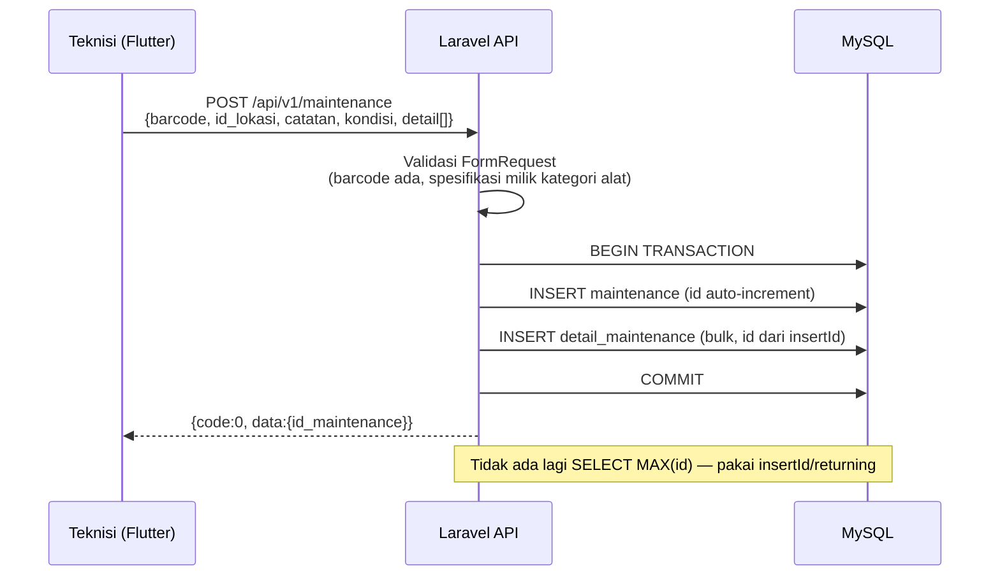
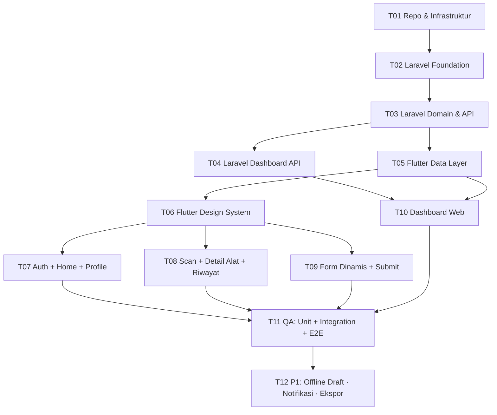

# Rencana Implementasi Mei-V2 — Flutter + Laravel

> **实现现状（2026-10-14 更新）**：本文件是规划稿，实际落地以 `STATUS.md` 为准。
> 后端实际为 **Laravel 13.36 + Sanctum 4.3.3**（下文的 Laravel 11 是当时计划版本）；
> 15 个端点已实现并通过 **19 测试 / 173 断言**；模型契约 **80 项检查**通过。
> 复现：`powershell -ExecutionPolicy Bypass -File .\scripts\verify-all.ps1`。

> **Dasar**: seluruh perencanaan lama (Buku TA) diterapkan ulang — lihat `docs/LEGACY-ANALYSIS.md`.
> **Skema data**: `docs/db/schema-v2.sql` (terverifikasi, bukan dugaan).
> **Keputusan backend**: `docs/BACKEND-RECOMMENDATION.md` §4.4 — backend lama & hosting sudah tidak dapat diakses, sehingga **Laravel dibangun dari awal sebagai P0** (bukan lagi "pakai PHP lama").
> **Repo**: satu repo **Mei-V2** berisi mobile app + web dashboard (single pubspec, dual entry). Repo lama `dhimasbebe/Mei-V` **tidak disentuh** (read-only).

---

## 1. Keputusan stack

| Lapisan | Pilihan | Alasan singkat |
|---|---|---|
| Mobile + Web | **Flutter 3.x (Dart)** | Satu basis kode untuk Android/iOS/Web; UI/UX lama bisa direplikasi persis |
| State management | **Riverpod 2.5** | Testable, tanpa `BuildContext` untuk logika |
| Routing | **go_router 14** | Route guard per role (Teknisi/Supervisor/Admin) |
| HTTP | **dio 5** | Interceptor token, retry, logging |
| Model | **json_serializable** | Aman dari perubahan kontrak |
| Scanner | **mobile_scanner** | Pengganti CaptureAct (QR/barcode) |
| Grafik dashboard | **fl_chart** | Tren, distribusi, perbandingan |
| Simpan token | **flutter_secure_storage** | Bearer token, bukan cookie |
| Backend | **Laravel 11 + MySQL/MariaDB** | Lihat §2 |
| Auth | **Laravel Sanctum** (Bearer token) | Satu mekanisme untuk mobile & web |
| PDF laporan | **barryvdh/laravel-dompdf** | Mempertahankan format laporan lama (DOMPDF) |
| Hosting web dashboard | Build `flutter build web` → statis | Bisa satu domain dengan API |

**Warna & tema (dari UI lama)**: merah Telkom sebagai aksen utama, top bar hitam, latar putih, tombol pil merah. Untuk **dashboard monitoring** tetap pakai konvensi status: **merah = abnormal/terlambat, hijau = normal/tepat waktu** (bukan konvensi pasar saham).

---

## 2. Backend Laravel — desain

### 2.1 Struktur (feature-first)

```
backend/
├── app/
│   ├── Http/
│   │   ├── Controllers/Api/V1/
│   │   │   ├── AuthController.php            # login, logout, ubah password
│   │   │   ├── MasterDataController.php      # kategori, spesifikasi, alat, lokasi, users
│   │   │   ├── MaintenanceController.php     # riwayat + simpan pemeliharaan
│   │   │   ├── ReportController.php          # laporan periode (PDF/CSV)
│   │   │   └── DashboardController.php       # KPI, tren, distribusi, overdue
│   │   ├── Requests/                         # validasi (FormRequest)
│   │   ├── Resources/                        # API Resource → envelope seragam
│   │   └── Middleware/EnsureRole.php         # otorisasi per role di server
│   ├── Models/  (User, Kategori, Spesifikasi, Alat, Lokasi, Maintenance, DetailMaintenance)
│   ├── Services/ (MaintenanceService, DashboardService, ReportService)
│   └── Exceptions/Handler.php                # error JSON konsisten
├── database/migrations/                      # dari docs/db/schema-v2.sql
├── database/seeders/                         # kategori + spesifikasi (7 kategori)
└── routes/api.php
```

### 2.2 Endpoint `/api/v1`

| Endpoint | Metode | Role | Padanan lama |
|---|---|---|---|
| `/auth/login` | POST | publik | `login.php` |
| `/auth/logout` | POST | semua | — (baru) |
| `/auth/password` | PUT | semua | `updatepassword.php` |
| `/users` | GET/POST/PUT | Admin | `formregistrasi.php` |
| `/kategori` | GET | semua | *(baru — sumber form dinamis)* |
| `/kategori/{id}/spesifikasi` | GET | semua | *(baru — item checklist per kategori)* |
| `/alat` | GET | semua | *(baru — daftar alat)* |
| `/alat/{barcode}` | GET | semua | `cari_id_alat.php` + `detail_alat.php` |
| `/alat/{barcode}/riwayat` | GET | semua | `history_maintenance.php` |
| `/lokasi` | GET | semua | `get_lokasi.php` |
| `/maintenance` | POST | Teknisi | `input_data_*.php` (**6 endpoint → 1**) |
| `/maintenance/{id}` | GET | semua | *(baru)* |
| `/reports/maintenance` | GET | Supervisor, Admin | `download_report.php` (PDF/CSV) |
| `/dashboard/kpi` | GET | Supervisor, Admin | *(baru)* |
| `/dashboard/trend` | GET | Supervisor, Admin | *(baru)* |
| `/dashboard/distribution` | GET | Supervisor, Admin | *(baru)* |
| `/dashboard/overdue` | GET | Supervisor, Admin | *(baru)* |
| `/maintenance/paged` | GET | Supervisor, Admin | *(baru — tabel dashboard)* |

**Envelope seragam** (menggantikan `{status,message,data}` lama):

```json
{ "code": 0, "message": "ok", "data": { } }
```

**Penyederhanaan penting**: 6 endpoint `input_data_ac|alarm|apar|panel|hydrant|petir.php` → **satu** `POST /maintenance` yang menerima daftar `detail: [{id_spesifikasi, status}]`. Ini otomatis memperbaiki bug tabrakan `id_spesifikasi` dan menghapus duplikasi kode.

### 2.3 Transaksi simpan pemeliharaan (pengganti pola `MAX(id_maintenance)`)



**Perbaikan yang wajib dibanding sistem lama**: hash password (bcrypt), parameter binding (Eloquent), operasi tulis via POST (bukan GET), otorisasi role di server, transaksi untuk multi-tabel.

---

## 3. UI/UX — dari layar lama ke layar Flutter

| Layar lama (TA) | Layar Mei-V2 | Perubahan yang disengaja |
|---|---|---|
| Login (3.17 / 4.1) | `LoginScreen` — dropdown role, username = NIP, password | Tambah validasi inline, toggle lihat password, indikator loading |
| Menu Utama (3.18 / 4.2) | `HomeScreen` — grid kategori (7: Hydrant, AC, Genset, APAR, Panel Listrik, Fire Alarm, Penangkal Petir) + tombol SCAN & REPORT | Grid diambil dari **API kategori** (bukan hardcode); tambah badge jumlah alat overdue per kategori |
| Halaman Pemeliharaan (3.19) | `MaintenanceFormScreen` — **form dinamis** dari `spesifikasi` | 6 form hardcode → 1 form dinamis; field angka pakai keyboard numerik + satuan |
| User Profile (3.20 / 4.3) | `ProfileScreen` — avatar, nama, role, NIP, email, LOGOUT | Tambah status koneksi & tombol sinkron draft |
| Registrasi (4.4) | `UserManagementScreen` di **dashboard web** (Admin) | Dipindah ke web agar admin kerja di desktop |
| Edit Password (4.5) | `ChangePasswordScreen` | Validasi konfirmasi + kekuatan password |
| Detail Alat (4.6) | `AlatDetailScreen` — deskripsi fungsi, tabel Kode/Merk/Lokasi | Tambah status "terakhir dipelihara" & badge overdue |
| Detail Maintenance Teknisi (4.7) | `MaintenanceFormScreen` (varian teknisi) | Timestamp otomatis dari server, bukan jam HP |
| Detail Maintenance Supervisor (4.8) | `RiwayatScreen` + tabel Waktu/Teknisi/Detail | Tambah filter periode & kategori |
| — | **Dashboard web** (baru): Overview KPI, Analytics, Records, Alat, Lokasi, Reports, Users | Nilai tambah utama Mei-V2 |

**Prinsip**: bentuk visual lama dipertahankan (agar teknisi tidak perlu belajar ulang), tetapi **struktur data dibuat dinamis** dan **keamanan diperbaiki**.

---

## 4. Fitur dashboard web monitoring (baru)

| Halaman | Isi |
|---|---|
| **Overview** | Kartu KPI: total alat, pemeliharaan bulan ini, % selesai tepat waktu, jumlah overdue; grafik tren 12 bulan; distribusi per kategori; daftar 10 alat paling overdue |
| **Analytics** | Tren pemeliharaan per kategori, rata-rata interval pemeliharaan, ranking teknisi (jumlah & ketepatan), perbandingan kondisi baik/kurang baik/rusak |
| **Records** | Tabel `maintenance` dengan filter (periode, kategori, lokasi, teknisi, kondisi), pencarian barcode, pagination server-side, ekspor CSV |
| **Alat** | Daftar alat + kategori + lokasi + terakhir dipelihara + status overdue |
| **Lokasi** | Daftar lokasi + jumlah alat + tingkat kepatuhan pemeliharaan |
| **Reports** | Laporan periode (padanan `download_report.php`) → PDF (DomPDF) & CSV |
| **Users** | Kelola akun Teknisi/Supervisor (padanan UC-001, `formregistrasi.php`) |

---

## 5. Daftar tugas (assignment & dependensi)



| ID | Tugas | Output | Dep | Pemilik | Prio | Ukuran |
|---|---|---|---|---|---|---|
| **T01** | Repo & infrastruktur: inisialisasi `Mei-V2`, `flutter create`, dual entry (`main.dart`/`main_web.dart`), `.gitignore`, README, CI skeleton, salin `docs/` ke repo | repo + CI | — | Engineer | P0 | M |
| **T02** | Laravel foundation: project, koneksi DB, migrasi dari `schema-v2.sql`, seeder kategori+spesifikasi, Sanctum, envelope `{code,data,message}`, CORS, error handler, `/health` | `backend/**` | T01 | Engineer | P0 | M |
| **T03** | Laravel domain & API: model+relasi, Auth (login/logout/password), master data (kategori, spesifikasi, alat, lokasi, users), `POST /maintenance` (transaksi), riwayat, laporan PDF/CSV, middleware role | controller/service/resource + tests | T02 | Engineer | P0 | L |
| **T04** | Laravel dashboard API: `kpi`, `trend`, `distribution`, `overdue`, `maintenance/paged` (agregasi SQL + index) | endpoint agregat | T03 | Engineer | P0 | M |
| **T05** | Flutter data layer: model (json_serializable), dio client + interceptor token, repository per domain, mapping error → pesan Indonesia, secure storage | `lib/data/**` | T03 | Engineer | P0 | L |
| **T06** | Flutter design system: tema merah Telkom + top bar hitam, tipografi, komponen (tombol pil, kartu alat, tabel, badge status, skeleton/empty/error state) | `lib/core/theme/**`, `lib/shared/widgets/**` | T05 | Engineer | P0 | M |
| **T07** | Auth + Home + Profile: login (role dropdown, NIP), guard route per role, grid kategori dari API, profile, ubah password, logout | `lib/mobile/features/{auth,home,profile}/**` | T06 | Engineer | P0 | L |
| **T08** | Scan + Detail Alat + Riwayat: scanner QR/barcode, detail alat (deskripsi, tabel kode/merk/lokasi), riwayat Waktu/Teknisi/Detail + filter | `lib/mobile/features/{scan,alat,riwayat}/**` | T06 | Engineer | P0 | L |
| **T09** | Form pemeliharaan dinamis: render dari `spesifikasi` (number/text/select + satuan), catatan, kondisi, submit transaksi, konfirmasi & feedback | `lib/mobile/features/maintenance/**` | T06 | Engineer | P0 | L |
| **T10** | Dashboard web: shell + sidebar 7 menu, Overview (KPI+grafik), Analytics, Records (filter+pagination), Alat, Lokasi, Reports, Users | `lib/web/**` | T04, T05 | Engineer | P0 | L |
| **T11** | QA: unit test (service Laravel + repository Flutter), integration (endpoint), widget test (form dinamis, login), E2E alur UC-003→UC-009, matriks regresi 9 use case + SUS ≥ 85,5% | `test/**`, laporan QA | T07–T10 | QA | P0 | L |
| **T12** | P1: offline draft (hive) + sinkron, notifikasi pengingat maintenance & unduh laporan (saran penulis TA), ekspor CSV/PDF dashboard, analitik anomali | fitur P1 | T11 | Engineer | P1 | M |

**Jalur kritis**: T01 → T02 → T03 → T05 → T06 → T09 → T11.
**Dapat paralel**: T04 (setelah T03) ∥ T07/T08/T09 (setelah T06); T10 menunggu T04 + T05.

---

## 6. Matriks penerimaan (agar tidak ada fitur lama yang hilang)

| Use case lama | Kriteria penerimaan di Mei-V2 | Task |
|---|---|---|
| UC-001 Tambah akun | Admin dapat menambah/menonaktifkan Teknisi & Supervisor dari dashboard; password ter-hash | T03, T10 |
| UC-002 Uji fungsi | Seluruh endpoint & layar tercakup automated test; CI hijau | T11 |
| UC-003 Login | Login dengan NIP + role; token tersimpan aman; route guard bekerja | T03, T05, T07 |
| UC-004 Scan | Scan barcode → detail alat muncul < 2 dtk; barcode tidak dikenal → pesan jelas | T03, T08 |
| UC-005 Riwayat | Riwayat per alat tampil (waktu, teknisi, detail) untuk Teknisi & Supervisor | T03, T08 |
| UC-006 Input detail | Form tampil **sesuai kategori alat** (jumlah & jenis field dari `spesifikasi`) | T03, T09 |
| UC-007 Simpan hasil | Data tersimpan dalam satu transaksi; gagal → rollback tanpa data separuh | T03, T09 |
| UC-008 Laporan rutin | PDF periode dengan kolom Waktu/Alat/Teknisi/Lokasi/Kondisi/Catatan + CSV + grafik | T03, T10 |
| UC-009 Logout | Token dihapus; kembali ke Login; tidak bisa back ke halaman terproteksi | T03, T07 |
| (baru) Dashboard | Supervisor/Admin melihat KPI, tren, overdue, dan dapat memfilter data | T04, T10 |
| (baru) Notifikasi | Pengingat jadwal maintenance & unduh laporan (P1) | T12 |

---

## 7. Pertanyaan yang perlu keputusan Anda

| # | Pertanyaan | Dampak jika tidak diputuskan |
|---|---|---|
| Q6 | **Siklus pemeliharaan per kategori** (default diusulkan 30 hari) dan definisi "overdue" | Memblokir `dashboard/overdue` + KPI |
| Q11 | **Kategori Genset**: ada di rancangan tapi tidak diimplementasikan. Dipakai atau dibuang? Field checklist-nya (usulan di `schema-v2.sql`) perlu konfirmasi | Menentukan jumlah form dinamis |
| Q12 | **Username = NIP** dan akun hanya dibuat Admin (tidak ada registrasi mandiri) — dipertahankan? | Menentukan layar Users & login |
| Q13 | **Warna brand**: ambil hex resmi merah Telkom dari brand guideline | Menentukan tema Flutter |
| Q14 | **Hosting baru**: VPS/shared hosting untuk Laravel + domain baru | Menentukan deploy & HTTPS |
| Q15 | Apakah **data historis 2022** masih diperlukan? Kalau ya, cari dump `.sql` (lihat `DB-RECOVERY.md`) | Menentukan perlu tidaknya skrip impor |
