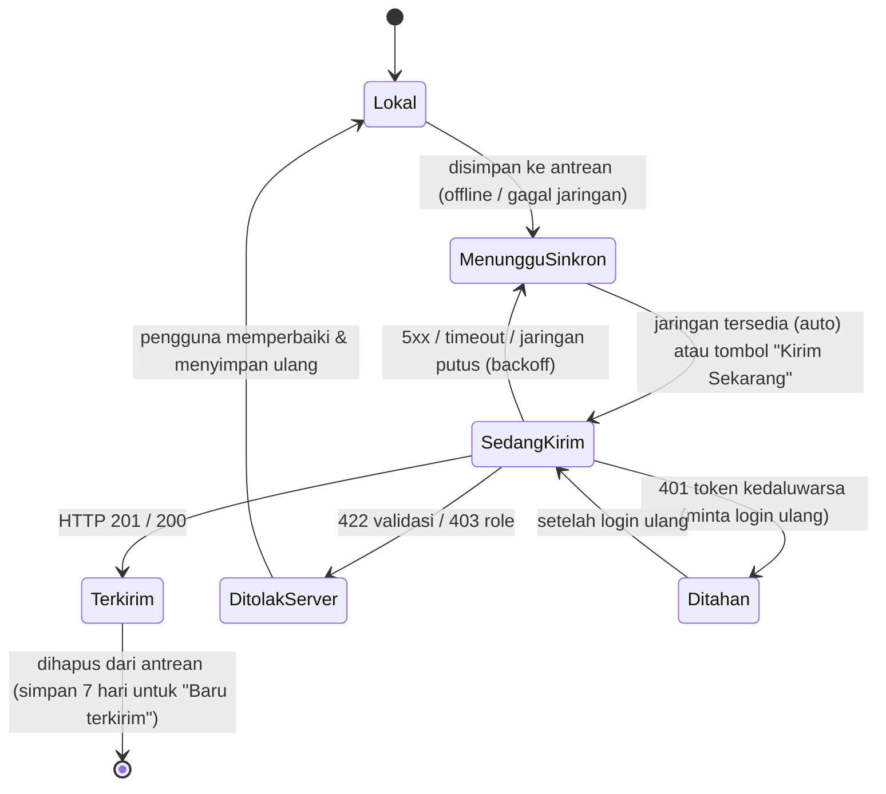
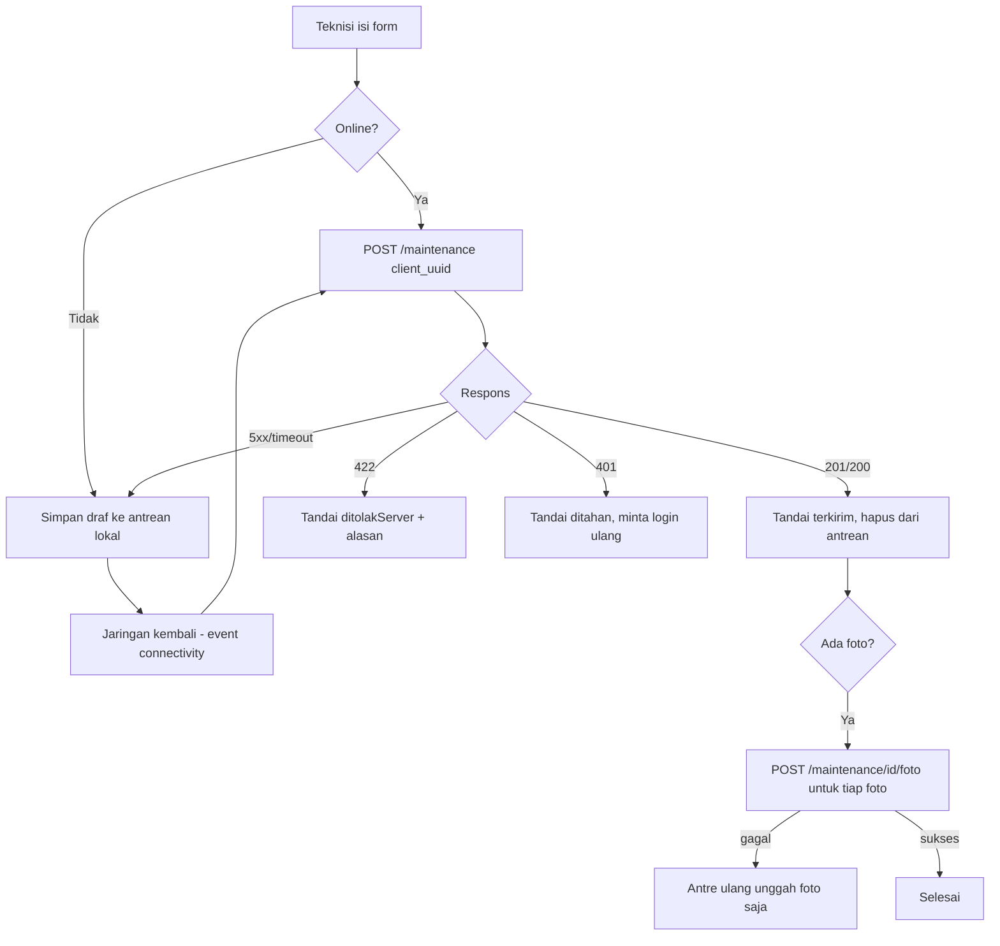

# PRD — Mei-V2: Fitur Tahap 3 (Offline · Notifikasi · Foto · Audit Log · Mode Gelap · Animasi · Grafik · Gesture)

> Versi: v3.1 ｜ Penulis: 许清楚 (Xu) — Product Manager ｜ Status: Siap diturunkan ke arsitek
> Perubahan v3.1: +8 workstream baru (I–P) hasil persetujuan pengguna. Workstream A–H tidak diubah.
> Proyek: `mei-v2/` (Flutter 3.44 mobile + web, Laravel 13 API)
> Bahasa dokumen: Indonesia ｜ Terminologi domain tetap bahasa Indonesia asli
> Basis: `docs/PRD-ROLE-UI-V2.md` (v2), `docs/LEGACY-ANALYSIS.md` §11–§12, `docs/DESIGN-ROLE-UI-V2.md`, `STATUS.md`

---

## 1. Ringkasan Eksekutif & Tujuan

Mei-V2 tahap 2 sudah menghadirkan UI berbasis role, sistem token desain, dan 43 endpoint backend (70 uji / 464 assertion lulus). Tahap 3 menutup **celah operasional lapangan** yang membuat aplikasi lama (dan tahap 2) tidak dapat diandalkan: teknisi kehilangan data saat sinyal putus, tidak ada bukti foto, pengawas tidak punya jejak audit yang dapat dibaca, dan tidak ada pengingat jadwal.

Delapan workstream telah disetujui pengguna. PRD ini membuat kedelapannya **dapat dikerjakan tanpa menebak-nebak**, dengan kriteria penerimaan yang dapat dijawab **ya/tidak** oleh penguji melalui gerbang verifikasi yang tersedia di sandbox (`php artisan test`, `tools/modelcheck`, kompilasi `gen_kernel`).

### 1.1 Tujuan produk

| # | Tujuan | Ukuran keberhasilan |
|---|---|---|
| G1 | **Nol kehilangan data lapangan** — pemeliharaan terisi lengkap walau tanpa sinyal, tersinkron otomatis saat jaringan kembali | 100% draf bertahan melewati penutupan aplikasi; 0 duplikat record (idempotensi `client_uuid`); pengiriman ulang saat jaringan kembali berhasil tanpa intervensi |
| G2 | **Bukti visual & akuntabilitas** — teknisi melampirkan foto kondisi alat; Admin/Supervisor melihat jejak siapa mengubah apa | Foto tampil di riwayat & layar verifikasi; layar Audit Log menampilkan entitas, aktor, aksi, dan diff perubahan yang terbaca manusia |
| G3 | **Kenyamanan & ketertelusuran data analitik** — pengingat jadwal, mode gelap, grafik yang dapat ditelusuri, aksi cepat lewat gesture | Pengingat muncul untuk alat jatuh tempo/terlambat; dark mode tersimpan; kartu KPI & grafik dapat diklik untuk menelusuri data |
| G4 | **Target UX** | SUS ≥ 85,5% (baseline aplikasi lama, `LEGACY-ANALYSIS` §12 #8) |

### 1.2 Prinsip kerja tahap ini

1. **Aditif saja.** Tidak ada perubahan skema destruktif; tidak ada perubahan palet brand `#CB2400`, top bar hitam, dan radius pil 50dp.
2. **Tanpa dependensi baru kecuali disetujui.** Setiap paket wajib tercantum di §5 dengan alasan **dan** alternatif tanpa paket.
3. **Logika murni dipisahkan dari widget.** Agar dapat diuji `dart.exe` (modelcheck) tanpa Flutter CLI, seluruh logika antrean, pemetaan warna, pemformatan audit, dan riwayat kueri ditulis di berkas Dart **tanpa impor `package:flutter`**.
4. **Dapat diverifikasi lewat gerbang sandbox.** Setiap kriteria penerimaan ditandai `[BE]` (`php artisan test`), `[MDL]` (`tools/modelcheck`), `[KERNEL]` (kompilasi `gen_kernel`), atau `[MANUAL]` (hanya bisa di terminal pengguna).

---

## 2. Persona & Matriks Fitur per Role

### 2.1 Ringkasan persona

| Role | Fokus | Konteks perangkat |
|---|---|---|
| **Teknisi** | Menyelesaikan pemeliharaan di lokasi secepat mungkin, sesedikit mungkin ketikan | HP, satu tangan, sering di ruang mesin gelap / tanpa sinyal |
| **Supervisor** | Menjaga alat terpelihara tepat waktu & memverifikasi mutu laporan | HP + web dashboard |
| **Admin** | Menjaga master data, akun, konfigurasi tetap benar | HP + web dashboard |

### 2.2 Matriks 8 workstream × role

| Workstream | Teknisi | Supervisor | Admin |
|---|---|---|---|
| **A. Mode offline penuh** | Antre draf, isi tanpa sinyal, sinkron otomatis, lihat status sinkron | Lihat laporan hasil sinkron (tanpa penanda "dari offline") | Lihat laporan hasil sinkron |
| **B. Notifikasi & pengingat** | Pengingat alat jatuh tempo/terlambat miliknya | Notifikasi laporan menunggu verifikasi | Notifikasi laporan menunggu verifikasi (opsional) |
| **C. Foto lampiran** | Ambil/unggah foto kondisi saat mengisi checklist | Lihat foto di layar verifikasi | Lihat foto di detail/riwayat |
| **D. Audit Log (UI)** | — (403) | Baca log (read-only) | Baca + filter seluruh log |
| **E. Mode gelap** | Pengalih manual + tema gelap | Pengalih manual + tema gelap | Pengalih manual + tema gelap |
| **F. Animasi & transisi** | Hero kartu alat→detail, animasi sukses kirim | Transisi halaman, animasi KPI | Skeleton shimmer, animasi KPI |
| **G. Grafik interaktif** | — (tak ada dashboard) | Grafik sentuh, filter periode, kartu ringkasan dapat diklik | idem + telusuri ke Records |
| **H. Gesture & aksi cepat** | Tarik-untuk-segarkan, ketuk-lama menu konteks | Geser kartu setujui/tolak, pencarian riwayat kueri | Geser kartu hapus, tarik-untuk-segarkan |
| **I. Scan berkelanjutan (patroli)** | Mode patroli multi-scan + antrian kerja | — | — |
| **J. Checklist cepat "Semua Baik"** | Aksi satu-tap di form | — | — |
| **K. Duplikat laporan terakhir** | Duplikat laporan miliknya | — | — |
| **L. Ekspor PDF laporan** | — | PDF per laporan & per periode | idem |
| **M. Impor massal alat (CSV)** | — | — | Unggah CSV + preview validasi + commit |
| **N. Cetak label QR massal** | — | Cetak label alat terpilih | idem |
| **O. Bagikan tautan laporan** | — | Buat/cabut tautan read-only | idem |
| **P. Multi-bahasa (ID/EN)** | Pilih bahasa | Pilih bahasa | Pilih bahasa |

### 2.3 Aturan akses (tetap, tidak berubah)

| Kemampuan baru | Teknisi | Supervisor | Admin |
|---|---|---|---|
| Antre/sinkron draf sendiri | Ya | Tidak | Tidak |
| Lihat foto lampiran | Milik sendiri | Semua | Semua |
| Unggah/hapus foto | Hanya saat mengisi laporan sendiri | Tidak (hanya lihat) | Hapus (moderasi) |
| Audit Log | Tidak (403) | Ya (baca) | Ya (baca) |
| Mode gelap | Ya | Ya | Ya |

> Catatan: middleware `role` server tetap sumber kebenaran; guard klien hanya untuk UX (dua lapis, `DESIGN-ROLE-UI-V2` §11 R9).

---

## 3. User Story + Kriteria Penerimaan Terukur per Workstream

Setiap kriteria dirancang untuk dijawab **ya/tidak**. Tag gerbang: `[BE]` `php artisan test` · `[MDL]` `tools/modelcheck` (Dart murni) · `[KERNEL]` kompilasi `gen_kernel` kedua entry point · `[MANUAL]` diverifikasi pengguna di terminal.

---

### A. Mode Offline Penuh

#### A.1 User story

- **US-A1** — Sebagai **Teknisi**, saya ingin mengisi form pemeliharaan saat tidak ada sinyal, agar pekerjaan di ruang mesin bawah tanah tidak terhambat.
- **US-A2** — Sebagai **Teknisi**, saya ingin draf tersimpan otomatis walau aplikasi ditutup tiba-tiba, agar data tidak hilang.
- **US-A3** — Sebagai **Teknisi**, saya ingin draf terkirim otomatis begitu jaringan kembali, agar saya tidak perlu mengingat-ingat.
- **US-A4** — Sebagai **Teknisi**, saya ingin melihat status tiap draf (menunggu, sedang kirim, terkirim, ditolak server), agar saya tahu apa yang belum masuk.

#### A.2 Mekanisme

Draf disimpan lokal sebagai antrean berurutan. Setiap draf membawa `client_uuid` (sudah ada, 3000/3000 unik) yang menjadi kunci idempotensi server: kirim ulang → **HTTP 200 + record lama**, pertama kali → **201**.

#### A.3 Kriteria penerimaan

**Antrean & persistensi**

- **AC-A1** `[MDL]` Fungsi murni `DraftQueue.enqueue(draft)` menambah draf; `DraftQueue.count` bertambah 1. Diuji `dart.exe`.
- **AC-A2** `[MDL]` Dua draf dengan `client_uuid` berbeda untuk alat yang sama tersimpan sebagai **dua** entri (bukan digabung).
- **AC-A3** `[MDL]` Draf yang sama (`client_uuid` sama) di-`enqueue` dua kali hanya menghasilkan **satu** entri (dedupe).
- **AC-A4** `[MDL]` `DraftQueue.serialize()` → `DraftQueue.deserialize()` menghasilkan antrean identik (round-trip), termasuk `client_uuid`, `barcode`, `id_lokasi`, `id_kategori`, nilai checklist, catatan, kondisi, dan daftar path foto.
- **AC-A5** `[KERNEL]` Kompilasi `main.dart` & `main_web.dart` bersih setelah integrasi antrean ke `maintenance_form_screen.dart`.
- **AC-A6** `[MANUAL]` Menutup aplikasi di tengah pengisian form, lalu membuka kembali → form menampilkan banner "Draf dipulihkan" dan seluruh isian kembali utuh.

**Indikator status**

- **AC-A7** `[MDL]` `DraftStatus` memiliki tepat 5 nilai: `menungguSinkron`, `sedangKirim`, `terkirim`, `ditolakServer`, `ditahan`.
- **AC-A8** `[MANUAL]` Beranda Teknisi menampilkan lencana jumlah draf `menungguSinkron`; lencana hilang saat jumlah 0.
- **AC-A9** `[MANUAL]` Terdapat layar/bagian "Antrean Sinkron" berisi daftar draf + status + alasan bila `ditolakServer`/`ditahan`.

**Skenario kegagalan (wajib, satu AC per skenario)**

- **AC-A10 — Jaringan putus di tengah unggah** `[MDL]` `DraftQueue.onUploadFailed(uuid, reason)` mengembalikan status draf ke `menungguSinkron` (bukan `terkirim`, bukan `ditolakServer`) dan **mempertahankan** `client_uuid` asli.
- **AC-A11 — Backoff** `[MDL]` `RetryPolicy.nextDelay(attempt)` naik secara eksponensial dan **dibatasi** maksimum (mis. 5s→10s→20s→40s→60s→60s…), tidak pernah melebihi batas atas.
- **AC-A12 — Aplikasi ditutup di tengah pengisian** `[MDL]` Draf yang belum lengkap pun tersimpan (autosave debounce) sehingga `count` bertambah sebelum tombol kirim ditekan.
- **AC-A13 — Draf ganda** `[MDL]` Mengirim draf dua kali berturut-turut hanya menghasilkan satu panggilan jaringan; panggilan kedua dilewati bila status sudah `sedangKirim` atau `terkirim`.
- **AC-A14 — Server menolak karena validasi (422)** `[MDL]` `DraftQueue.onRejected(uuid, errors)` menandai draf `ditolakServer`, menyimpan pesan error, dan draf **tidak** dikirim ulang otomatis.
- **AC-A15 — Token kedaluwarsa (401)** `[MDL]` Respons 401 menandai draf `ditahan`, menghentikan seluruh antrean (tidak ada retry beruntun), dan mengembalikan flag `perluLoginUlang = true`.
- **AC-A16 — Role ditolak (403)** `[MDL]` Respons 403 menandai draf `ditolakServer` dengan pesan "Tidak berhak", tidak pernah diulang.
- **AC-A17 — Idempotensi end-to-end** `[BE]` `POST /api/v1/maintenance` dengan `client_uuid` yang sama dipanggil dua kali mengembalikan **201** lalu **200**, dan jumlah baris `maintenance` dengan `client_uuid` itu tetap **1**.
- **AC-A18 — Urutan sinkron** `[MDL]` `DraftQueue.nextPending()` selalu mengembalikan draf `menungguSinkron` tertua lebih dulu (FIFO), tidak pernah melompat.
- **AC-A19** `[MANUAL]` Saat perangkat kembali online, antrean mulai terkirim tanpa perlu menekan apa pun.

#### A.4 Berkas terpengaruh

- **Baru:** `app/lib/core/offline/draft_queue.dart` (Dart murni), `app/lib/core/offline/draft_status.dart` (Dart murni), `app/lib/core/offline/retry_policy.dart` (Dart murni), `app/lib/providers/draft_provider.dart`, `app/lib/presentation/screens/offline/sync_queue_screen.dart`, `app/lib/presentation/widgets/sync_banner.dart`.
- **Diubah:** `app/lib/presentation/screens/maintenance/maintenance_form_screen.dart`, `app/lib/presentation/screens/home/teknisi_home_screen.dart`, `app/lib/data/repositories/maintenance_repository.dart`, `app/lib/main.dart`, `app/lib/main_web.dart`.

---

### B. Notifikasi & Pengingat Jadwal

#### B.1 User story

- **US-B1** — Sebagai **Teknisi**, saya ingin diingatkan pagi ini tentang alat yang jatuh tempo/terlambat, agar tidak ada yang terlewat.
- **US-B2** — Sebagai **Supervisor**, saya ingin diberi tahu saat ada laporan baru menunggu verifikasi, agar tindak lanjut tidak tertunda.

#### B.2 Mekanisme

Pengingat dihitung dari data yang **sudah ada**: `GET /tugas-hari-ini` (Teknisi) dan `GET /maintenance/pending/count` (Supervisor). Endpoint baru `GET /api/v1/pengingat` menyatukan keduanya dalam satu payload agar klien cukup satu panggilan saat aplikasi dibuka / disegarkan.

Dua lapis notifikasi:

| Lapis | Waktu | Dependensi |
|---|---|---|
| **In-app** (lencana tab + banner beranda) | Saat aplikasi dibuka/disegarkan | Tanpa paket baru |
| **OS lokal** (muncul walau aplikasi tertutup, mis. 07:00) | Terjadwal harian | Butuh `flutter_local_notifications` + `timezone` |

#### B.3 Kriteria penerimaan

- **AC-B1** `[BE]` `GET /api/v1/pengingat` mengembalikan 200 dengan bentuk `{ ringkasan: {jatuh_tempo, terlambat, menunggu_verifikasi}, daftar: [...] }` untuk Teknisi.
- **AC-B2** `[BE]` `GET /api/v1/pengingat` untuk Supervisor/Admin mengembalikan `menunggu_verifikasi` sesuai `GET /maintenance/pending/count`.
- **AC-B3** `[BE]` Teknisi **tidak** boleh memanggil `GET /maintenance/pending/count` → 403; Supervisor **tidak** boleh memanggil `GET /tugas-hari-ini` → 403 (regresi aturan akses).
- **AC-B4** `[MDL]` `PengingatPayload.fromJson()` memetakan fixture JSON baru tanpa error; jumlah item `daftar` sama dengan nilai `ringkasan`.
- **AC-B5** `[MDL]` `NotifSchedule.dailyAt(hour: 7)` menghasilkan jadwal harian pada jam 7 lokal `Asia/Jakarta`.
- **AC-B6** `[KERNEL]` Kompilasi bersih setelah integrasi `flutter_local_notifications` (bila disetujui).
- **AC-B7** `[MANUAL]` Tanpa paket notifikasi (permintaan ditolak), lencana tab Verifikasi (Supervisor) dan lencana draf/alat jatuh tempo (Teknisi) tetap muncul dan terbarui saat pull-to-refresh.
- **AC-B8** `[MANUAL]` Menekan notifikasi membuka layar yang tepat (Verifikasi untuk Supervisor, Tugas untuk Teknisi).
- **AC-B9** `[MANUAL]` Terdapat sakelar "Pengingat harian" di Profil; preferensi tersimpan di perangkat.

> Konsekuensi bila paket ditolak: pengingat **hanya** muncul saat aplikasi terbuka (lencana + banner). Tidak ada notifikasi saat aplikasi tertutup. Ini tetap memenuhi G3 secara parsial; turunkan prioritas OS-notification ke P2.

#### B.4 Berkas terpengaruh

- **Baru:** `backend/app/Http/Controllers/Api/PengingatController.php`, `app/lib/domain/models/pengingat.dart`, `app/lib/core/notif/notif_schedule.dart` (Dart murni), `app/lib/core/notif/local_notifier.dart`, `app/lib/providers/notif_provider.dart`.
- **Diubah:** `backend/routes/api.php`, `app/lib/presentation/shell/role_shell.dart` (lencana), `app/lib/presentation/screens/profile/profile_screen.dart` (sakelar), `app/lib/presentation/screens/home/supervisor_home_screen.dart`, `app/test/fixtures/` (fixture baru), `tools/modelcheck/verify_models.dart`.

---

### C. Foto Lampiran Pemeliharaan

#### C.1 User story

- **US-C1** — Sebagai **Teknisi**, saya ingin memotret kondisi alat saat mengisi checklist, agar laporan punya bukti visual.
- **US-C2** — Sebagai **Supervisor**, saya ingin melihat foto kondisi alat di layar verifikasi, agar saya dapat menilai mutu laporan sebelum menyetujui.
- **US-C3** — Sebagai **Teknisi** di area tanpa sinyal, saya ingin foto tetap tersimpan lokal dan terunggah nanti, agar tidak hilang.

#### C.2 Keputusan desain (dijawab eksplisit)

| Pertanyaan | Keputusan | Alasan |
|---|---|---|
| Unggah langsung vs tunda | **Tunda sampai online** (masuk antrean workstream A) | Konsisten dengan G1; `POST /maintenance` idempoten, foto ikut antrean |
| Urutan | Buat `maintenance` dulu (dapat `id_maintenance`) → unggah foto merujuk id itu | Foto butuh FK ke record yang sudah ada |
| Batas ukuran | Maks **5 MB per foto** (setelah kompresi); **kuota total 100 MB per laporan**; ditolak melebihi batas dengan pesan jelas | Hemat kuota lapangan; kompresi turunkan tipikal 3–4 MB → < 500 KB |
| Kompresi | Resize sisi terpanjang ≤ **1600 px**, JPEG kualitas **80** | Cukup untuk inspeksi, hemat bandwidth |
| Jumlah per laporan | Maks **15 foto** dan total gabungan **≤ 100 MB** | Menutup kebutuhan bukti visual yang lebih lengkap tanpa membengkakkan unggahan |
| Format | JPEG/PNG (dikonversi JPEG saat kompresi) | Dukungan universal |

#### C.3 Kriteria penerimaan

- **AC-C1** `[BE]` `POST /api/v1/maintenance/{id}/foto` (multipart, `role:Teknisi,Admin`) mengembalikan **201** dengan `{ id_foto, url, ukuran, mime }`.
- **AC-C2** `[BE]` Unggah foto ke `id_maintenance` yang tidak ada → **404**; ke laporan milik teknisi lain → **403**.
- **AC-C3** `[BE]` Unggah foto > 5 MB → **422** dengan pesan validasi ukuran.
- **AC-C4** `[BE]` Unggah foto ke-16 pada satu laporan → **422** dengan pesan "maksimum 15 foto"; unggah yang membuat total foto > 100 MB → **422** dengan pesan kuota.
- **AC-C5** `[BE]` `GET /api/v1/maintenance/{id}/foto` mengembalikan daftar foto; `GET /api/v1/maintenance/{id}` menyertakan array `foto`.
- **AC-C6** `[BE]` `DELETE /api/v1/maintenance/foto/{id_foto}` (Supervisor/Admin) mengembalikan 200 dan menghapus baris + berkas; Teknisi → **403**.
- **AC-C7** `[BE]` Migrasi `maintenance_foto` bersifat **aditif**: `php artisan migrate` pada database lama tidak menghapus/mengubah kolom tabel yang ada; seluruh 70 uji lama tetap lulus.
- **AC-C8** `[MDL]` `Maintenance.fromJson()` memetakan field `foto` (array) dari fixture baru; laporan tanpa foto → array kosong, bukan null.
- **AC-C9** `[MDL]` `PhotoPolicy.canAdd(currentCount, {totalBytes, bytesBaru})` mengembalikan `false` saat `currentCount >= 15` atau saat `totalBytes + bytesBaru > 100 MB`, `true` sebaliknya.
- **AC-C10** `[MDL]` `PhotoPolicy.acceptSize(bytes)` menerima ≤ 5 MB (per berkas), menolak > 5 MB; `maxTotalBytes` = 100 MB per laporan.
- **AC-C11** `[KERNEL]` Kompilasi bersih setelah integrasi `image_picker` (bila disetujui).
- **AC-C12** `[MANUAL]` Di form maintenance, teknisi dapat memilih "Ambil Foto" (kamera) atau "Pilih dari Galeri"; pratinjau thumbnail muncul sebelum kirim.
- **AC-C13** `[MANUAL]` Di layar Verifikasi, setiap laporan menampilkan galeri thumbnail foto; menekan thumbnail membuka tampilan penuh (zoom).
- **AC-C14** `[MANUAL]` Di riwayat, laporan dengan foto menampilkan indikator jumlah foto.
- **AC-C15** `[MANUAL]` Foto yang diambil offline muncul sebagai thumbnail "menunggu unggah" dan terunggah otomatis setelah laporan tersinkron.

> Konsekuensi bila paket ditolak: **tidak ada alternatif tanpa paket** untuk pengambilan foto (kamera). Fitur C harus **dikesampingkan** dari rilis ini dan dipindahkan ke versi berikutnya. Tidak ada degradasi parsial yang bermakna.

#### C.4 Berkas terpengaruh

- **Baru (backend):** `backend/database/migrations/2024_01_03_000000_create_maintenance_foto_table.php`, `backend/app/Models/MaintenanceFoto.php`, `backend/app/Http/Controllers/Api/FotoController.php`, `backend/tests/Feature/FotoTest.php`.
- **Baru (app):** `app/lib/core/media/photo_policy.dart` (Dart murni), `app/lib/core/media/photo_compressor.dart`, `app/lib/data/repositories/foto_repository.dart`, `app/lib/presentation/widgets/foto_gallery.dart`, `app/lib/presentation/widgets/foto_picker_field.dart`.
- **Diubah:** `backend/routes/api.php`, `backend/app/Http/Controllers/Api/MaintenanceController.php` (sertakan `foto`), `app/lib/domain/models/maintenance.dart`, `app/lib/presentation/screens/maintenance/maintenance_form_screen.dart`, `app/lib/presentation/screens/verifikasi/verifikasi_screen.dart`, `app/lib/presentation/screens/maintenance/riwayat_screen.dart`, `app/test/fixtures/`, `tools/modelcheck/verify_models.dart`.

---

### D. Layar Audit Log

#### D.1 User story

- **US-D1** — Sebagai **Admin**, saya ingin melihat siapa mengubah apa dan kapan, agar perubahan data dapat dipertanggungjawabkan.
- **US-D2** — Sebagai **Supervisor**, saya ingin melihat jejak verifikasi yang saya lakukan, agar dapat menelusuri keputusan saya.

#### D.2 Keputusan UI (backend sudah siap — `GET /api/v1/audit-log`, `role:Admin,Supervisor`)

**Kolom tabel:**

| Kolom | Sumber | Tampilan |
|---|---|---|
| Waktu | `created_at` | `dd MMM yyyy HH:mm` (intl) |
| Aktor | `actor_username` | Nama + `RoleBadge` bila dapat dipetakan |
| Aksi | `aksi` | `StatusBadge` berlabel: create→"Buat", update→"Ubah", delete→"Hapus", verify→"Verifikasi", assign→"Tugaskan", login→"Masuk" |
| Entitas | `entitas` + `entitas_id` | mis. "alat · AC-001" |
| Detail | `detail` (JSON string) | Ringkasan satu baris + tombol "Lihat perubahan" |

**Filter:** entitas (dropdown dari nilai yang muncul), aktor (pencarian), aksi (chip), rentang tanggal `dari`–`sampai`, paginasi "Muat lebih banyak".

**Menampilkan `detail` JSON:** diurai menjadi daftar baris `kunci: nilai_lama → nilai_baru` (bila berbentuk perubahan) atau `kunci: nilai` (bila hanya nilai baru). JSON tidak valid ditampilkan sebagai teks mentah di dalam blok monospace.

#### D.3 Kriteria penerimaan

- **AC-D1** `[BE]` `GET /api/v1/audit-log` sebagai Admin → 200 dengan paginasi; sebagai Supervisor → 200; sebagai Teknisi → **403**.
- **AC-D2** `[BE]` Filter `entitas`, `actor`, `aksi` masing-masing mempersempit hasil; filter gabungan bekerja (AND).
- **AC-D3** `[BE]` `GET /api/v1/audit-log?dari=&sampai=` (filter tanggal baru, aditif) mempersempit hasil berdasarkan `created_at`.
- **AC-D4** `[BE]` Verifikasi maintenance menulis satu baris audit `aksi=verify`, `entitas=maintenance` (regresi `AuditLogTest` tetap lulus).
- **AC-D5** `[MDL]` `AuditDetail.format(jsonString)` menghasilkan daftar baris terbaca: `{"merk_alat":"Daikin"}` → `["merk_alat: Daikin"]`.
- **AC-D6** `[MDL]` `AuditDetail.format` atas JSON tidak valid mengembalikan satu baris berisi teks mentah (tidak melempar exception).
- **AC-D7** `[MDL]` `AuditAksi.label('verify')` → "Verifikasi"; aksi tak dikenal → teks asli.
- **AC-D8** `[MDL]` `AuditLogEntry.fromJson()` memetakan fixture audit-log tanpa error.
- **AC-D9** `[KERNEL]` Kompilasi bersih setelah penambahan rute `/audit-log` ke router.
- **AC-D10** `[MANUAL]` Layar Audit Log dapat dibuka Admin & Supervisor; item tab "Data" (Admin) dan "Riwayat"/menu (Supervisor) menuju layar ini.
- **AC-D11** `[MANUAL]` Menekan "Lihat perubahan" membuka dialog berisi daftar perubahan kunci–nilai.
- **AC-D12** `[MANUAL]` Layar menampilkan skeleton saat memuat, empty state bila kosong, dan tombol "Coba Lagi" saat error.

#### D.4 Berkas terpengaruh

- **Baru (app):** `app/lib/core/audit/audit_detail.dart` (Dart murni), `app/lib/core/audit/audit_aksi.dart` (Dart murni), `app/lib/data/repositories/audit_repository.dart`, `app/lib/providers/audit_provider.dart`, `app/lib/presentation/screens/audit/audit_log_screen.dart`, `app/lib/presentation/widgets/audit_detail_dialog.dart`.
- **Diubah:** `backend/app/Http/Controllers/Api/AuditLogController.php` (filter tanggal), `backend/tests/Feature/AuditLogTest.php`, `app/lib/core/router/routes.dart`, `app/lib/core/router/route_access.dart`, `app/lib/core/router/app_router.dart`, `app/lib/presentation/shell/{role_shell,web_shell}.dart`, `app/lib/domain/models/audit_log.dart`, `tools/modelcheck/verify_models.dart`.

---

### E. Mode Gelap (Dark Mode)

#### E.1 User story

- **US-E1** — Sebagai **pengguna**, saya ingin mengaktifkan mode gelap, agar nyaman dipakai di ruang gelap / malam.
- **US-E2** — Sebagai **pengguna**, saya ingin pilihan tema tersimpan, agar tidak perlu diatur ulang tiap membuka aplikasi.

#### E.2 Strategi teknis (masalah `const`)

`AppColors` saat ini mayoritas `static const Color`. Menulis ulang seluruh layar adalah pemborosan. Strategi **dua lapis**:

1. **Warna brand tetap `const`** dan **tidak berubah** antar tema: `primary #CB2400`, `primaryDark`, `primarySoft`, `black`, `tableBorder`, warna per-role, warna kondisi/status (merah/hijau/oranye). Ini identitas brand — wajib sama di kedua tema (batasan mengikat #3).
2. **Warna permukaan & teks menjadi tema-aware** lewat `ThemeExtension<AppPalette>`: `background`, `surface`, `surfaceAlt`, `surfaceMuted`, `textPrimary`, `textSecondary`, `divider`, `borderSubtle`, `fieldDark`, `shadowColor`. Nilai light = nilai sekarang; nilai dark = varian gelap baru (bukan brand).
3. **Layar yang belum disentuh tidak pecah.** `AppColors` tetap ada sebagai fallback nilai light; migrasi bertahap ke `context.palette`. `main.dart` memasang `theme: AppTheme.light()`, `darkTheme: AppTheme.dark()`, `themeMode: ref.watch(themeModeProvider)`.

Nilai inti palet (ARGB) didefinisikan di berkas **Dart murni** `app_palette_spec.dart` agar dapat diuji `dart.exe`; `AppPalette` (Flutter) hanya membaca dari sana.

| Token | Light | Dark (usulan) |
|---|---|---|
| `background` | `0xFFFFFFFF` | `0xFF121212` |
| `surface` | `0xFFFFFFFF` | `0xFF1E1E1E` |
| `surfaceAlt` | `0xFFF5F6FA` | `0xFF181818` |
| `surfaceMuted` | `0xFFF4F4F4` | `0xFF2A2A2A` |
| `textPrimary` | `0xFF1A1A1A` | `0xFFEDEDED` |
| `textSecondary` | `0xFF6B6B6B` | `0xFFAFAFAF` |
| `divider` | `0xFFE0E0E0` | `0xFF2E2E2E` |
| `borderSubtle` | `0xFFEEEEEE` | `0xFF262626` |
| `primary` (brand) | `0xFFCB2400` | `0xFFCB2400` **(sama)** |

Top bar tetap hitam di kedua tema (batasan mengikat #3).

#### E.3 Kriteria penerimaan

- **AC-E1** `[MDL]` `PaletteSpec.value('light', 'background')` ≠ `PaletteSpec.value('dark', 'background')` (tema benar-benar berbeda).
- **AC-E2** `[MDL]` `PaletteSpec.value('light', 'primary')` == `PaletteSpec.value('dark', 'primary')` == `0xFFCB2400` (brand tidak berubah).
- **AC-E3** `[MDL]` `PaletteSpec.value(_, 'primary')` sama dengan nilai di `AppColors.primary` (satu sumber kebenaran brand).
- **AC-E4** `[MDL]` Kontras `textPrimary` vs `background` ≥ 4.5:1 di **kedua** tema (dihitung murni dari nilai ARGB).
- **AC-E5** `[MDL]` `ThemeModeCodec.fromString('dark')` → `ThemeMode.dark`-setara (`'dark'`), `fromString(null)` → `'system'`; round-trip string stabil.
- **AC-E6** `[KERNEL]` Kompilasi bersih kedua entry point setelah `darkTheme` dipasang di `main.dart` & `main_web.dart`.
- **AC-E7** `[MANUAL]` Sakelar tema (Terang/Gelap/Sistem) tersedia di Profil; pilihan bertahan setelah aplikasi ditutup dan dibuka.
- **AC-E8** `[MANUAL]` Pada mode gelap, palet merah `#CB2400`, top bar hitam, dan radius pil 50dp **tidak berubah**; tidak ada teks gelap di atas latar gelap (semua terbaca).
- **AC-E9** `[MANUAL]` Tidak ada `Color(0xFF...)` literal warna brand baru di layar (tetap lewat token).

#### E.4 Berkas terpengaruh

- **Baru:** `app/lib/core/theme/app_palette_spec.dart` (Dart murni), `app/lib/core/theme/app_palette.dart` (`ThemeExtension`), `app/lib/core/theme/theme_mode_codec.dart` (Dart murni), `app/lib/providers/theme_provider.dart`.
- **Diubah:** `app/lib/core/theme/app_theme.dart` (`dark()` + `extensions`), `app/lib/core/theme/app_colors.dart` (tandai token tema-aware sebagai fallback), `app/lib/main.dart`, `app/lib/main_web.dart`, `app/lib/presentation/screens/profile/profile_screen.dart`, `app/lib/presentation/widgets/*` (baca `context.palette`), `tools/modelcheck/verify_models.dart`.

---

### F. Animasi & Transisi Lanjutan

#### F.1 User story

- **US-F1** — Sebagai **pengguna**, saya ingin perpindahan halaman terasa halus, agar aplikasi terasa premium.
- **US-F2** — Sebagai **pengguna**, saya ingin animasi sukses setelah kirim laporan, agar ada rasa selesai.

#### F.2 Kriteria penerimaan

- **AC-F1** `[KERNEL]` Kompilasi bersih setelah menambahkan transisi kustom & hero.
- **AC-F2** `[MDL]` `AppMotion.transitionDuration(pageId)` mengembalikan durasi dalam rentang 200–300 ms untuk seluruh rute yang terdaftar.
- **AC-F3** `[MANUAL]` Kartu alat di daftar → detail alat memakai `Hero` (tag unik per barcode); barcode terlihat "terbang".
- **AC-F4** `[MANUAL]` Setelah kirim laporan sukses, muncul animasi centang (dibuat dari `AnimatedBuilder`/`CustomPainter`, **tanpa paket Lottie**) sebelum snackbar.
- **AC-F5** `[MANUAL]` Skeleton shimmer pada beranda, riwayat, dashboard (memakai `Skeleton` yang sudah ada, ditingkatkan menjadi shimmer).
- **AC-F6** `[MANUAL]` Angka KPI beranimasi naik dari 0 ke nilai akhir (mis. 400 ms) saat kartu pertama kali tampil.
- **AC-F7** `[MANUAL]` Transisi halaman konsisten di Android & iOS (lewat `pageTransitionsTheme` yang sudah ada + builder kustom).

#### F.3 Berkas terpengaruh

- **Baru:** `app/lib/core/motion/app_motion.dart` (Dart murni untuk durasi/kurva), `app/lib/presentation/widgets/animated_number.dart`, `app/lib/presentation/widgets/success_check.dart`.
- **Diubah:** `app/lib/core/theme/app_theme.dart`, `app/lib/presentation/widgets/skeleton.dart`, `app/lib/presentation/widgets/kpi_card.dart`, `app/lib/presentation/screens/maintenance/detail_alat_screen.dart`, `app/lib/presentation/screens/maintenance/maintenance_form_screen.dart`, `app/lib/core/router/app_router.dart`, `tools/modelcheck/verify_models.dart`.

---

### G. Grafik & Statistik Interaktif

#### G.1 User story

- **US-G1** — Sebagai **Supervisor**, saya ingin menyentuh grafik untuk melihat rincian titik, agar dapat membaca angka tepat.
- **US-G2** — Sebagai **Supervisor/Admin**, saya ingin menekan kartu ringkasan untuk menelusuri data, agar cepat sampai ke daftar alat terkait.

#### G.2 Kriteria penerimaan

- **AC-G1** `[KERNEL]` Kompilasi bersih setelah menambah interaksi `fl_chart` (paket sudah ada).
- **AC-G2** `[MDL]` `ChartRange.forPeriod('30d')` → `{dari, sampai}` benar (30 hari ke belakang dari tanggal acuan), untuk 7/30/90 hari.
- **AC-G3** `[MDL]` `ChartRange.label('30d')` → "30 Hari"; periode tak dikenal → fallback "30 Hari".
- **AC-G4** `[MANUAL]` Menyentuh/menggeser grafik menampilkan tooltip berisi nilai + tanggal.
- **AC-G5** `[MANUAL]` Filter periode (7/30/90) mengubah grafik **tanpa** berpindah layar (data diambil ulang dari `/dashboard/trends`).
- **AC-G6** `[MANUAL]` Kartu ringkasan dapat diklik dan menelusuri ke daftar terfilter (mis. klik "Overdue" → daftar alat overdue; klik "Maintenance bulan ini" → Records dengan rentang tanggal).
- **AC-G7** `[MANUAL]` Grafik distribusi (pie) dapat disentuh untuk melihat persentase per kategori.

#### G.3 Berkas terpengaruh

- **Baru:** `app/lib/core/charts/chart_range.dart` (Dart murni), `app/lib/presentation/widgets/interactive_line_chart.dart`, `app/lib/presentation/widgets/interactive_pie_chart.dart`.
- **Diubah:** `app/lib/presentation/screens/dashboard/dashboard_overview_screen.dart`, `dashboard_analytics_screen.dart`, `dashboard_records_screen.dart`, `app/lib/presentation/widgets/kpi_card.dart`, `tools/modelcheck/verify_models.dart`.

---

### H. Gesture & Aksi Cepat

#### H.1 User story

- **US-H1** — Sebagai **Supervisor**, saya ingin menggeser kartu laporan untuk menyetujui/menolak, agar verifikasi lebih cepat.
- **US-H2** — Sebagai **Admin**, saya ingin menggeser kartu untuk menghapus, dengan konfirmasi.
- **US-H3** — Sebagai **pengguna**, saya ingin menarik daftar untuk menyegarkan.
- **US-H4** — Sebagai **pengguna**, saya ingin pencarian menyimpan riwayat kueri terakhir.

#### H.2 Kriteria penerimaan

- **AC-H1** `[KERNEL]` Kompilasi bersih setelah menambahkan `Dismissible`/`RefreshIndicator`/`LongPress`.
- **AC-H2** `[MDL]` `SwipeAction.forRole('Supervisor', 'verifikasi')` → aksi `[setujui, tolak]`; `forRole('Admin', 'data')` → `[hapus]`; Teknisi → daftar kosong.
- **AC-H3** `[MDL]` `SwipeAction.confirmRequired('hapus')` → `true`; `('setujui')` → `false`.
- **AC-H4** `[MDL]` `SearchHistory.add('AC-001')` menaruh kueri terbaru di depan; duplikat dipindah ke depan, bukan digandakan.
- **AC-H5** `[MDL]` `SearchHistory.add` melebihi kapasitas (mis. 10) membuang yang terlama (bounded).
- **AC-H6** `[MANUAL]` Geser kartu di layar Verifikasi memunculkan aksi Setujui/Tolak; menolak wajib mengisi komentar.
- **AC-H7** `[MANUAL]` Geser kartu di Manajemen (user/alat/master) memunculkan Hapus dengan **dialog konfirmasi ganda**.
- **AC-H8** `[MANUAL]` Tarik-untuk-segarkan berfungsi di beranda, riwayat, verifikasi, dan semua daftar.
- **AC-H9** `[MANUAL]` Ketuk-lama kartu membuka menu konteks (mis. "Salin barcode", "Lihat detail").
- **AC-H10** `[MANUAL]` Kotak pencarian menampilkan riwayat kueri saat difokuskan; dapat dihapus per item.

#### H.3 Berkas terpengaruh

- **Baru:** `app/lib/core/gesture/swipe_action.dart` (Dart murni), `app/lib/core/search/search_history.dart` (Dart murni), `app/lib/presentation/widgets/swipe_card.dart`, `app/lib/presentation/widgets/search_history_field.dart`.
- **Diubah:** `app/lib/presentation/screens/verifikasi/verifikasi_screen.dart`, `app/lib/presentation/screens/data/{user_management,master_data,alat_management}_screen.dart`, `app/lib/presentation/screens/maintenance/riwayat_screen.dart`, `app/lib/presentation/screens/home/*`, `app/lib/presentation/widgets/filter_chip_bar.dart`, `tools/modelcheck/verify_models.dart`.

---

### I. Scan Berkelanjutan (Batch Scan / Patroli)

#### I.1 User story

- **US-I1** — Sebagai **Teknisi**, saya ingin memindai banyak alat berturut-turut tanpa keluar dari layar kamera, agar patroli beberapa lantai lebih cepat.
- **US-I2** — Sebagai **Teknisi**, saya ingin hasil scan terkumpul dalam antrian "patroli" yang bisa dikerjakan satu per satu, agar saya tidak kehilangan daftar alat yang sudah saya lewati.

#### I.2 Keputusan desain

- Layar baru rute `/patroli` (khusus Teknisi). Kamera **tetap aktif** setelah deteksi; tiap barcode valid masuk antrian patroli dengan umpan balik ringkas (getar + kartu kecil "AC-001 ditambahkan") tanpa berpindah layar.
- Antrian patroli bersifat **sesi kerja** tetapi **dipersistenkan lokal** (bertahan bila aplikasi ditutup) — memakai pola penyimpanan yang sama dengan workstream A.
- Laporan hasil patroli memakai **antrean draf yang sama** dengan workstream A (tidak ada jalur sinkron kedua).
- Barcode yang tidak terdaftar (tidak dapat divalidasi karena offline / 404) tetap boleh masuk antrian dengan tanda "belum validasi"; validasi penuh terjadi saat laporan dikirim (422 → `ditolakServer` bila barcode tak dikenal).

#### I.3 Kriteria penerimaan

- **AC-I1** `[MDL]` `PatrolQueue.add(barcode)` menambah item; memanggil `add` dua kali untuk barcode yang sama **tidak** menduplikasi (mengembalikan flag duplikat).
- **AC-I2** `[MDL]` `PatrolQueue` mempertahankan urutan FIFO; `remove(barcode)` dan `clear()` bekerja tanpa mengubah urutan item lain.
- **AC-I3** `[MDL]` `PatrolQueue.serialize()` → `deserialize()` round-trip identik (persistensi).
- **AC-I4** `[MDL]` Item patroli memiliki status validasi: `tervalidasi` / `belumValidasi`; 404 dari `/alat/{barcode}` menandai `belumValidasi` (bukan menghapus item).
- **AC-I5** `[KERNEL]` Kompilasi bersih kedua entry point setelah layar patroli terdaftar di router.
- **AC-I6** `[MANUAL]` Di layar patroli, setelah deteksi kamera tidak berhenti; overlay ringkas muncul dan hilang otomatis (~1,5 dtk).
- **AC-I7** `[MANUAL]` Tombol "Selesai (N alat)" membuka daftar antrian; tiap item punya aksi "Kerjakan" yang membuka form maintenance alat tsb.
- **AC-I8** `[MANUAL]` Laporan hasil patroli menampilkan indikator sinkronisasi yang sama dengan workstream A.
- **AC-I9** `[MANUAL]` Barcode yang belum tervalidasi ditandai jelas di daftar antrian.
- **AC-I10** `[BE]` Regresi: `GET /alat/{barcode}` tidak berubah perilaku (validasi barcode tetap server-side).
- **AC-I11** `[MANUAL]` Guard role: Supervisor/Admin yang membuka `/patroli` diarahkan ke `/403`.

#### I.4 Berkas terpengaruh

- **Baru:** `app/lib/core/patrol/patrol_queue.dart` (Dart murni), `app/lib/providers/patrol_provider.dart`, `app/lib/presentation/screens/patrol/patrol_screen.dart`, `app/lib/presentation/screens/patrol/patrol_queue_screen.dart`.
- **Diubah:** `app/lib/core/router/{routes,route_access,app_router}.dart`, `app/lib/providers/role_nav_provider.dart` (opsional), `app/lib/presentation/screens/home/teknisi_home_screen.dart` (tombol "Mode Patroli"), `app/lib/presentation/widgets/scan/*` (reuse overlay), `tools/modelcheck/verify_models.dart`.

---

### J. Checklist Cepat "Semua Baik"

#### J.1 User story

- **US-J1** — Sebagai **Teknisi**, saya ingin satu tap menandai seluruh item checklist "Baik/OK", agar saya hanya perlu mengoreksi item yang abnormal (tipikal: 90% item normal).

#### J.2 Keputusan desain (interaksi dengan field status per item)

- Tombol **"Semua Baik"** di form maintenance mengisi field **pilihan kondisi/status** per item ke nilai default "Baik/OK".
- **Tidak menimpa** isian yang sudah dibuat pengguna.
- Item bertipe **angka/teks bebas** (mis. "Tegangan R-N: ___ V") **tidak** diisi otomatis — tetap kosong dan tetap dihitung belum terisi.
- Progres pengisian dihitung ulang setelah aksi; tombol `KIRIM` tetap terkunci sampai item wajib (termasuk angka) benar-benar terisi.

#### J.3 Kriteria penerimaan

- **AC-J1** `[MDL]` `ChecklistQuickFill.markAllOk(items, defaultValue)` mengisi hanya item bertipe pilihan yang punya opsi "Baik/OK"; isian yang sudah ada **tidak** ditimpa.
- **AC-J2** `[MDL]` Item tanpa opsi "Baik/OK" (angka/teks) tetap kosong setelah aksi.
- **AC-J3** `[MDL]` Perhitungan progres (mis. "5/8 item terisi") setelah `markAllOk` hanya menghitung item yang benar-benar terisi — tidak pernah > total.
- **AC-J4** `[KERNEL]` Kompilasi bersih setelah tombol terpasang di form.
- **AC-J5** `[MANUAL]` Tombol "Semua Baik" tersedia di form maintenance (aksi eksplisit pengguna, bukan default otomatis).
- **AC-J6** `[MANUAL]` Setelah aksi, item abnormal masih dapat dikoreksi satu per satu tanpa mengisi ulang item lain.
- **AC-J7** `[MANUAL]` Aksi menampilkan snackbar "N item ditandai Baik" (memakai `AppSnackbar`).

#### J.4 Berkas terpengaruh

- **Baru:** `app/lib/core/maintenance/checklist_quick_fill.dart` (Dart murni), `app/lib/presentation/widgets/quick_fill_button.dart`.
- **Diubah:** `app/lib/presentation/screens/maintenance/maintenance_form_screen.dart`, `app/lib/providers/maintenance_provider.dart`, `tools/modelcheck/verify_models.dart`.

---

### K. Duplikat Laporan Terakhir

#### K.1 User story

- **US-K1** — Sebagai **Teknisi**, saya ingin menduplikat laporan terakhir alat yang sama, agar pengisian rutin mingguan tidak diketik ulang dari nol.

#### K.2 Keputusan desain

- Aksi **"Duplikat"** pada detail laporan (riwayat milik sendiri) membentuk **draf baru** berisi: barcode, id_kategori, id_lokasi, nilai checklist, kondisi keseluruhan, catatan.
- `client_uuid` **baru** (bukan salinan) — duplikat adalah laporan berbeda, bukan kirim ulang.
- **Foto TIDAK disalin** — foto harus diambil ulang (bukti kondisi harus aktual, bukan warisan laporan lama).
- `waktu_maintenance` = waktu duplikasi. Draf masuk antrean workstream A (langsung kirim bila online).

#### K.3 Kriteria penerimaan

- **AC-K1** `[MDL]` `DraftTemplate.fromReport(report)` menghasilkan payload draf dengan `client_uuid` **berbeda** dari laporan asal dan **tanpa** field foto apa pun (array foto kosong).
- **AC-K2** `[MDL]` `waktu_maintenance` hasil duplikat ≠ waktu laporan asal.
- **AC-K3** `[MDL]` Nilai checklist (detail) dan `catatan` tersalin utuh; `barcode_alat`, `id_kategori`, `id_lokasi` tersalin; `kondisi_keseluruhan` tersalin.
- **AC-K4** `[KERNEL]` Kompilasi bersih.
- **AC-K5** `[MANUAL]` Tombol "Duplikat" hanya tampil pada laporan milik sendiri (Teknisi tidak melihat aksi ini di laporan teknisi lain).
- **AC-K6** `[MANUAL]` Setelah aksi, form terbuka dengan isian terisi + penanda "Salinan dari laporan #88"; isian masih dapat dikoreksi.
- **AC-K7** `[BE]` Regresi: pengiriman hasil duplikat via `POST /maintenance` mengembalikan **201** (client_uuid baru = laporan baru, bukan idempoten-replay).

#### K.4 Berkas terpengaruh

- **Baru:** `app/lib/core/maintenance/draft_template.dart` (Dart murni).
- **Diubah:** `app/lib/presentation/screens/maintenance/riwayat_screen.dart` (aksi duplikat), `app/lib/presentation/screens/maintenance/maintenance_form_screen.dart` (penanda salinan), `app/lib/providers/draft_provider.dart`, `tools/modelcheck/verify_models.dart`.

---

### L. Ekspor PDF Laporan

#### L.1 User story

- **US-L1** — Sebagai **Supervisor/Admin**, saya ingin mengunduh PDF resmi per laporan dan per periode, agar dapat dilampirkan ke laporan manajemen.

#### L.2 Keputusan desain

- **Generate di backend Laravel** (bukan di Flutter) — sesuai arahan: hindari paket PDF di sisi Flutter. Paket composer: `barryvdh/laravel-dompdf` (alternatif: `snappy`, butuh biner wkhtmltopdf — tidak disarankan di shared hosting).
- Dua endpoint: `GET /maintenance/{id}/pdf` (satu laporan, lengkap dengan tabel checklist) dan `GET /dashboard/export/pdf?dari=&sampai=` (ringkasan periode).
- App: tombol unduh memakai Dio `ResponseType.bytes` (pola yang sudah dipakai ekspor CSV) → simpan/bagikan. **Tidak ada paket baru di pubspec Flutter.**

#### L.3 Kriteria penerimaan

- **AC-L1** `[BE]` `GET /api/v1/maintenance/{id}/pdf` (role: Supervisor,Admin) → **200** dengan `Content-Type: application/pdf` dan body diawali `%PDF`.
- **AC-L2** `[BE]` Teknisi memanggil endpoint PDF → **403**; tanpa token → **401**.
- **AC-L3** `[BE]` `GET /api/v1/dashboard/export/pdf?dari=&sampai=` → 200 PDF ringkasan periode; rentang tidak valid (sampai < dari) → **422**.
- **AC-L4** `[BE]` PDF per laporan memuat: id_maintenance, waktu, teknisi, barcode/nama alat, kategori, lokasi, kondisi keseluruhan, tabel checklist (nama spesifikasi + nilai + satuan), status verifikasi, dan logo Mei-V.
- **AC-L5** `[BE]` Regresi: `GET /dashboard/export?format=csv` tetap 200 `text/csv` (ekspor CSV tidak rusak).
- **AC-L6** `[KERNEL]` Kompilasi bersih; **pubspec Flutter tidak bertambah paket** (diverifikasi lewat diff pubspec).
- **AC-L7** `[MANUAL]` Tombol "PDF" tersedia di Records (per baris & per periode) dan di detail laporan; berkas terunduh dan dapat dibuka.

#### L.4 Berkas terpengaruh

- **Baru (backend):** `backend/app/Http/Controllers/Api/PdfController.php`, `backend/resources/views/pdf/maintenance.blade.php`, `backend/resources/views/pdf/periode.blade.php`, `backend/tests/Feature/PdfExportTest.php`.
- **Diubah:** `backend/routes/api.php`, `backend/composer.json`, `app/lib/data/api/api_service.dart` + `app/lib/data/repositories/dashboard_repository.dart` (endpoint bytes), `app/lib/presentation/screens/dashboard/dashboard_records_screen.dart`.

---

### M. Impor Massal Alat dari CSV

#### M.1 User story

- **US-M1** — Sebagai **Admin**, saya ingin mengunggah CSV berisi banyak alat sekaligus dengan preview dan validasi per baris sebelum commit, agar penambahan puluhan alat tidak satu-satu.

#### M.2 Keputusan desain

- Dua tahap (aman): `POST /alat/impor/preview` (validasi per baris, **tanpa** menulis DB) → `POST /alat/impor/commit` (menulis hanya baris valid).
- Kolom CSV wajib: `barcode_alat`, `merk_alat`, `nama_kategori`, `nama_lokasi` (memakai nama, bukan ID, agar ramah admin). Validasi: barcode duplikat (di DB **dan** di dalam berkas), kategori/lokasi tak dikenal, kolom kosong.
- Parsing CSV **server-side** dengan `fgetcsv` bawaan PHP (tanpa paket). App hanya mengunggah berkas (multipart, pola foto) dan menampilkan hasil.
- Aksi impor tercatat di audit log dengan aksi baru `import` (kolom `aksi` bertipe string 50 — **tanpa** perubahan skema).

#### M.3 Kriteria penerimaan

- **AC-M1** `[BE]` `POST /api/v1/alat/impor/preview` (Admin) → 200 dengan `data: { total, jumlah_valid, error: [{baris, pesan}] }`; **tidak** ada baris baru di tabel `alat` setelah preview.
- **AC-M2** `[BE]` `POST /api/v1/alat/impor/commit` → 201; hanya baris valid diimpor; `jumlah_alat` bertambah sesuai; baris duplikat ditolak dan dilaporkan.
- **AC-M3** `[BE]` Commit dengan 0 baris valid → **422**.
- **AC-M4** `[BE]` Supervisor/Teknisi memanggil endpoint impor → **403**.
- **AC-M5** `[BE]` Aksi impor tercatat di `audit_log` (`aksi=import`, `entitas=alat`, detail memuat jumlah baris valid/gagal).
- **AC-M6** `[MDL]` `AlatImportResult.fromJson()` memetakan fixture hasil preview (valid/error per baris) tanpa error.
- **AC-M7** `[KERNEL]` Kompilasi bersih.
- **AC-M8** `[MANUAL]` Layar impor: pilih berkas (web) / tempel isi CSV (ponsel) → tabel preview dengan penanda valid/error per baris → tombol "Impor N baris valid".
- **AC-M9** `[MANUAL]` Tanpa `file_picker`: admin di ponsel dapat menempel isi CSV ke textarea (alternatif yang dispesifikasikan).

#### M.4 Berkas terpengaruh

- **Baru (backend):** `backend/app/Http/Controllers/Api/AlatImportController.php`, `backend/tests/Feature/AlatImportTest.php`.
- **Baru (app):** `app/lib/domain/models/alat_import.dart`, `app/lib/presentation/screens/data/alat_import_screen.dart`.
- **Diubah:** `backend/routes/api.php`, `backend/app/Support/AuditLogger.php` (tambah aksi `import`), `app/lib/data/repositories/alat_repository.dart`, `app/lib/presentation/screens/data/{alat_management,data}_screen.dart`, `tools/modelcheck/verify_models.dart`.

---

### N. Cetak Label QR Massal

#### N.1 User story

- **US-N1** — Sebagai **Admin/Supervisor**, saya ingin mencetak label QR untuk alat terpilih (mis. yang baru diimpor), agar alat siap dipindai di lapangan.

#### N.2 Keputusan desain

- Memakai **infrastruktur PDF yang sama** dengan workstream L (dompdf di backend). Paket QR: `simplesoftwareio/simple-qrcode` (composer).
- `POST /dashboard/export/qr-labels` menerima daftar `barcode_alat` → PDF grid label (tiap label: QR + teks barcode + merk + kategori + lokasi).
- Pemilihan alat dilakukan di layar Manajemen Alat (multi-pilih). Opsi "semua alat tanpa riwayat scan" tidak dibuat — pemilihan manual saja (sederhana, tanpa state "pernah dilabeli").

#### N.3 Kriteria penerimaan

- **AC-N1** `[BE]` `POST /api/v1/dashboard/export/qr-labels` (role: Supervisor,Admin) → 200 `application/pdf`; jumlah label = jumlah barcode valid yang dikirim.
- **AC-N2** `[BE]` Daftar memuat barcode yang tidak dikenal → **422** dengan daftar barcode tidak valid.
- **AC-N3** `[BE]` Daftar kosong → **422**.
- **AC-N4** `[BE]` Teknisi memanggil endpoint → **403**.
- **AC-N5** `[MANUAL]` QR pada label terbaca oleh `mobile_scanner` aplikasi ini (round-trip: cetak → scan → detail alat benar).
- **AC-N6** `[KERNEL]` Kompilasi bersih (tombol di app tanpa paket baru).
- **AC-N7** `[MANUAL]` Di Manajemen Alat: multi-pilih alat → tombol "Cetak Label QR" → PDF terunduh.

#### N.4 Berkas terpengaruh

- **Baru (backend):** `backend/app/Http/Controllers/Api/QrLabelController.php`, `backend/resources/views/pdf/qr-labels.blade.php`, `backend/tests/Feature/QrLabelTest.php`.
- **Diubah:** `backend/routes/api.php`, `backend/composer.json`, `app/lib/presentation/screens/data/alat_management_screen.dart` (multi-pilih + tombol).

---

### O. Bagikan Tautan Laporan

#### O.1 User story

- **US-O1** — Sebagai **Supervisor/Admin**, saya ingin membagikan tautan read-only per laporan kepada pihak eksternal (mis. klien gedung), tanpa memberi akun.

#### O.2 Keputusan desain

- Tabel baru `share_links` (token acak ≥32 karakter, unik) + tiga endpoint: buat tautan, cabut tautan, dan **halaman publik** `GET /share/{token}` di **luar** prefix `/api/v1` & tanpa auth Sanctum — halaman HTML ringkas read-only (waktu, teknisi, alat, lokasi, kondisi, checklist, thumbnail foto). Bukan envelope JSON; halaman web berdiri sendiri.
- Token dapat dicabut kapan saja; `expires_at` opsional.
- App: tombol "Bagikan Tautan" di detail laporan → tautan disalin ke clipboard (tanpa paket) atau dibagikan via share sheet bila `share_plus` disetujui.
- Halaman publik **tidak** menampilkan data akun (email, NIP lengkap) — hanya nama teknisi.

#### O.3 Kriteria penerimaan

- **AC-O1** `[BE]` `POST /api/v1/maintenance/{id}/share` (Supervisor,Admin) → **201** dengan `{url, token}`; dua permintaan menghasilkan dua token berbeda; token ≥32 karakter dan unik di tabel.
- **AC-O2** `[BE]` `GET /share/{token}` **tanpa** header Authorization → 200 halaman HTML memuat data laporan; tidak memuat email/NIP teknisi.
- **AC-O3** `[BE]` Token salah, kedaluwarsa, atau telah dicabut → **404** halaman "Tautan tidak berlaku".
- **AC-O4** `[BE]` `DELETE /api/v1/share/{token}` → 200; setelah itu `GET /share/{token}` → 404.
- **AC-O5** `[BE]` Teknisi memanggil buat/cabut tautan → **403**.
- **AC-O6** `[MDL]` `ShareLink.fromJson()` memetakan fixture buat-tautan (url, token, expires_at).
- **AC-O7** `[KERNEL]` Kompilasi bersih.
- **AC-O8** `[MANUAL]` Tombol "Bagikan Tautan" di detail laporan; tautan tersalin ke clipboard (atau share sheet bila `share_plus` disetujui).
- **AC-O9** `[MANUAL]` Membuka tautan di browser (tanpa login) menampilkan halaman ringkas read-only.

#### O.4 Berkas terpengaruh

- **Baru (backend):** `backend/database/migrations/2024_01_03_000001_create_share_links_table.php`, `backend/app/Models/ShareLink.php`, `backend/app/Http/Controllers/Api/ShareController.php`, `backend/resources/views/share/maintenance.blade.php`, `backend/tests/Feature/ShareLinkTest.php`.
- **Baru (app):** `app/lib/domain/models/share_link.dart`, `app/lib/presentation/widgets/share_link_button.dart`.
- **Diubah:** `backend/routes/api.php` (grup publik baru + rute terproteksi), `backend/routes/web.php` (halaman share bila dipisah), `app/lib/data/repositories/maintenance_repository.dart`, `app/lib/presentation/screens/dashboard/dashboard_records_screen.dart`, `tools/modelcheck/verify_models.dart`.

---

### P. Multi-bahasa (ID/EN)

#### P.1 User story

- **US-P1** — Sebagai **pengguna**, saya dapat memilih bahasa Indonesia atau English, dengan bahasa Indonesia sebagai bawaan.

#### P.2 Keputusan desain (scope realistis)

- Menyentuh hampir semua string di app — karena itu **prioritas terendah, dikerjakan paling akhir**, dengan scope minimal yang jelas:
  1. **Kerangka l10n terpasang** (`flutter_localizations` SDK + `gen_l10n` + ARB `app_id.arb` / `app_en.arb`, `supportedLocales: [id, en]`).
  2. **Contoh 1 layar penuh dwibahasa**: layar Login (semua string-nya lewat ARB).
  3. Pemilih bahasa di Profil + preferensi tersimpan di perangkat.
- **Bukan** "semua string diterjemahkan" — penerjemahan menyeluruh adalah iterasi berikutnya (lihat §7).

#### P.3 Kriteria penerimaan

- **AC-P1** `[KERNEL]` Kompilasi bersih dengan `flutter_localizations`, `supportedLocales: [id, en]`, dan ARB terpasang.
- **AC-P2** `[MANUAL]` Tanpa setelan apa pun, aplikasi tampil dalam bahasa Indonesia.
- **AC-P3** `[MANUAL]` Memilih English → **seluruh string layar Login** berubah ke bahasa Inggris (tanpa sisa string Indonesia).
- **AC-P4** `[MANUAL]` Preferensi bahasa tersimpan; tetap setelah aplikasi ditutup dan dibuka.
- **AC-P5** `[MDL]` `LocaleCodec.fromString('en')` / `('id')` / `null` round-trip stabil (Dart murni, tanpa impor Flutter).
- **AC-P6** `[MANUAL]` Pemilih bahasa tersedia di Profil.

#### P.4 Berkas terpengaruh

- **Baru:** `app/lib/l10n/app_id.arb`, `app/lib/l10n/app_en.arb`, `app/l10n.yaml`, `app/lib/core/locale/locale_codec.dart` (Dart murni).
- **Diubah:** `app/lib/main.dart`, `app/lib/main_web.dart` (`localizationsDelegates`, `supportedLocales`), `app/pubspec.yaml` (`generate: true`), `app/lib/presentation/screens/auth/login_screen.dart` (pindah ke ARB), `app/lib/presentation/screens/profile/profile_screen.dart` (pemilih bahasa), `tools/modelcheck/verify_models.dart`.

---

## 4. Prioritas P0 / P1 / P2

| Prioritas | Workstream | Alasan |
|---|---|---|
| **P0** | **A. Mode offline penuh** | Nilai bisnis tertinggi: mencegah kehilangan data lapangan (keluhan inti). Jalur tanpa paket tersedia (`shared_preferences`), jadi pasti dapat dikirim. |
| **P0** | **C. Foto lampiran** | Bukti visual adalah alasan utama nilai tambah v3 dan diminta pengguna. **Bergantung persetujuan `image_picker`** — bila ditolak, otomatis turun ke P2 (dikesampingkan). |
| **P0** | **D. Audit Log (UI)** | Backend **sudah siap** (`AuditLogController`, `role:Admin,Supervisor`); biaya rendah, nilai kepatuhan tinggi. Tanpa paket baru. |
| **P1** | **E. Mode gelap** | Diminta pengguna, tanpa paket baru, tetapi murni kenyamanan (bukan kehilangan data). Perlu refaktor tema yang hati-hati. |
| **P1** | **H. Gesture & aksi cepat** | Meningkatkan efisiensi kerja (verifikasi lebih cepat); tanpa paket baru. |
| **P1** | **B. Notifikasi & pengingat** | Bergantung persetujuan `flutter_local_notifications`. Lapis in-app tanpa paket masuk P1; lapis OS lokal masuk P2 bila paket ditolak. |
| **P2** | **F. Animasi lanjutan** | Memperindah; tidak memblokir alur kerja. Hero + animasi sukses boleh naik ke P1 sebagai bagian polish SUS. |
| **P2** | **G. Grafik interaktif** | Nilai analitis bagus tetapi dashboard sudah fungsional; ditunda setelah alur inti stabil. |
| **P1** | **I. Scan berkelanjutan (patroli)** | Efisiensi kerja teknisi langsung terasa; tanpa paket baru; antrean memakai pola workstream A. Dikerjakan **setelah P0 (A/C/D) selesai**. |
| **P1** | **J. Checklist cepat "Semua Baik"** | Menghemat waktu pengisian signifikan (tipikal 90% item normal); tanpa paket baru; ruang kecil. |
| **P1** | **K. Duplikat laporan terakhir** | Menghemat ketikan pengisian rutin; tanpa paket baru; memakai antrean A. |
| **P1** | **L. Ekspor PDF** | Kebutuhan pelaporan manajemen; **dikerjakan lebih dulu di antara L–O karena fondasi backend PDF** yang dipakai N. Paket composer (backend), pubspec Flutter tetap. |
| **P1** | **O. Bagikan tautan** | Nilai komunikasi eksternal tinggi, biaya backend kecil (1 tabel + 3 endpoint); dikerjakan bersamaan dengan L. |
| **P2** | **M. Impor massal CSV** | Berguna saat onboarding data awal; sesudahnya frekuensi rendah. |
| **P2** | **N. Cetak label QR** | **Bergantung infrastruktur PDF (L selesai lebih dulu)**; nilai tinggi setelah impor massal (M) dipakai. |
| **P3** | **P. Multi-bahasa** | Menyentuh hampir semua berkas UI — wajib paling akhir agar tidak memicu konflik merge besar. Scope: kerangka + 1 layar dwibahasa. |

**Urutan gelombang implementasi yang disarankan:** D → A → E → H → (C, B jika paket disetujui) → F → G. Alasan: D cepat & berdiri sendiri; A fondasi (dipakai C); E menyentuh tema (sebaiknya sebelum polish animasi); H/C/B mandiri; F & G terakhir karena murni polish.

**Urutan gelombang tambahan (v3.1, setelah P0 A/C/D):** I → J → K → L → O → M → N → P. Alasan: I/J/K mandiri & tanpa paket; L fondasi PDF untuk N; O paralel dengan L; M sebelum N (impor menghasilkan alat baru yang perlu label); P selalu terakhir.

---

## 5. Daftar Dependensi Pub yang Dibutuhkan + Alternatif

> **Aturan proyek:** tidak menambah dependensi pub tanpa persetujuan pengguna. Tabel ini adalah permintaan persetujuan.

| Paket | Versi usulan | Workstream | Alasan | Alternatif **tanpa paket** | Bila ditolak |
|---|---|---|---|---|---|
| `flutter_local_notifications` | ^17.x | B | Notifikasi pengingat muncul walau aplikasi tertutup | **Ada (degradasi):** lencana tab + banner in-app memakai data `/pengingat`. Pengingat tidak muncul saat aplikasi tertutup | Notif OS → P2; lapis in-app tetap jalan |
| `timezone` | ^0.9.x | B | Penjadwalan zona waktu `Asia/Jakarta` untuk notifikasi harian | Hanya diperlukan bersama paket di atas | Ikut ditolak bersama |
| `image_picker` | ^1.1.x | C | Ambil foto dari kamera & galeri | **TIDAK ADA** — tanpa ini foto tidak dapat diambil sama sekali | Fitur C **dikesampingkan** ke versi berikutnya |
| `flutter_image_compress` | ^2.x | C | Kompresi cepat native sebelum unggah | **Ada:** resize/re-encode via `dart:ui` (`instantiateImageCodec` + `toByteData`) — tanpa paket, sedikit lebih kompleks | Kompresi via `dart:ui`; batas ukuran tetap diberlakukan |
| `path_provider` | ^2.x | A, C | Direktori dokumen app untuk menyimpan berkas draf foto & berkas sementara | **Parsial:** draf **teks** bisa lewat `shared_preferences` (sudah ada); draf **foto** (biner) tidak bisa | Tanpa ini: draf teks tetap jalan; draf foto hilang (foto harus online saat diambil) |
| `hive` / `hive_flutter` | ^2.x | A | Antrean terstruktur tahan crash, lebih rapi untuk banyak draf | **Ada:** `shared_preferences` menyimpan antrean sebagai JSON (memadai untuk skala lapangan) | Pakai `shared_preferences` (sudah ada) |
| `barryvdh/laravel-dompdf` *(composer)* | ^3.x | L, N | Generate PDF di backend Laravel (arah: hindari paket PDF di Flutter) | **Ada:** halaman HTML "print-friendly" yang dicetak ke PDF lewat browser — tanpa paket, tanpa tombol unduh langsung | PDF → halaman cetak HTML |
| `simplesoftwareio/simple-qrcode` *(composer)* | ^4.x | N | Render QR ke PNG/SVG untuk label | **Degradasi:** label berisi teks barcode + kode yang diketik manual (scan lewat Input Manual) | Label QR → label teks |
| `share_plus` | ^10.x | O | Share sheet OS untuk tautan laporan | **Ada:** salin ke clipboard bawaan Flutter (`Clipboard.setData`) | Tautan disalin manual |
| `file_picker` | ^8.x | M | Pilih berkas CSV di ponsel | **Ada:** web memakai input file bawaan; ponsel memakai "tempel isi CSV ke textarea" | Tempel teks CSV |
| `flutter_localizations` *(SDK Flutter)* | SDK | P | Kerangka l10n resmi + `gen_l10n` | — (bagian SDK Flutter, **bukan** paket pub pihak ketiga; tidak perlu persetujuan) | — |

**Sudah tersedia (tidak perlu persetujuan):** `flutter_riverpod`, `go_router`, `dio`, `connectivity_plus`, `flutter_secure_storage`, `shared_preferences`, `mobile_scanner`, `fl_chart`, `intl`.

**Kesimpulan kebutuhan persetujuan:**
1. **Wajib untuk C:** `image_picker` (+ `path_provider` sangat disarankan). Tanpa ini C dikesampingkan.
2. **Disarankan untuk A:** `path_provider` (agar draf foto ikut tahan offline). Tanpa ini A tetap jalan untuk draf teks.
3. **Opsional untuk B:** `flutter_local_notifications` + `timezone`. Tanpa ini notifikasi hanya in-app.
4. **Opsional:** `flutter_image_compress` (ada alternatif `dart:ui`), `hive` (ada alternatif `shared_preferences`).
5. **Backend (composer, tidak menyentuh pubspec Flutter):** `barryvdh/laravel-dompdf` + `simple-qrcode` untuk workstream L & N. Bila ditolak: PDF diganti halaman HTML print-friendly, QR diganti label teks.
6. **Opsional M:** `file_picker` (ada alternatif tempel teks CSV).
7. **Opsional O:** `share_plus` (ada alternatif clipboard).
8. **Tidak perlu persetujuan:** `flutter_localizations` (bagian SDK Flutter, workstream P).

---

## 6. Dampak ke Backend

### 6.1 Migrasi baru (semuanya **aditif**)

| Migrasi | Isi | Catatan |
|---|---|---|
| `2024_01_03_000000_create_maintenance_foto_table.php` | Tabel `maintenance_foto`: `id_foto` (PK), `id_maintenance` (FK → `maintenance.id_maintenance`, cascade delete), `path` (string), `mime` (string), `ukuran` (unsignedBigInteger), `created_at` | Tabel **baru**; tidak mengubah tabel lama |
| `2024_01_03_000001_create_share_links_table.php` | Tabel `share_links`: `id_share` (PK), `id_maintenance` (FK → `maintenance`, cascade delete), `token` (string, unique, acak ≥32 karakter), `created_by` (string 50, username), `expires_at` (nullable), `revoked_at` (nullable), `created_at` | Tabel **baru**; aditif (workstream O) |

**Tidak ada** perubahan kolom pada `maintenance`, `users`, `alat`, `kategori`, `lokasi`, `spesifikasi`, atau `audit_log`. `client_uuid` (sudah ada, unique) tetap menjadi kunci idempotensi.

### 6.2 Endpoint baru / berubah

| Metode | Endpoint | Role | Keterangan |
|---|---|---|---|
| `GET` | `/api/v1/pengingat` | Teknisi, Supervisor, Admin | Ringkasan pengingat (jatuh tempo, terlambat, menunggu verifikasi) + daftar |
| `POST` | `/api/v1/maintenance/{id}/foto` | Teknisi, Admin | Unggah foto (multipart), maks 5 MB/berkas, maks 15 foto & ≤ 100 MB total per laporan → 201 |
| `GET` | `/api/v1/maintenance/{id}/foto` | semua (sesuai kepemilikan) | Daftar foto laporan |
| `DELETE` | `/api/v1/maintenance/foto/{id_foto}` | Supervisor, Admin | Hapus foto (moderasi) |
| `GET` | `/api/v1/audit-log?dari=&sampai=` | Admin, Supervisor | **Perluasan filter** pada endpoint yang sudah ada (aditif) |
| `GET` | `/api/v1/maintenance/{id}/pdf` | Supervisor, Admin | PDF resmi satu laporan (workstream L) |
| `GET` | `/api/v1/dashboard/export/pdf?dari=&sampai=` | Supervisor, Admin | PDF ringkasan periode (workstream L) |
| `POST` | `/api/v1/alat/impor/preview` | Admin | Validasi CSV per baris, **tanpa** menulis DB (workstream M) |
| `POST` | `/api/v1/alat/impor/commit` | Admin | Impor hanya baris valid (workstream M) |
| `POST` | `/api/v1/dashboard/export/qr-labels` | Supervisor, Admin | PDF label QR untuk daftar barcode (workstream N) |
| `POST` | `/api/v1/maintenance/{id}/share` | Supervisor, Admin | Buat tautan bagikan (token acak) (workstream O) |
| `DELETE` | `/api/v1/share/{token}` | Supervisor, Admin | Cabut tautan (workstream O) |
| `GET` | `/share/{token}` — **publik, tanpa auth** | — | Halaman web read-only ringkas; di **luar** prefix `/api/v1` dan di luar grup `auth:sanctum`; respons HTML (bukan envelope) (workstream O) |

Catatan v3.1: enum aksi audit diperluas dengan nilai `import` (workstream M) — kolom `audit_log.aksi` bertipe string, **tanpa** perubahan skema.

**Perubahan respons (aditif, tanpa breaking):**

- `GET /api/v1/maintenance/{id}` → tambah field `foto: [{id_foto, url, mime, ukuran}]` (array kosong bila tak ada).
- `GET /api/v1/maintenance/pending` → tambah field `jumlah_foto` per item.

**Storage:** berkas foto disimpan di `backend/storage/app/public/foto/`; wajib `php artisan storage:link` saat deploy. URL publik dibentuk dari `Storage::url()`.

### 6.3 Uji backend baru (`php artisan test`)

| Berkas uji | Cakupan |
|---|---|
| `backend/tests/Feature/FotoTest.php` | AC-C1…AC-C7 (unggah 201, 404/403, 422 ukuran & jumlah, list, hapus, migrasi aditif) |
| `backend/tests/Feature/PengingatTest.php` | AC-B1…AC-B3 (bentuk payload, konsistensi dengan pending count, aturan akses 403) |
| `backend/tests/Feature/AuditLogTest.php` (perluas) | AC-D1…AC-D4 (filter entitas/actor/aksi/tanggal, 403 Teknisi, regresi verify) |
| `backend/tests/Feature/PdfExportTest.php` | AC-L1…AC-L5 (PDF per laporan & periode, 401/403, 422 rentang, regresi CSV) |
| `backend/tests/Feature/AlatImportTest.php` | AC-M1…AC-M5 (preview tanpa tulis DB, commit, 422, 403, audit `import`) |
| `backend/tests/Feature/QrLabelTest.php` | AC-N1…AC-N4 (PDF label, 422 barcode tak dikenal/daftar kosong, 403) |
| `backend/tests/Feature/ShareLinkTest.php` | AC-O1…AC-O5 (buat/cabut token, halaman publik tanpa auth, 404, 403) |

Regresi wajib: **70 uji / 464 assertion lama tetap lulus.**

---

## 7. Yang Sengaja Dikecualikan dari Versi Ini

| # | Dikecualikan | Alasan |
|---|---|---|
| 1 | **Push notification dari server (FCM/APNs)** | Butuh akun Firebase, kunci server, dan pengaturan platform di luar kendali sandbox; notifikasi lokal (workstream B) sudah menutup kebutuhan pengingat harian |
| 2 | **Sinkronisasi real-time / websocket** | Antrean berbasis polling saat aplikasi aktif sudah memenuhi G1; websocket menambah kompleksitas backend tanpa kebutuhan terverifikasi |
| 3 | **Penerjemahan penuh seluruh string ke bahasa Inggris** | Kerangka l10n + 1 layar dwibahasa **masuk** versi ini (workstream P, prioritas terakhir); penerjemahan menyeluruh ditunda ke iterasi berikutnya — menyentuh hampir semua berkas UI, terlalu besar untuk satu rilis |
| 4 | **Edit/hapus record audit** | Audit log bersifat append-only (by design, `DESIGN-ROLE-UI-V2` M2); hanya baca + filter |
| 5 | **Video lampiran** | Ukuran & bandwidth tidak layak untuk lapangan; foto sudah cukup sebagai bukti |
| 6 | **Mode gelap otomatis berbasis sensor cahaya** | Hanya 3 pilihan manual (Terang/Gelap/Sistem) |
| 7 | **Grafik yang dapat diekspor sebagai gambar** | Ekspor data sudah tersedia (CSV) sejak v2 |
| 8 | **iOS: `SettingsChannel` & galeri** | iOS di luar lingkup rilis (PRD v2 §10); `SettingsChannel` mengembalikan `false` bila tidak tersedia |
| 9 | **Redesain aset logo** | Logo Mei-V & Telkom Property tetap asli (batasan mengikat) |
| 10 | **Perubahan palet brand / top bar / radius pil** | Dilarang (batasan mengikat #3) |

---

## 8. Risiko & Asumsi

### 8.1 Risiko

| # | Risiko | Dampak | Mitigasi |
|---|---|---|---|
| R1 | **`flutter analyze`/`flutter test` tidak dapat dijalankan di sandbox** (`ERROR_PIPE_BUSY 231`) | Kriteria visual tak terverifikasi otomatis | Semua AC logika dirancang di berkas Dart murni (`[MDL]`) atau backend (`[BE]`); AC visual ditandai `[MANUAL]` untuk pengguna. `gen_kernel` (`[KERNEL]`) menangkap error tipe di seluruh graf |
| R2 | **Draf offline hilang saat proses aplikasi dimatikan paksa** | Kehilangan data (risiko inti G1) | Autosave debounce setiap perubahan field; tulis atomik ke penyimpanan; uji round-trip `[MDL]` AC-A4 |
| R3 | **Duplikat record saat jaringan tidak stabil** | Data ganda di laporan | `client_uuid` idempoten (terbukti 3000/3000 unik); dedupe lokal (AC-A3) + skip bila `sedangKirim` (AC-A13); uji `[BE]` AC-A17 |
| R4 | **Konflik: draf lama dikirim setelah master data berubah** (mis. kategori dihapus) | 422 dari server | Draf `ditolakServer` + pesan alasan; pengguna memperbaiki manual (AC-A14); tidak ada retry otomatis |
| R5 | **Ukuran APK membengkak** (saat ini 66,8 MB) akibat foto & notifikasi | Distribusi lapangan | Kompresi ≤1600px/JPEG 80; pantau di `build-app.ps1`; tolak paket opsional bila tidak kritis |
| R6 | **Regresi 70 uji backend** | Gerbang mutu merah | Semua migrasi aditif; endpoint baru di grup role terpisah; `verify-all.ps1` sebagai gerbang wajib tiap perubahan |
| R7 | **Refaktor tema (dark mode) menyentuh banyak berkas** | Risiko regresi visual | Strategi dua lapis (brand `const` tetap, permukaan jadi `ThemeExtension`); migrasi bertahap; `AppColors` tetap sebagai fallback light sehingga layar yang belum disentuh tidak pecah |
| R8 | **Konflik tulis berkas bersama** (`app_theme.dart`, `app_router.dart`, `api_service.dart`, `role_shell.dart`) oleh engineer paralel | Perubahan saling menimpa | Satu pemilik per berkas; gelombang D → A → E → H mengurangi tumpang-tindih; koordinasi via `SendMessage` |
| R9 | **Foto berisi data sensitif lokasi/alat** | Kebocoran | Akses foto dibatasi kepemilikan laporan (Teknisi hanya miliknya); hapus hanya Supervisor/Admin (AC-C6) |
| R10 | **Baterai/CPU boros karena polling antrean** | UX lapangan | Backoff eksponensial terbatas (AC-A11); pemicu sinkron = event `connectivity_plus`, bukan polling terus-menerus |
| R11 | **Generate PDF berat di shared hosting** (dompdf memakan memori pada ekspor periode besar) | Timeout / gagal 500 | Batas maksimum baris/rentang per permintaan (422 bila melebihi); render dipaginasi; fallback halaman HTML print-friendly |
| R12 | **Tautan share bocor atau dibagikan berlebihan** | Data laporan jadi publik tanpa izin | Token acak ≥32 karakter, unik, dapat dicabut, `expires_at` opsional; halaman publik hanya menampilkan data laporan (tanpa email/NIP); aksi buat/cabut tercatat di audit log |
| R13 | **Multi-bahasa menyentuh hampir semua berkas UI** | Konflik merge besar dengan workstream lain | Prioritas terakhir (P3) setelah semua workstream stabil; scope minimal (kerangka + login); ARB menjadi satu sumber teks |
| R14 | **Impor CSV memasukkan data kotor massal** | Master data rusak sekaligus | Pola preview → commit dua tahap (AC-M1); duplikat ditolak; jumlah baris tercatat di audit log; tidak ada impor otomatis tanpa konfirmasi Admin |

### 8.2 Asumsi

1. Endpoint `POST /maintenance` tetap idempoten lewat `client_uuid` (201 pertama, 200 kirim ulang) — sudah terbukti di tahap 2 dan menjadi fondasi workstream A.
2. `GET /tugas-hari-ini` dan `GET /maintenance/pending/count` sudah tersedia dan stabil (workstream B hanya menyatukannya).
3. `AuditLogController` + `role:Admin,Supervisor` sudah siap; workstream D hanya menambah UI + filter tanggal.
4. Penyimpanan lokal (`shared_preferences` / `flutter_secure_storage`) cukup andal di perangkat target Android 8.0+.
5. Perangkat lapangan dapat menyimpan foto (≤5 MB/berkas, kuota laporan 100 MB) sementara sebelum tersinkron (ruang disk memadai).
6. Zona waktu server & perangkat `Asia/Jakarta` (sudah disetel di `config/app.php`).
7. Pengguna menyetujui minimal `image_picker` (+`path_provider`) bila workstream C ingin dikirim pada versi ini; jika tidak, C dikesampingkan tanpa memblokir A/D/E/H.

---

## Lampiran A — Diagram Alur Sinkronisasi Offline (ringkas)

## Lampiran B — Matriks Kriteria Penerimaan → Gerbang Verifikasi

| Gerbang | Jumlah AC | Cara jalan |
|---|---|---|
| `[BE]` php artisan test | AC-A17, B1–B3, C1–C7, D1–D4 | `php artisan test` (perluas suite yang ada; regresi 70 uji lama wajib lulus) |
| `[MDL]` modelcheck (`dart.exe`) | AC-A1–A4, A7, A10–A16, A18, B4–B5, C8–C10, D5–D8, E1–E5, F2, G2–G3, H2–H5 | `tools/modelcheck/verify_models.dart` (146 pemeriksaan saat ini, akan bertambah) |
| `[KERNEL]` gen_kernel | AC-A5, B6, C11, D9, E6, F1, G1, H1 | `scripts/verify-all.ps1` (kompilasi `lib/main.dart` + `lib/main_web.dart`) |
| `[MANUAL]` terminal pengguna | AC-A6, A8–A9, A19, B7–B9, C12–C15, D10–D12, E7–E9, F3–F7, G4–G7, H6–H10 | `flutter run` + `flutter analyze` + `flutter test` di terminal pengguna |

**Tambahan v3.1 — workstream I–P (masuk gerbang yang sama):**
- `[BE]` AC-I10, K7, L1–L5, M1–M5, N1–N4, O1–O5 → `PdfExportTest`, `AlatImportTest`, `QrLabelTest`, `ShareLinkTest` + regresi seluruh uji lama wajib lulus.
- `[MDL]` AC-I1–I4, J1–J3, K1–K3, M6, O6, P5 → `PatrolQueue`, `ChecklistQuickFill`, `DraftTemplate`, `AlatImportResult`, `ShareLink`, `LocaleCodec` di `tools/modelcheck/verify_models.dart`.
- `[KERNEL]` AC-I5, J4, K4, L6, M7, N6, O7, P1 → kompilasi `gen_kernel` kedua entry point.
- `[MANUAL]` sisanya (AC-I6–I9, I11, J5–J7, K5–K6, L7, M8–M9, N5, N7, O8–O9, P2–P4, P6) — visual/perangkat, hanya di terminal pengguna.

---

*Dokumen ini adalah keluaran Product Manager untuk diturunkan ke arsitek. Tidak ada kode implementasi di sini — berkas yang terpengaruh hanya disebutkan sebagai batas kepemilikan.*
