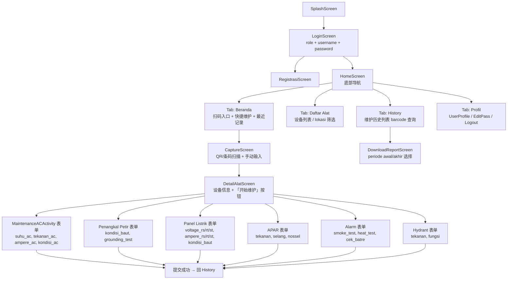
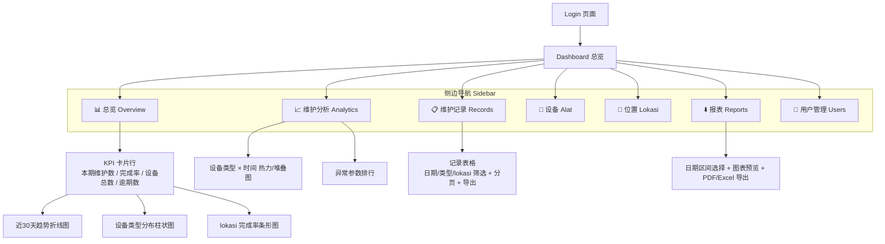

# PRD — Mei-V：Flutter 重构 + Web 监控 Dashboard

> 版本：v1.0 ｜ 作者：许清楚（Xu，产品经理） ｜ 状态：待评审
> 源项目：https://github.com/dhimasbebe/Mei-V（原生 Android + Java，2022 单 commit，无 README）

---

## 1. 项目信息

| 项 | 值 |
|---|---|
| Language | 中文（保留印尼语业务术语原文） |
| Programming Language | Flutter（Mobile Android/iOS + Web Dashboard） |
| Project Name | `mei_v_flutter`（代号，可由架构师调整） |
| 原始需求 | "Plan software project architecture and task assignment, tapi ubah total project ini menjadi flutter dengan dashboard web untuk monitoring dari project ini https://github.com/dhimasbebe/Mei-V" |

**需求复述**：将 Mei-V 设备维护 App（原生 Android/Java）**完全重写为 Flutter**，同时**新增一个 Web 端监控 Dashboard**，供管理者查看维护数据、统计与报表。原系统核心业务：技术员通过扫码（QR/条码）定位设备，按 6 类设备填写维护表单，数据经 PHP REST 后端存储；支持历史查询与按日期区间下载报表。

**术语表**（印尼语原文保留）：

| 印尼语 | 中文 | 说明 |
|---|---|---|
| alat | 设备/工具 | 维护对象 |
| lokasi | 位置 | 设备所在区域 |
| barcode | 条码 | 设备唯一标识 |
| Teknisi | 维护技术员 | 一线录入角色 |
| Supervisor | 主管/管理员 | 审核与监控角色 |
| catatan | 备注 | 表单附注 |
| suhu / tekanan / ampere / voltage | 温度/压力/电流/电压 | 设备参数 |
| kondisi | 状态 | 设备状况 |
| periode awal / akhir | 起始/终止日期 | 报表区间 |
| APAR | 灭火器 | Alat Pemadam Api Ringan |
| Penangkal Petir | 避雷针 | — |
| Panel Listrik | 配电柜 | — |
| Hydrant | 消防栓 | — |

---

## 2. 产品目标

| # | 目标 | 衡量标准 |
|---|---|---|
| G1 | **跨端迁移**：老 Android 全部功能 1:1 迁移至 Flutter，一套代码覆盖 Android/iOS | 原 13 个 Activity 对应功能在 Flutter 端全部可用；老功能回归通过率 100% |
| G2 | **监控可视化**：新增 Web Dashboard，管理者无需翻报表即可掌握维护执行情况 | Dashboard 覆盖：完成率、按设备类型分布、逾期提醒、按 lokasi 统计；页面首屏加载 < 3s |
| G3 | **数据资产化**：维护数据从"可录入可查询"升级为"可分析可决策" | 支持趋势图、排行、异常（不合格参数）标记；报表可导出 |

**Dashboard 价值**：原系统数据只进不出——`download_report.php` 需手动选日期导出，管理者无法实时看到"哪台设备多久没维护、哪个 lokasi 完成率低"。Web Dashboard 把沉睡的 maintenance 历史变成实时监控视图，是从"记录工具"到"管理工具"的升级。

---

## 3. 用户故事

| # | 角色 | 故事 | 验收要点 |
|---|---|---|---|
| US-1 | Teknisi | As a **Teknisi**, I want to **用账号登录（role + username + password）** so that 我只能看到自己权限内的功能 | 登录走 form POST；角色区分 Teknisi/Supervisor/Admin；会话保持 |
| US-2 | Teknisi | As a **Teknisi**, I want to **扫描设备 QR/条码** so that 自动带出该设备信息与所在 lokasi，无需手输 | 扫码 → `cari_id_alat.php?barcode=` → 显示 `detail_alat`；支持手动输入条码兜底 |
| US-3 | Teknisi | As a **Teknisi**, I want to **为 6 类设备分别填写维护表单** so that 录入参数符合各设备检查项 | 6 套表单字段与老 App 完全一致（见 §6）；必填校验；提交带 waktu_maintenance、barcode、username、id_lokasi、catatan |
| US-4 | Teknisi | As a **Teknisi**, I want to **查询自己录入的维护历史** so that 核对工作记录、避免重复录入 | 按 barcode 查 `history_maintenance.php`，倒序列表展示 |
| US-5 | Supervisor | As a **Supervisor**, I want to **在 Web Dashboard 查看维护完成情况** so that 及时发现逾期未维护设备 | 卡片 KPI + 完成率图表 + 按 lokasi/设备类型下钻 |
| US-6 | Supervisor | As a **Supervisor**, I want to **按日期区间下载/导出报表** so that 归档与汇报 | 保留原 `download_report.php` 逻辑；P1 增加图表化报表 |
| US-7 | Admin | As an **Admin**, I want to **管理用户（注册、改密码、查看资料）** so that 控制系统访问权限 | 注册 `formregistrasi.php`、改密 `updatepassword.php`、`UserProfileActivity` 对等功能 |
| US-8 | Supervisor | As a **Supervisor**, I want **异常参数高亮提醒**（如 voltage 三相不平衡、APAR tekanan 不合格）so that 优先处理高风险设备 | Dashboard 标红异常记录；P1 推送提醒 |

---

## 4. 需求池（P0/P1/P2）

### P0 — Must have（原功能 1:1 迁移 + Dashboard 基础监控）

| ID | 需求 | 归属端 |
|---|---|---|
| P0-01 | 登录/注册/修改密码/用户资料（role + username + password，本地会话） | mobile |
| P0-02 | QR/条码扫描查设备（CaptureAct → 扫码 + 手动输入） | mobile |
| P0-03 | 设备详情页（detail_alat：名称、类型、lokasi） | mobile |
| P0-04 | 6 类维护表单录入：AC、Penangkal Petir、Panel Listrik、APAR、Alarm、Hydrant（字段 1:1，见 §6） | mobile |
| P0-05 | 维护历史查询（按 barcode，含时间/技术员/参数） | mobile |
| P0-06 | 报表按日期区间下载（periode awal/akhir） | mobile + web |
| P0-07 | 设备列表 + 位置列表浏览（alat / lokasi） | mobile |
| P0-08 | Dashboard KPI 卡片：今日/本期维护数、完成率、设备总数、逾期数 | web |
| P0-09 | Dashboard 图表：按设备类型维护分布（柱状图）、按 lokasi 完成率（饼/条图）、近 30 天趋势（折线） | web |
| P0-10 | Dashboard 明细表：维护记录列表，支持日期/设备类型/lokasi 筛选、分页 | web |
| P0-11 | Dashboard 登录与角色权限（Supervisor/Admin 可看，Teknisi 可选放开） | web |
| P0-12 | 后端 API 复用/适配层（现有 PHP 端点可用；聚合端点见 Open Questions） | API |

### P1 — Should have（报表/图表增强、离线缓存、推送提醒）

| ID | 需求 | 归属端 |
|---|---|---|
| P1-01 | 报表图表化：Dashboard 内嵌趋势分析与可打印 PDF 导出 | web |
| P1-02 | 离线缓存：无网络时表单草稿本地保存，联网后自动补传 | mobile |
| P1-03 | 逾期维护推送/站内提醒（设备超期未维护通知 Supervisor） | web + mobile |
| P1-04 | 异常参数自动标红 + 汇总列表（见 US-8） | web |
| P1-05 | 扫码体验增强：扫码失败手动搜索、历史扫码记录 | mobile |
| P1-06 | 深色模式 / 响应式布局适配平板 | mobile + web |

### P2 — Nice to have（预防性维护计划、多语言等）

| ID | 需求 | 归属端 |
|---|---|---|
| P2-01 | 预防性维护计划：按设备类型设定周期，自动生成待办 | web + mobile |
| P2-02 | 多语言（印尼语/中文/英语切换） | 全端 |
| P2-03 | 设备照片附件（维护现场拍照上传） | mobile |
| P2-04 | 数据看板自定义（管理者拖拽配置指标） | web |
| P2-05 | 用户操作审计日志 | API + web |

---

## 5. UI 设计稿（文字 + 结构描述）

### 5.1 移动端（Flutter Mobile）页面清单

**关键布局**：
- **LoginScreen**：居中卡片表单，三个字段（role 下拉、username、password）+ 登录/注册按钮。
- **HomeScreen**：底部 4 Tab 导航（Beranda / Daftar Alat / History / Profil）；Beranda 顶部大号「Scan Barcode」FAB，下方「最近维护」卡片流。
- **CaptureScreen**：全屏相机取景框 + 底部手动输入条码输入框（兜底）。
- **DetailAlatScreen**：设备信息卡（名称、类型、lokasi 图标行）+ 主操作按钮「Mulai Maintenance」。
- **维护表单**：单页滚动表单——顶部固定（设备名 + barcode + waktu_maintenance 自动填充 + id_lokasi），中部各参数输入（数字键盘、单位后缀），底部 catatan 多行文本 + 提交按钮；必填项星号标注，参数超阈值内联警告。
- **History**：按日期分组的卡片列表（设备名、类型徽章、技术员、关键参数摘要），点开看详情；顶部搜索框按 barcode 过滤。
- **DownloadReportScreen**：双日期选择器（periode awal / periode akhir）+ 下载按钮。

### 5.2 Web Dashboard（Flutter Web）页面清单

**关键布局**：
- **整体框架**：左侧固定 Sidebar（图标 + 印尼语菜单名），顶部工具栏（日期范围全局筛选器、用户头像、登出），右侧内容区自适应栅格。
- **Overview**：第一行 4 张 KPI 卡片（数值 + 环比箭头）；第二行左 2/3 折线图（近 30 天维护量趋势）、右 1/3 饼图（设备类型分布）；第三行横向条形图（按 lokasi 完成率，低完成率红色）；第四行「逾期设备」警示列表。
- **图表类型约定**：趋势 → 折线；分类对比 → 柱状；占比 → 饼/环；排名/完成率 → 横向条形；相关性 → 热力（P1）。
- **Records 表格**：列 = 日期 waktu_maintenance、设备、类型、lokasi、技术员、关键参数、状态（正常/异常徽章）；支持搜索、筛选、分页、CSV 导出。
- **权限差异**：Teknisi 登录只显示 N3（自己的记录）；Supervisor 显示全部；Admin 额外 N7。

---

## 6. 功能清单矩阵（老 Android → Flutter 目标 → 归属端）

| # | 老 Android 功能（Activity/端点） | Flutter 目标功能 | mobile | web | API |
|---|---|---|:-:|:-:|:-:|
| 1 | SplashScreen | 启动页 + 会话恢复 | ✅ | — | — |
| 2 | LoginActivity（`login.php`） | 登录（角色/账号/密码） | ✅ | ✅ | ✅ |
| 3 | RegistrasiActivity（`formregistrasi.php`） | 注册 | ✅ | ✅（Admin 建用户） | ✅ |
| 4 | EditPassUser（`updatepassword.php`） | 修改密码 | ✅ | ✅ | ✅ |
| 5 | UserProfileActivity + UserPreferences | 个人资料 + 本地会话 | ✅ | ✅ | — |
| 6 | HomeActivity | 首页（Tab 导航） | ✅ | — | — |
| 7 | CaptureAct（扫码） | QR/条码扫描 + 手动输入 | ✅ | ❌（Web 无相机扫码，输入条码查询） | — |
| 8 | DetailAlatActivity（`detail_alat.php?nama=`） | 设备详情 | ✅ | ✅（Dashboard 下钻） | ✅ |
| 9 | —（`cari_id_alat.php?barcode=`） | 扫码反查设备 | ✅ | ✅ | ✅ |
| 10 | ListAlatAdapter（设备列表） | 设备列表 + 搜索 | ✅ | ✅（设备管理页） | ✅ |
| 11 | ListTableAdapter（lokasi 列表） | 位置列表 | ✅ | ✅ | ✅（`get_lokasi.php`） |
| 12 | MaintenanceACActivity（`input_data_ac.php`） | AC 维护表单 | ✅ | — | ✅ |
| 13 | MaintenancePenangkalPetirActivity（`input_data_petir.php`） | 避雷针表单 | ✅ | — | ✅ |
| 14 | MaintenancePanelListrikActivity（`input_data_panel.php`） | 配电柜表单 | ✅ | — | ✅ |
| 15 | MaintenanceAPARActivity（`input_data_apar.php`） | 灭火器表单 | ✅ | — | ✅ |
| 16 | MaintenanceAlarmActivity（`input_data_alarm.php`） | 火警报警器表单 | ✅ | — | ✅ |
| 17 | MaintenanceHydrantActivity（`input_data_hydrant.php`） | 消防栓表单 | ✅ | — | ✅ |
| 18 | 维护历史（`history_maintenance.php?barcode=`） | 历史查询 | ✅ | ✅（记录表） | ✅ |
| 19 | DownloadReportActivity（`download_report.php?periodeawal=&periodeakhir=`） | 按日期区间下载报表 | ✅ | ✅ | ✅ |
| 20 | —（新增） | Dashboard KPI 总览 | — | ✅ | ⚠️ 需聚合端点 |
| 21 | —（新增） | Dashboard 图表（趋势/分布/完成率） | — | ✅ | ⚠️ 需聚合端点 |
| 22 | —（新增） | 记录筛选/分页/导出 | — | ✅ | ⚠️ 需分页端点 |
| 23 | —（新增） | 逾期/异常提醒 | ✅ | ✅ | ⚠️ 需计算 |

> ⚠️ = 依赖后端新增或扩展端点，见 §8 Open Questions。

**6 类维护表单字段对照**（迁移必须 1:1）：

| 设备类型 | 字段（印尼语原名） | 中文 |
|---|---|---|
| AC（空调） | suhu_ac, tekanan_ac, ampere_ac, kondisi_ac | 温度、压力、电流、状态 |
| Penangkal Petir（避雷针） | kondisi_baut, grounding_test | 螺栓状态、接地测试 |
| Panel Listrik（配电柜） | voltage_rs, voltage_rt, voltage_st, ampere_rs, ampere_rt, ampere_st, kondisi_baut | 三相电压、三相电流、螺栓状态 |
| APAR（灭火器） | tekanan, selang, nossel | 压力、软管、喷嘴 |
| Alarm（火警报警器） | smoke_test, heat_test, cek_batre | 烟感测试、温感测试、电池检查 |
| Hydrant（消防栓） | tekanan, fungsi | 压力、功能 |
| 公共字段 | waktu_maintenance, barcode, username, id_lokasi, catatan | 维护时间、设备条码、技术员、位置、备注 |

---

## 7. 非功能需求

| 类别 | 要求 |
|---|---|
| 跨端 | Flutter 单代码库覆盖 Android / iOS / Web Dashboard；最低支持 Android 8.0、iOS 13、现代浏览器（Chrome/Edge/Firefox/Safari 最近 2 个大版本） |
| 角色权限 | 三级：Teknisi（录入 + 查自己历史）、Supervisor（全量查看 + 报表 + Dashboard）、Admin（用户管理 + 全部）。移动端与 Web 端权限一致，后端必须二次校验（不可仅靠前端隐藏） |
| 语言 | UI 与业务术语保留**印尼语原文**（alat、lokasi、catatan、waktu_maintenance 等）；文档/代码注释用中文或英文；多语言切换为 P2 |
| 数据一致性 | 表单公共字段（waktu_maintenance、barcode、username、id_lokasi、catatan）在移动端与 Dashboard 展示口径一致；时间统一为服务器时间（建议 +07:00 WIB 明确时区）；扫码与手动输入走同一查询端点，避免双数据源 |
| 性能 | 移动端表单提交 < 2s（正常网络）；Dashboard 首屏 < 3s，列表分页默认 20 条/页 |
| 安全 | 登录凭据走 HTTPS；会话 token 有效期与失效登出；密码不明文落盘；输入参数服务端校验 |
| 可用性 | 离线草稿（P1）；提交失败本地暂存可重试；关键操作（提交、删除）有确认与结果反馈 |
| 可维护性 | 6 类表单字段配置化（避免 6 套硬编码 UI）；API 层集中管理；老功能迁移需有回归清单 |

---

## 8. 待确认问题（Open Questions）

| # | 问题 | 影响 | 建议 |
|---|---|---|---|
| Q1 | 现有 **PHP 后端是否继续复用**？还是随 Flutter 一并重构（如迁移到 Dart/Firebase/其他）？ | 高——决定 API 层设计与工期 | 建议 P0 复用 + 加聚合端点，后续再议迁移 |
| Q2 | Dashboard 所需的**聚合统计端点**（KPI、趋势、分布、完成率）现有 `get_*` 端点不覆盖，谁来新增？PHP 直接加 `dashboard_stats.php` 还是走新服务？ | 高——P0-08~10 依赖 | 见架构方案，PM 侧只需确认"可以新增端点" |
| Q3 | 记录列表是否需要**分页/筛选端点**（`download_report.php` 目前是按日期下载，不是分页 JSON）？ | 中 | P0 先给分页 + 筛选 |
| Q4 | **离线策略**优先级：P1 的离线草稿是否必须进首版？弱网现场（机房/屋顶）是否常见？ | 中 | 与用户确认现场网络情况 |
| Q5 | **角色模型**：老端只有 role 字段（Teknisi/Supervisor/Admin 几种取值？）注册是否开放自助注册，还是仅 Admin 创建？ | 中 | 影响登录/权限设计 |
| Q6 | **逾期/完成率的业务定义**：完成率分母是"设备总数"还是"本期计划数"？逾期阈值按设备类型维护周期（老系统未见周期字段，是否需新增）？ | 高——Dashboard 核心口径 | 需业务方给出口径，否则 KPI 无法实现 |
| Q7 | **iOS 发布**是否在范围内（证书、App Store 上架）？ | 中 | 代码跨端没问题，上架另议 |
| Q8 | **域名/部署**：Web Dashboard 部署在哪里？PHP 后端同机还是托管平台？HTTPS 证书谁出？ | 中 | 交给架构/运维确认 |
| Q9 | **异常参数阈值**（P1 标红）：每类设备的合格范围由谁提供？ | 低 | 需业务方提供参数标准表 |

---

*本 PRD 不含架构设计与任务拆分（见架构师产出），不含竞品分析（内部工具迁移场景，非必要）。*
