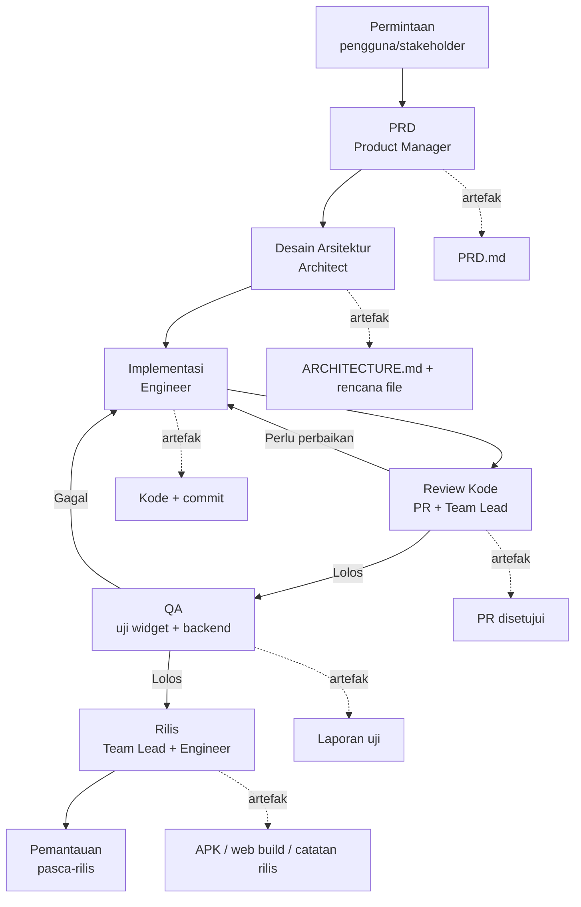

# Standar Kolaborasi & Proses Delivery Tim Mei-V2

> Versi: v1.0 ｜ Penulis: 许清楚 (Xu) — Product Manager ｜ Status: Berlaku
> Ruang lingkup: pengembangan Mei-V2 (Flutter app + web dashboard + Laravel API)
> Bahasa dokumen: Indonesia

---

## 1. Tujuan & Prinsip Kerja

**Tujuan:** memberi tim cara kerja yang seragam dan dapat diprediksi sejak permintaan masuk hingga rilis dan pemantauan, sehingga mutu keluaran konsisten dan tidak bergantung pada satu orang.

**Prinsip:**

1. **Dokumen dulu, kode kemudian.** Tidak ada implementasi tanpa PRD/desain arsitektur yang disetujui.
2. **Satu sumber kebenaran.** Warna dari `AppColors`, kontrak API dari envelope `{code, data, message}`, definisi fitur dari PRD.
3. **Kualitas adalah gerbang, bukan tambahan.** Analisis bersih dan uji lulus adalah syarat masuk, bukan saran.
4. **Serah terima eksplisit.** Tiap tahap punya artefak masuk/keluar dan pemilik yang jelas.
5. **Kecil & sering.** Perubahan kecil yang sering lebih aman daripada satu perubahan besar.
6. **Tidak ada dead-end bagi pengguna.** Setiap layar wajib punya state loading/error/empty + jalan keluar.

---

## 2. Struktur Tim & Tanggung Jawab (RACI)

R = Responsible (mengerjakan) ｜ A = Accountable (penanggung jawab akhir) ｜ C = Consulted ｜ I = Informed

| Aktivitas | Product Manager | Architect | Engineer | QA | Team Lead |
|---|---|---|---|---|---|
| Menulis & menyetujui PRD | **A/R** | C | I | C | I |
| Desain arsitektur & rencana file | C | **A/R** | C | I | I |
| Redesign UI / design system | C | C | **A/R** | C | I |
| Implementasi role & navigasi | C | C | **A/R** | C | I |
| Perbaikan alur (scan/form/riwayat/detail) | C | C | **A/R** | C | I |
| Endpoint & logika backend | C | C | **A/R** | C | I |
| Dashboard web | C | C | **A/R** | C | I |
| Uji widget & uji backend | I | I | C | **A/R** | I |
| Review kode (PR) | I | C | C | C | **A/R** |
| Definisi DoD & gerbang mutu | **A** | C | C | **R** | C |
| Prioritas & penyelesaian konflik | C | C | I | I | **A/R** |
| Keputusan rilis (go/no-go) | C | C | I | C | **A/R** |
| Eksekusi rilis | I | I | **R** | C | **A** |

**Aturan keputusan:**
- Perubahan **cakupan/prioritas fitur** -> Product Manager memutuskan, Team Lead menyetujui.
- Perubahan **arsitektur/folder/dependensi baru** -> Architect memutuskan.
- **Kualitas** tidak bisa dinegosiasikan demi tanggal; QA berhak memblokir rilis.
- Sengketa teknis vs produk -> Team Lead memutuskan setelah mendengar kedua pihak.

---

## 3. Alur Kerja SOP End-to-End



| Tahap | Artefak masuk | Artefak keluar | Pemilik |
|---|---|---|---|
| Permintaan | Kebutuhan pengguna | Ringkasan kebutuhan | Team Lead |
| PRD | Kebutuhan + kondisi kode saat ini | `docs/PRD-*.md` disetujui | Product Manager |
| Arsitektur | PRD | `docs/ARCHITECTURE.md` + rencana file | Architect |
| Implementasi | Arsitektur + standar | Kode + commit di branch | Engineer |
| Review | Pull request | PR disetujui | Team Lead (+peer) |
| QA | Build + laporan | Laporan uji lulus/gagal | QA |
| Rilis | Laporan uji lulus | APK/web build + catatan rilis | Team Lead + Engineer |
| Pemantauan | Build terpasang | Temuan regresi | Seluruh tim |

---

## 4. Kanal Komunikasi & Protokol Serah Terima

**Kanal:**
- Perubahan cakupan/prioritas: diskusi dengan Product Manager, keputusan tertulis di PRD.
- Pertanyaan teknis silang: langsung antar Engineer terkait (tidak lewat perantara).
- Pemblokir: eskalasi ke Team Lead segera, sertakan konteks + percobaan yang sudah dilakukan.
- Keputusan arsitektur: dicatat di `ARCHITECTURE.md`, bukan hanya di percakapan.

**Isi minimum sebuah serah terima (handoff):**
1. Apa yang dikerjakan & mengapa (tautan PRD/task).
2. Berkas/endpoint yang berubah (daftar path).
3. Cara menguji (langkah reproduksi + akun seed bila perlu).
4. Asumsi & batasan yang diketahui.
5. Yang belum selesai / risiko terbuka.

**Kapan sebuah tahap dianggap selesai:**
- PRD selesai: kriteria penerimaan bernomor + di luar lingkup jelas + disetujui Team Lead.
- Arsitektur selesai: rencana file lengkap, tidak ada keputusan terbuka yang memblokir implementasi.
- Implementasi selesai: kode jalan, `flutter analyze` bersih, definisi DoD terpenuhi.
- QA selesai: semua AC di PRD terverifikasi atau tercatat sebagai temuan.
- Rilis selesai: build terpasang & diverifikasi pasca-rilis.

---

## 5. Strategi Branch & Konvensi Commit

**Branch:**
- `main` — selalu stabil, siap rilis.
- `develop` — integrasi harian.
- `feat/<ringkas>` — fitur baru (mis. `feat/role-home`).
- `fix/<ringkas>` — perbaikan bug (mis. `fix/scan-permission`).
- `chore/<ringkas>` — pemeliharaan (mis. `chore/deps-update`).

**Alur:** branch dari `develop` -> PR ke `develop` -> setelah lolos QA digabung ke `main` untuk rilis.

**Conventional Commits** (`<tipe>(<ruang>): <deskripsi imperatif>`):
- `feat(scan): tambah toggle senter dan input manual`
- `fix(login): perbaiki tinggi logo dan tambah dropdown role`
- `docs(prd): tambah spesifikasi scan state`
- `refactor(theme): pindahkan warna ke AppColors`
- `test(backend): tambah uji endpoint verifikasi`
- `chore(build): perbarui skrip build apk`

**Aturan pull request:**
- Minimal 1 reviewer (Team Lead atau peer Engineer).
- Deskripsi memakai templat PR (§10).
- Ukuran sehat: **<= 400 baris perubahan** atau 1 tujuan tunggal; PR lebih besar dipecah.
- Tidak menggabung tanpa analisis bersih & uji lulus.
- Tidak menambah dependensi tanpa persetujuan Architect.

---

## 6. Standar Kode

### 6.1 Dart / Flutter
- `flutter analyze` **0 issue** (wajib lulus sebelum PR).
- Penamaan: `lowerCamelCase` (variabel/metode), `UpperCamelCase` (kelas), `snake_case` (nama berkas).
- Struktur folder mengikuti yang berlaku: `lib/core/`, `lib/domain/`, `lib/data/`, `lib/providers/`, `lib/presentation/`.
- Wajib `const` di mana memungkinkan (widget, nilai konstan).
- **Larangan menambah dependensi tanpa persetujuan Architect.**
- Tidak ada warna brand hardcode; pakai `AppColors`/`AppTheme`.
- Tidak ada logika bisnis di dalam widget build; pindahkan ke provider/repository.
- Setiap layar wajib menangani state loading/error/empty.

### 6.2 PHP / Laravel
- Gaya **PSR-12**.
- Validasi lewat **FormRequest** atau `validate()` — bukan di dalam controller secara manual.
- Respons **selalu** lewat envelope `{code, data, message}` (+ `errors` saat 422).
- **Dilarang N+1**: gunakan eager loading (`with`), `withCount`, atau query agregat.
- Logika berat dipindah ke service; controller tipis.
- Waktu & timezone konsisten (`Asia/Jakarta`).

---

## 7. Standar UI

- **Token wajib:** warna & tipografi hanya dari `AppColors` / `AppTheme`. Hardcode warna brand dilarang.
- **Identitas brand (tidak boleh diubah):** merah `#CB2400`, top bar hitam, latar putih, garis tabel `#AFAFAF`, tombol pil radius 50dp.
- **Logo:** gunakan aset asli di `assets/logos/` (`logoputih.png`, `logohitam.png`, `logotelpro.png`). Logo Mei-V di login tinggi 60px; logo Telkom Property tinggi 32px.
- **Target sentuh** minimal 48dp.
- **Kontras** memenuhi WCAG AA.
- Setiap layar wajib punya **state loading (skeleton), error (dengan tombol Coba Lagi), dan kosong (dengan aksi)**.
- Setiap ikon aksi punya `semanticLabel`.
- Animasi konsisten 200–300 ms.

---

## 8. Gerbang Mutu / Definition of Done

Sebuah pekerjaan **selesai** hanya jika seluruh daftar ini lulus:

- [ ] Semua kriteria penerimaan (AC) terkait di PRD terpenuhi.
- [ ] `flutter analyze` bersih (0 issue) untuk perubahan Dart.
- [ ] Uji backend lulus (`php artisan test`) untuk perubahan PHP.
- [ ] Tidak ada regresi pada fitur yang sudah ada (uji ulang alur terkait).
- [ ] State loading/error/empty ada di setiap layar yang disentuh.
- [ ] Warna/tipe dari token; tidak ada hardcode brand.
- [ ] Target sentuh >= 48dp pada elemen baru.
- [ ] Dokumentasi diperbarui (`STATUS.md` / PRD / ARCHITECTURE) bila menyentuh perilaku.
- [ ] PR disetujui minimal 1 reviewer.
- [ ] Tidak ada dependensi baru tanpa persetujuan.

---

## 9. Proses QA & Kriteria Rilis

**Jenis uji:**
- Uji unit/backend: endpoint, validasi, envelope, idempotency `client_uuid`.
- Uji kontrak model: `app/test/models_test.dart` + `tools/modelcheck/verify_models.dart`.
- Uji widget: layar kunci (login, scan state, form, riwayat) + interaksi.
- Uji manual perangkat: alur teknisi (scan -> form -> kirim) di HP fisik.

**Cakupan minimum:**
- Semua AC di PRD terverifikasi (lulus atau tercatat sebagai temuan).
- Semua state kamera (SC-1 … SC-8) diuji, termasuk perangkat tanpa kamera/izin ditolak.
- Ketiga role diuji login + beranda masing-masing.

**Kriteria go/no-go (Team Lead memutuskan):**
- **GO:** semua AC lulus, analisis bersih, uji lulus, tidak ada bug pemblokir terbuka.
- **NO-GO:** ada AC gagal pada alur utama, ada regresi, atau ada bug pemblokir (aplikasi tidak dapat menyelesaikan alur inti).

---

## 10. Proses Rilis

**Rilis APK:**
```
powershell -ExecutionPolicy Bypass -File .\scripts\build-app.ps1 -Target apk -Backend device
```

**Rilis Web:**
```
powershell -ExecutionPolicy Bypass -File .\scripts\build-app.ps1 -Target web
```

**Rilis Backend:** deploy kode Laravel + `php artisan migrate --force` + `config:cache`/`route:cache` di server target (bukan di repo).

**Verifikasi pasca-rilis:**
1. Login ketiga akun seed (`12345`, `11111`, `67890` / `password`).
2. Uji alur inti: scan -> detail -> form -> kirim -> muncul di riwayat.
3. Cek dashboard web menampilkan KPI tanpa error.

**Rencana rollback:**
- Simpan build sebelumnya (APK/web) yang diketahui stabil.
- Bila bug pemblokir ditemukan pasca-rilis: kembalikan ke build stabil sebelumnya, catat insiden, perbaiki di branch `fix/*`, uji ulang, rilis ulang.

---

## 11. Manajemen Risiko & Eskalasi

| # | Risiko | Dampak | Mitigasi | Eskalasi |
|---|---|---|---|---|
| R1 | Perangkat tanpa kamera / kamera gagal | Teknisi tidak bisa scan | State SC-4/SC-5 + input manual & galeri selalu tersedia | Engineer -> Team Lead |
| R2 | Jaringan terputus saat kirim maintenance | Data hilang | Draft offline + `client_uuid` idempoten untuk kirim ulang | Engineer -> Team Lead |
| R3 | ID spesifikasi bertabrakan antar kategori | Checklist salah tampil | ID unik global (sudah diperbaiki di v2) + uji kontrak | Engineer -> Architect |
| R4 | Token kedaluwarsa saat sesi berjalan | Pengguna terlempar tanpa penjelasan | Interceptor 401 -> logout bersih + pesan "sesi berakhir" | Engineer -> Team Lead |
| R5 | Dependensi baru tanpa persetujuan | Kerusakan build/kompatibilitas | Gerbang PR: dilarang tanpa persetujuan Architect | Architect |
| R6 | PR besar & bercampur | Sulit ditinjau, regresi lolos | Batas 400 baris / 1 tujuan | Team Lead |

**Jalur eskalasi umum:** Engineer -> Team Lead -> Product Manager (bila menyentuh cakupan/mutu) -> pemilik produk.

---

## 12. Templat

### 12.1 Templat Deskripsi PR

```
## Ringkasan
<apa yang diubah dan mengapa, tautkan task/PRD>

## Perubahan
- <berkas/endpoint>

## Cara menguji
1. <langkah>

## Kriteria penerimaan terkait
- AC-xx

## Risiko / catatan
- <asumsi, batasan>

## Daftar periksa
- [ ] flutter analyze bersih
- [ ] uji lulus
- [ ] state loading/error/empty ada
- [ ] tidak ada dependensi baru
```

### 12.2 Templat Laporan Bug

```
## Judul
<ringkas>

## Lingkungan
- Perangkat/OS:
- Versi build:
- Role akun:

## Langkah reproduksi
1. <langkah>

## Hasil yang diharapkan
<...>

## Hasil aktual
<...>

## Bukti
<screenshot/log>

## Tingkat keparahan
Blocker / Mayor / Minor
```

### 12.3 Templat Catatan Rilis

```
# Catatan Rilis <versi> — <tanggal>

## Baru
- <fitur>

## Perbaikan
- <bug>

## Perubahan
- <perubahan perilaku>

## Diketahui
- <keterbatasan>

## Artefak
- APK: <path>
- Web: <path>
```
